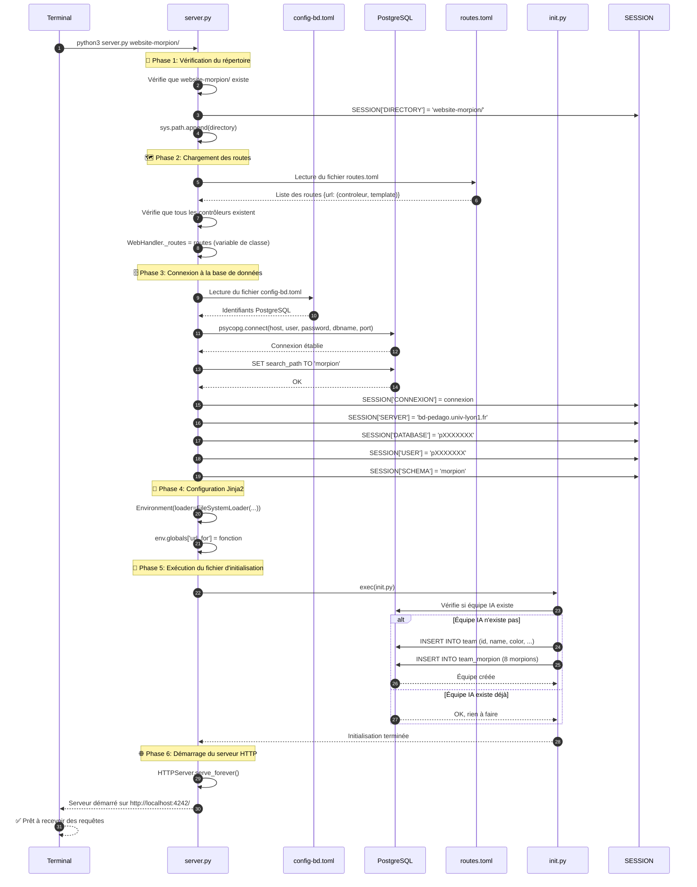
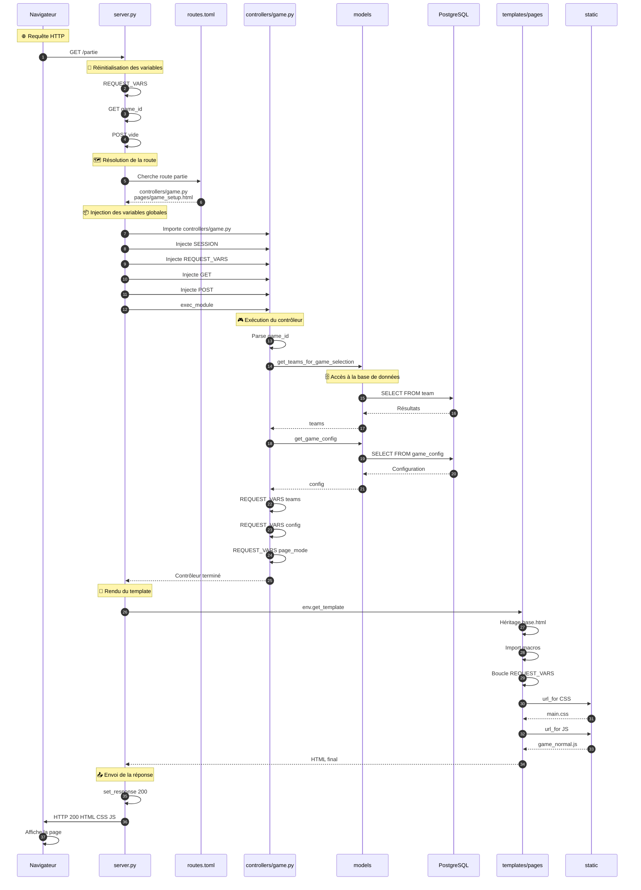
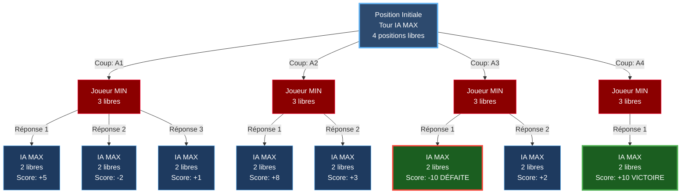
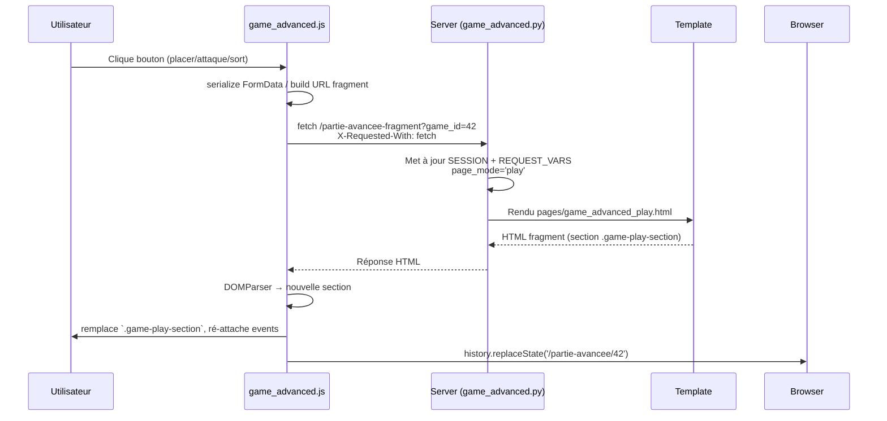

<style>
:root {
  --logo-html: url("https://cdn.jsdelivr.net/gh/devicons/devicon/icons/html5/html5-original.svg");
  --logo-css: url("https://cdn.jsdelivr.net/gh/devicons/devicon/icons/css3/css3-original.svg");
  --logo-js: url("https://cdn.jsdelivr.net/gh/devicons/devicon/icons/javascript/javascript-original.svg");
  --logo-python: url("https://cdn.jsdelivr.net/gh/devicons/devicon/icons/python/python-original.svg");
  --logo-sql: url("https://cdn.jsdelivr.net/gh/devicons/devicon/icons/postgresql/postgresql-original.svg");
  --logo-markdown: url("https://cdn.jsdelivr.net/gh/devicons/devicon/icons/markdown/markdown-original.svg");
  --logo-text: url("data:image/svg+xml,%3Csvg xmlns='http://www.w3.org/2000/svg' viewBox='0 0 16 16'%3E%3Crect x='1' y='0.5' width='14' height='15' rx='2' ry='2' fill='%23f4f4f4' stroke='%23000' stroke-width='0.8'/%3E%3Ctext x='8' y='11.5' font-family='Arial' font-size='7' text-anchor='middle' fill='%23000'%3ETXT%3C/text%3E%3C/svg%3E");
  --logo-box: url("data:image/svg+xml,%3Csvg xmlns='http://www.w3.org/2000/svg' viewBox='0 0 16 16'%3E%3Cpath d='M1 5.2L8 1l7 4.2v6.6L8 15 1 11.8z' fill='%23f0c419' stroke='%238a5a0a' stroke-width='0.8'/%3E%3Cpath d='M1 5.2l7 3.8 7-3.8' fill='none' stroke='%238a5a0a' stroke-width='0.8'/%3E%3Cpath d='M8 1v14' fill='none' stroke='%238a5a0a' stroke-width='0.8'/%3E%3C/svg%3E");
  --logo-folder: url("data:image/svg+xml,%3Csvg xmlns='http://www.w3.org/2000/svg' viewBox='0 0 16 16'%3E%3Cpath d='M1.5 4h4l1 1.5h8v7.5a1 1 0 01-1 1h-11a1 1 0 01-1-1z' fill='%23fbd490' stroke='%23c38a2e' stroke-width='0.7'/%3E%3Cpath d='M1.5 4.5h13' stroke='%23c38a2e' stroke-width='0.7'/%3E%3C/svg%3E");
  --logo-terminal: url("data:image/svg+xml,%3Csvg xmlns='http://www.w3.org/2000/svg' viewBox='0 0 16 16'%3E%3Crect x='1' y='2' width='14' height='12' rx='2' ry='2' fill='%23000' stroke='%2300c853' stroke-width='0.8'/%3E%3Cpath d='M4 6l2 2-2 2' stroke='%23fff' stroke-width='1.2' stroke-linecap='round' stroke-linejoin='round'/%3E%3Cpath d='M8 10h4' stroke='%23fff' stroke-width='1.2' stroke-linecap='round'/%3E%3C/svg%3E");
  --logo-db: url("data:image/svg+xml,%3Csvg xmlns='http://www.w3.org/2000/svg' viewBox='0 0 16 16'%3E%3Cellipse cx='8' cy='3.5' rx='6.5' ry='2.5' fill='%232196f3'/%3E%3Cpath d='M1.5 3.5v8c0 1.4 2.9 2.5 6.5 2.5s6.5-1.1 6.5-2.5v-8' fill='%232196f3' stroke='%230c47a1' stroke-width='0.8'/%3E%3Cline x1='1.5' y1='7' x2='14.5' y2='7' stroke='%230c47a1' stroke-width='0.6'/%3E%3Cline x1='1.5' y1='10.5' x2='14.5' y2='10.5' stroke='%230c47a1' stroke-width='0.6'/%3E%3C/svg%3E");
  --logo-linux: url("https://cdn.jsdelivr.net/gh/devicons/devicon/icons/linux/linux-original.svg");
  --logo-windows: url("https://cdn.jsdelivr.net/gh/devicons/devicon/icons/windows8/windows8-original.svg");
  --logo-mac: url("https://cdn.jsdelivr.net/gh/devicons/devicon/icons/apple/apple-original.svg");
  --logo-model: url("data:image/svg+xml,%3Csvg xmlns='http://www.w3.org/2000/svg' viewBox='0 0 20 20'%3E%3Cg fill='none' stroke='%23666' stroke-width='1.2'%3E%3Crect x='3' y='3' width='5' height='5'/%3E%3Crect x='12' y='3' width='5' height='5'/%3E%3Crect x='3' y='12' width='5' height='5'/%3E%3Crect x='12' y='12' width='5' height='5'/%3E%3C/g%3E%3C/svg%3E");
  --logo-view: url("data:image/svg+xml,%3Csvg xmlns='http://www.w3.org/2000/svg' viewBox='0 0 20 20'%3E%3Crect x='2' y='3' width='16' height='14' rx='1.5' fill='none' stroke='%23444' stroke-width='1.2'/%3E%3Cpath d='M2 6.5h16' stroke='%23444' stroke-width='1.2'/%3E%3Crect x='5' y='9' width='4' height='5' rx='0.5' fill='%23666'/%3E%3Crect x='11' y='9' width='4' height='5' rx='0.5' fill='%23666'/%3E%3C/svg%3E");
  --logo-controller: url("data:image/svg+xml,%3Csvg xmlns='http://www.w3.org/2000/svg' viewBox='0 0 20 20'%3E%3Ccircle cx='10' cy='10' r='7' fill='none' stroke='%23555' stroke-width='1.2'/%3E%3Cpath d='M10 3v14M3 10h14' stroke='%23555' stroke-width='1.2'/%3E%3Ccircle cx='10' cy='10' r='2.5' fill='%23555'/%3E%3Ccircle cx='10' cy='6' r='1' fill='%23777'/%3E%3Ccircle cx='10' cy='14' r='1' fill='%23777'/%3E%3Ccircle cx='6' cy='10' r='1' fill='%23777'/%3E%3Ccircle cx='14' cy='10' r='1' fill='%23777'/%3E%3C/svg%3E");
  --badge-surface:#f3f5fa;
  --badge-border:rgba(15,23,42,0.12);
  --badge-text:#1f2933;
  --badge-os-bg:rgba(30,136,229,0.12);
  --badge-os-fg:#0d47a1;
  --badge-level-bg:rgba(255,193,7,0.18);
  --badge-level-fg:#8d6e00;
  --badge-role-bg:rgba(76,175,80,0.12);
  --badge-role-fg:#1b5e20;
  --badge-mvc-bg:rgba(236,64,122,0.12);
  --badge-mvc-fg:#880e4f;
}

i {
  display: inline-block;
  width: 16px;
  height: 16px;
  vertical-align: -3px;
}

i[html]{ background-image: var(--logo-html); }
i[css]{ background-image: var(--logo-css); }
i[js]{ background-image: var(--logo-js); }
i[py]{ background-image: var(--logo-python); }
i[sql]{ background-image: var(--logo-sql); }
i[md]{ background-image: var(--logo-markdown); }
i[file]{ background-image: var(--logo-text); }
i[toml]{ background-image: var(--logo-text); }
i[project]{ background-image: var(--logo-box); }
i[folder]{ background-image: var(--logo-folder); }
i[cmd]{ background-image: var(--logo-terminal); }
i[db]{ background-image: var(--logo-db); }
i[linux]{ background-image: var(--logo-linux); }
i[windows]{ background-image: var(--logo-windows); }
i[mac]{ background-image: var(--logo-mac); }
i[model]{ background-image: var(--logo-model); }
i[view]{ background-image: var(--logo-view); }
i[controller]{ background-image: var(--logo-controller); }

@media (prefers-color-scheme: dark){
  :root{
    --badge-surface:rgba(255,255,255,0.04);
    --badge-border:rgba(255,255,255,0.18);
    --badge-text:#f5f5f5;
    --badge-os-bg:rgba(100,181,246,0.18);
    --badge-os-fg:#d0e7ff;
    --badge-level-bg:rgba(255,214,102,0.18);
    --badge-level-fg:#ffecb3;
    --badge-role-bg:rgba(129,199,132,0.18);
    --badge-role-fg:#e8f5e9;
    --badge-mvc-bg:rgba(244,143,177,0.18);
    --badge-mvc-fg:#ffe4ec;
  }
}

pre.tree{
  background:#0a1628;
  padding:12px;
  border-radius:6px;
  overflow:auto;
  margin-bottom:8px;
}

.deleted-file{
  color:#d32f2f;
  text-decoration:line-through;
  text-decoration-thickness:2px;
}

pre.cmd-tree{
  background:#050505;
  color:#f2f2f2;
  padding:12px;
  border-radius:6px;
  margin-bottom:32px;
}

pre.cmd-block{
  background:#1f1f1f;
  color:#f2f2f2;
  padding:10px 12px;
  border-radius:6px;
  margin-bottom:8px;
}

pre.cmd-tree c{
  color:#050505;
}

pre.cmd-output{
  background:#141414;
  color:#8de2ff;
  padding:10px 12px;
  border-radius:6px;
  margin-bottom:16px;
  font-size:0.95em;
  position:relative;
  padding-left:28px;
}

pre.cmd-output::before{
  content:"▶";
  position:absolute;
  left:10px;
  top:10px;
  color:#4a9eff;
  font-weight:bold;
  font-size:1em;
}

.warning-block{
  background:#2b0410;
  color:#ff8a80;
  border-left:4px solid #ff1744;
  padding:12px 14px;
  border-radius:6px;
  margin:16px 0 8px;
}

.placeholder-table{
  width:100%;
  border-collapse:collapse;
  margin:8px 0 16px;
  font-size:0.95em;
}

.placeholder-table th,
.placeholder-table td{
  border:1px solid #ddd;
  padding:6px 8px;
  text-align:left;
}
.error-block{
  background:#2b040a;
  color:#ffcdd2;
  border-left:4px solid #f44336;
  padding:12px 14px;
  border-radius:6px;
  margin:16px 0 20px;
  box-shadow:0 2px 6px rgba(0,0,0,0.25);
}

.error-block strong{
  color:#ffe5e9;
}

.error-block strong::before{
  content:"⛔ ";
}

.error-block ul{
  margin:8px 0 0 20px;
  padding:0;
}

.error-block li{
  margin-bottom:8px;
  line-height:1.45;
}

.badge-row{
  display:flex;
  flex-wrap:wrap;
  gap:8px;
  margin:8px 0 18px;
}

.badge{
  display:inline-flex;
  align-items:center;
  gap:6px;
  padding:4px 10px;
  border-radius:999px;
  font-size:0.85em;
  text-transform:uppercase;
  letter-spacing:0.05em;
  background:var(--badge-surface);
  border:1px solid var(--badge-border);
  color:var(--badge-text);
  box-shadow:0 2px 6px rgba(15,15,15,0.08);
}

.badge i{
  margin-right:2px;
}

.badge-os{
  background:var(--badge-os-bg);
  border-color:var(--badge-os-fg);
  color:var(--badge-os-fg);
}

.badge-level{
  background:var(--badge-level-bg);
  border-color:var(--badge-level-fg);
  color:var(--badge-level-fg);
}

.badge-role{
  background:var(--badge-role-bg);
  border-color:var(--badge-role-fg);
  color:var(--badge-role-fg);
}

.badge-mvc{
  background:var(--badge-mvc-bg);
  border-color:var(--badge-mvc-fg);
  color:var(--badge-mvc-fg);
}

.badge-basico,
.badge-intermedio,
.badge-avanzado{
  font-weight:600;
  color:inherit;
}

.info-block{
  background:#0a1628;
  color:#b3d9ff;
  border-left:4px solid #2196f3;
  padding:12px 14px;
  border-radius:6px;
  margin:16px 0 8px;
}

.success-block{
  background:#0d2818;
  color:#a5d6a7;
  border-left:4px solid #4caf50;
  padding:12px 14px;
  border-radius:6px;
  margin:16px 0 8px;
}

/* Estilos para diagramas Mermaid */
.mermaid text,
.mermaid .messageText,
.mermaid .noteText,
.mermaid .labelText,
.mermaid tspan {
  fill: #ffffff !important;
  color: #ffffff !important;
  font-weight: 500 !important;
}

.mermaid .actor {
  fill: #1e3a5f !important;
  stroke: #64b5f6 !important;
}

.mermaid .note,
.mermaid rect.note {
  fill: #2d4a6e !important;
  stroke: #64b5f6 !important;
}

.mermaid .note text,
.mermaid .noteText tspan {
  fill: #ffffff !important;
}

.mermaid .messageLine0,
.mermaid .messageLine1 {
  stroke: #64b5f6 !important;
}

.mermaid .loopText,
.mermaid .loopLine {
  fill: #ffffff !important;
  stroke: #81c784 !important;
}

.mermaid .loopText tspan {
  fill: #ffffff !important;
}

/* Flechas blancas para diagramas de flujo */
.mermaid .edgePath .path,
.mermaid .edgePath path {
  stroke: #ffffff !important;
  stroke-width: 2px !important;
}

.mermaid .edgeLabel {
  background-color: #1e3a5f !important;
  color: #ffffff !important;
}

.mermaid marker {
  fill: #ffffff !important;
  stroke: #ffffff !important;
}

/* Números de secuencia con fondo oscuro */
.mermaid .sequenceNumber {
  fill: #1e3a5f !important;
  stroke: #64b5f6 !important;
}

.mermaid .sequenceNumber text {
  fill: #ffffff !important;
}

.code-explained{
  border:none;
  border-radius:8px;
  margin:16px 0;
  overflow:hidden;
}

.code-explained.code-explained-md{
  position:relative;
}

.code-explained-header{
  padding:10px 14px;
  border-bottom:none;
  display:flex;
  align-items:center;
  gap:10px;
}

.code-explained-md .code-explained-header{
  position:absolute;
  top:12px;
  left:12px;
  right:12px;
  z-index:2;
  border:none;
  border-radius:8px;
  box-shadow:none;
}

.code-explained-header i{
  width:20px;
  height:20px;
}

.code-file-link{
  color:#58a6ff;
  text-decoration:none;
  font-weight:500;
  font-family:monospace;
  font-size:0.95em;
}

.code-file-link:hover{
  text-decoration:underline;
}

.code-line-link{
  color:#8b949e;
  font-size:0.85em;
  margin-left:8px;
  text-decoration:none;
}

.code-line-link:hover{
  color:#58a6ff;
}

.code-explained-body{
  padding:0;
  font-family:'Courier New', monospace;
  font-size:0.95em;
  line-height:1.7;
  color:inherit;
}

.code-explained-body pre{
  margin:0;
  padding:16px;
  white-space:pre-wrap;
  word-break:break-word;
  overflow-wrap:anywhere;
  overflow-x:hidden;
}

.code-explained-md .code-explained-body pre[data-role="codeBlock"]{
  padding:72px 18px 18px;
}

.code-comment{
  color:#a8b5c4;
  font-style:italic;
}

.code-keyword{
  color:#ff9a8b;
  font-weight:600;
}

.code-function{
  color:#ddb8ff;
  font-weight:500;
}

.code-string{
  color:#b8e0ff;
}

.code-number{
  color:#9dd6ff;
}

.glossary-term{
  border-bottom:2px dotted #58a6ff;
  cursor:help;
  position:relative;
  display:inline-block;
}

.glossary-term:hover{
  border-bottom-color:#1f6feb;
}

.glossary-definition{
  background:#1c2128;
  border:1px solid #30363d;
  border-radius:6px;
  padding:12px 16px;
  margin:12px 0;
  border-left:3px solid #58a6ff;
  color:#e6edf3;
  line-height:1.85;
}

.glossary-definition strong{
  color:#58a6ff;
  font-size:0.95em;
  text-transform:uppercase;
  letter-spacing:0.5px;
  display:block;
  margin-bottom:8px;
}

.media-placeholder{
  background:#1a1a1a;
  border:2px dashed #ffa657;
  border-radius:8px;
  padding:24px;
  text-align:center;
  margin:20px 0;
  color:#ffa657;
  font-family:monospace;
}

.media-placeholder-icon{
  font-size:3em;
  margin-bottom:12px;
  display:block;
}

.media-placeholder-type{
  font-weight:bold;
  font-size:1.2em;
  margin-bottom:8px;
  text-transform:uppercase;
  letter-spacing:1px;
}

.media-placeholder-description{
  color:#8b949e;
  font-size:0.9em;
  font-style:italic;
  margin-top:8px;
}

.media-gif .media-placeholder-icon::before{
  content:"🎬";
}

.media-img .media-placeholder-icon::before{
  content:"🖼️";
}

.media-video .media-placeholder-icon::before{
  content:"🎥";
}
</style>

# Documentation Technique Complète - Morpion Masters

**Projet BDW (Bases de Données & Web) – Licence 2 Informatique UCBL Lyon 1**

👥 **Binôme** : Tomas Delon & Moustapha Abakar

---

## 📋 Table des Matières

1. [Introduction](#1-introduction)
2. [Installation & Configuration Approfondies](#2-installation--configuration-approfondies)
3. [Architecture Générale & server.py](#3-architecture-générale--serverpy)
4. [Models - Couche de Données et Logique Métier](#4-models---couche-de-données-et-logique-métier)
5. [Views - Couche de Présentation & Design System](#5-views---couche-de-présentation--design-system)
6. [Controllers - Couche de Gestion d'État](#6-controllers---couche-de-gestion-détat)
7. [Fonctionnalités Détaillées](#7-fonctionnalités-détaillées)
8. [Tests & Assurance Qualité](#8-tests--assurance-qualité)
9. [Backlog & Refactorings](#9-backlog--refactorings)
10. [Annexes](#10-annexes)
11. [Guide pour la Soutenance](#11-guide-pour-la-soutenance)

---

## 1. Introduction

<div class="badge-row">
  <span class="badge badge-level badge-basico">Niveau: Débutant</span>
  <span class="badge badge-role">UE: BDW</span>
</div>

### 1.1 Contexte académique

**Morpion Masters** est un projet académique développé dans le cadre de l'Unité d'Enseignement <span class="glossary-term">BDW</span> (Bases de Données & Web) de la Licence 2 Informatique à l'Université Claude Bernard Lyon 1.

<div class="glossary-definition">
  <strong>BDW (Bases de Données & Web)</strong><br>
  Unité d'Enseignement de deuxième année de Licence Informatique couvrant deux domaines complémentaires :
  <ul>
    <li><strong>Bases de Données</strong> : Modélisation relationnelle, SQL, contraintes d'intégrité, transactions</li>
    <li><strong>Développement Web</strong> : Architecture client-serveur, templates, sessions, architecture MVC</li>
  </ul>
  L'objectif est de maîtriser l'intégralité de la <strong>stack web</strong> : de la conception du schéma de base de données jusqu'à l'interface utilisateur finale.
</div>

Ce projet transforme le jeu classique du morpion en une application web complète avec :

**Système de personnages** :
- 16 personnages uniques (morpions) avec statistiques équilibrées
- Création d'équipes de 6-8 personnages
- Stats : HP, Attaque, Mana, Précision (somme = 15)

**Deux modes de jeu** :

<table class="placeholder-table">
  <tr>
    <th>Mode</th>
    <th>Description</th>
    <th>Caractéristiques</th>
  </tr>
  <tr>
    <td><strong>Mode Normal</strong></td>
    <td>Morpion classique</td>
    <td>Grilles 3×3 ou 4×4, détection de victoire, IA Minimax</td>
  </tr>
  <tr>
    <td><strong>Mode Avancé</strong></td>
    <td>Combat RPG</td>
    <td>Attaques, 3 sorts magiques, système de mana, mort des personnages</td>
  </tr>
</table>

**Fonctionnalités avancées** :
- Intelligence Artificielle avec algorithme <span class="glossary-term">Minimax</span>
- 10 dashboards de statistiques détaillées
- Export d'affiche PDF
- Interface responsive avec <span class="glossary-term">AJAX</span>

### 1.2 Objectifs pédagogiques

Ce projet couvre l'intégralité de la <span class="glossary-term">stack web</span> moderne :

<div class="glossary-definition">
  <strong>Stack Web</strong><br>
  Ensemble des technologies utilisées pour développer une application web complète. Une stack typique comprend :
  <ul>
    <li><strong>Base de données</strong> : Stockage persistant des données (ici PostgreSQL)</li>
    <li><strong>Backend</strong> : Logique serveur et accès aux données (ici Python)</li>
    <li><strong>Frontend</strong> : Interface utilisateur et interactions (ici HTML/CSS/JS)</li>
    <li><strong>Framework/Serveur</strong> : Infrastructure de communication (ici server.py fourni par le cours)</li>
  </ul>
  <br>
  <strong>Dans Morpion Masters</strong> : La stack complète est PostgreSQL (BD) + Python (modèles/contrôleurs) + Jinja2 (templates) + CSS modulaire (styles) + JavaScript (AJAX).
</div>

**Compétences développées** :

<pre class="tree">
<i project></i> Compétences BDW
┣━━ <i db></i> Base de Données
┃   ┣━━ Modélisation relationnelle (diagramme E/A, normalisation)
┃   ┣━━ Contraintes d'intégrité (UNIQUE, CHECK, FOREIGN KEY, CASCADE)
┃   ┣━━ Requêtes SQL complexes (JOINs multiples, CTEs, agrégations)
┃   ┗━━ Index et optimisation de performances
┣━━ <i py></i> Backend Python
┃   ┣━━ Pattern Repository (abstraction de la couche de données)
┃   ┣━━ Logique métier pure (fonctions sans dépendances externes)
┃   ┣━━ Gestion de sessions (stockage d'état inter-requêtes)
┃   ┗━━ Algorithmes (Minimax, calcul de victoire, système de précision)
┣━━ <i html></i> Frontend
┃   ┣━━ Templates Jinja2 (héritage, macros, filtres)
┃   ┣━━ CSS modulaire avec méthodologie BEM
┃   ┣━━ JavaScript AJAX (mise à jour partielle sans rechargement)
┃   ┗━━ Design system (variables, composants réutilisables)
┗━━ <i controller></i> Architecture
    ┣━━ MVC strict (séparation Model/View/Controller)
    ┣━━ Séparation des responsabilités
    ┣━━ Routing (routes.toml)
    ┗━━ Build system (compilation CSS)
</pre>

<div class="info-block">
💡 <strong>Particularité du projet</strong> : Ce projet utilise un framework custom fourni par le cours (<code>server.py</code>) plutôt qu'un framework web standard (Flask, Django). Cela permet de comprendre les mécanismes fondamentaux d'un serveur web sans la "magie" des frameworks modernes.
</div>

### 1.3 Portée de ce document

**Ce document vs. le README.md** :

<table class="placeholder-table">
  <tr>
    <th>Aspect</th>
    <th>README.md</th>
    <th>Documentation Technique (ce document)</th>
  </tr>
  <tr>
    <td><strong>Cible</strong></td>
    <td>Utilisateurs finaux, évaluateurs</td>
    <td>Développeurs, contributeurs, soutenance</td>
  </tr>
  <tr>
    <td><strong>Contenu</strong></td>
    <td>Guide rapide (quick start)</td>
    <td>Explications approfondies</td>
  </tr>
  <tr>
    <td><strong>Code</strong></td>
    <td>Exemples de commandes</td>
    <td>Analyse ligne par ligne, diagrammes</td>
  </tr>
  <tr>
    <td><strong>Architecture</strong></td>
    <td>Vue d'ensemble</td>
    <td>MVC détaillé, flux de données complets</td>
  </tr>
  <tr>
    <td><strong>Longueur</strong></td>
    <td>~370 lignes</td>
    <td>~4000+ lignes</td>
  </tr>
</table>

**Public visé par ce document** :

- ✅ **Étudiants de L2** avec bases en Python/SQL voulant comprendre une architecture complète
- ✅ **Contributeurs futurs** voulant étendre le projet avec de nouvelles fonctionnalités
- ✅ **Évaluateurs** analysant la qualité architecturale et les choix techniques
- ✅ **Nous-mêmes** pendant la soutenance pour justifier nos décisions

**Prérequis assumés (non expliqués dans ce document)** :

- ✅ Python : syntaxe de base (variables, fonctions, dictionnaires, listes, imports)
- ✅ SQL : requêtes de base (SELECT, INSERT, UPDATE, DELETE, JOIN simples)
- ✅ HTML/CSS : structure HTML5, sélecteurs CSS
- ✅ Bases de données relationnelles : concept de tables, clés primaires/étrangères

**Concepts expliqués en détail dans ce document** :

- 🎯 <span class="glossary-term">Architecture MVC</span> (Section 3)
- 🎯 <span class="glossary-term">Pattern Repository</span> (Section 4)
- 🎯 <span class="glossary-term">Templates Jinja2</span> (Section 5)
- 🎯 <span class="glossary-term">Méthodologie BEM</span> (Section 5)
- 🎯 <span class="glossary-term">AJAX</span> et fragments HTML (Section 6)
- 🎯 Gestion de <span class="glossary-term">sessions</span> (Section 6)
- 🎯 Algorithme <span class="glossary-term">Minimax</span> (Section 7)

<div class="success-block">
✅ <strong>Section Introduction complétée</strong><br>
Vous comprenez maintenant le contexte, les objectifs pédagogiques et la portée de ce document. Passons à l'installation détaillée.
</div>

---

## 2. Installation & Configuration Approfondies

<div class="badge-row">
  <span class="badge badge-os"><i linux></i>Linux</span>
  <span class="badge badge-os"><i windows></i>Windows</span>
  <span class="badge badge-os"><i mac></i>macOS</span>
  <span class="badge badge-level badge-intermedio">Niveau: Intermédiaire</span>
  <span class="badge badge-role">Rôle: Setup</span>
</div>

Cette section détaille chaque étape pour reproduire un environnement local fidèle à celui utilisé pendant la soutenance. Chaque commande est accompagnée de son impact et des points de contrôle attendus.

### 2.1 Matrice des prérequis

<table class="placeholder-table">
  <tr>
    <th>Composant</th>
    <th>Version minimale</th>
    <th>Commande de vérification</th>
    <th>Résultat attendu</th>
  </tr>
  <tr>
    <td>Python</td>
    <td>3.11</td>
    <td><code>python3 --version</code></td>
    <td><code>Python 3.11.x</code></td>
  </tr>
  <tr>
    <td>pip</td>
    <td>22+</td>
    <td><code>python3 -m pip --version</code></td>
    <td><code>pip 23.x (python 3.11)</code></td>
  </tr>
  <tr>
    <td>psql</td>
    <td>13+</td>
    <td><code>psql --version</code></td>
    <td><code>psql (PostgreSQL) 13+</code></td>
  </tr>
  <tr>
    <td>Accès réseau</td>
    <td>x</td>
    <td><code>x</code></td>
    <td>x</td>
  </tr>
</table>

<pre class="cmd-block">
<i cmd></i> python3 --version
</pre>

<pre class="cmd-output">
Python 3.11.8
</pre>

<div class="info-block">
💡 Les utilitaires PostgreSQL (<code>psql</code>, <code>pg_dump</code>) doivent être installés localement pour exécuter les scripts fournis dans <code>scripts/</code>. Sous Windows, installez-les avec <a href="https://www.enterprisedb.com/downloads/postgres-postgresql-downloads" target="_blank">l'installeur officiel</a>.
</div>

### 2.2 Préparation du dépôt

<pre class="cmd-tree">
<i cmd></i> git clone https://github.com/TomasDelon/BDW-project-L2
    <c>#</c>└──➤ Télécharge les sources (~40 Mo) dans le répertoire courant
        <c>#</c>└──➤ Crée le dossier <code>BDW-project-L2/</code>
<i cmd></i> cd BDW-project-L2
    <c>#</c>└──➤ Positionne le terminal sur la racine projet
</pre>

<pre class="cmd-output">
Cloning into 'BDW-project-L2'...
remote: Enumerating objects: 2354, done.
Receiving objects: 100% (2354/2354), 12.34 MiB | 6.50 MiB/s, done.
</pre>

Structure minimale attendue :

<pre class="tree">
<i project></i> BDW-project-L2/
┣━━ <i file></i> README.md
┣━━ <i file></i> config-bd.toml.example
┣━━ <i file></i> requirements.in
┣━━ <i py></i> server.py
┣━━ <i folder></i> scripts/
┣━━ <i folder></i> docs/
┣━━ <i folder></i> tests/
┗━━ <i folder></i> website-morpion/
</pre>

<div class="warning-block">
⚠️ Évitez les chemins contenant des espaces ou des caractères accentués. Les scripts Python et les utilitaires PostgreSQL lancés plus loin échouent si le répertoire parent se nomme, par exemple, <code>Mes Documents</code>.
</div>

### 2.3 Environnement virtuel & dépendances

<pre class="cmd-tree">
<i cmd></i> python3 -m venv .venv
    <c>#</c>└──➤ Crée un environnement isolé (.venv/)
<i cmd></i> source .venv/bin/activate   # Linux/macOS
    <c>#</c>└──➤ Préfixe les commandes Python/Pip par .venv
<i cmd></i> .venv\Scripts\activate     # Windows PowerShell
    <c>#</c>└──➤ Équivalent pour Windows
</pre>

<pre class="cmd-output">
(.venv) ➜ which python
/home/tomas/UL1/BDW/project/.venv/bin/python
</pre>

Arborescence après création du venv :

<pre class="tree">
<i project></i> BDW-project-L2/
┣━━ <i folder></i> .venv/
┃   ┣━━ <i folder></i> bin/
┃   ┣━━ <i folder></i> lib/
┃   ┗━━ <i folder></i> include/
┣━━ <i file></i> README.md
┣━━ <i file></i> config-bd.toml.example
┣━━ <i file></i> requirements.in
┣━━ <i py></i> server.py
┗━━ ...
</pre>

Installer ensuite les dépendances communes :

<pre class="cmd-tree">
<i cmd></i> python -m pip install --upgrade pip
    <c>#</c>└──➤ Met à jour pip/setuptools dans .venv
<i cmd></i> python -m pip install -r requirements.in
    <c>#</c>└──➤ Installe psycopg[binary], logzero, Jinja2
</pre>

<div class="error-block">
  <strong>Erreurs récurrentes :</strong>
  <ul>
    <li><code>pip: command not found</code> ➔ Utilisez <code>python -m pip ...</code> pour cibler l'interpréteur du venv.</li>
    <li><code>ModuleNotFoundError: No module named 'psycopg'</code> ➔ L'installation n'a pas été faite dans le bon environnement. Vérifiez que le prompt commence bien par <code>(.venv)</code>.</li>
  </ul>
</div>

### 2.4 Paramétrer `config-bd.toml`

Copier le modèle fourni et remplir vos identifiants pédagogiques :

<pre class="cmd-tree">
<i cmd></i> cp config-bd.toml.example config-bd.toml
    <c>#</c>└──➤ Crée un fichier ignoré par Git
<i cmd></i> code config-bd.toml  # ou vi/nano
    <c>#</c>└──➤ Ouvre le fichier pour édition
</pre>

État des fichiers après la copie :

<pre class="tree">
<i project></i> BDW-project-L2/
┣━━ <i file></i> config-bd.toml.example
┣━━ <i file></i> config-bd.toml   ← Identifiants locaux (non versionné)
┣━━ <i folder></i> .venv/
┣━━ <i file></i> requirements.in
┣━━ <i py></i> server.py
┗━━ ...
</pre>

<table class="placeholder-table">
  <tr><th>Clé</th><th>Description</th><th>Exemple</th></tr>
  <tr><td><code>POSTGRESQL_SERVER</code></td><td>Hôte fourni par l'UE</td><td><code>bd-pedago.univ-lyon1.fr</code></td></tr>
  <tr><td><code>POSTGRESQL_PORT</code></td><td>Port TCP (optionnel)</td><td><code>5432</code></td></tr>
  <tr><td><code>POSTGRESQL_USER</code></td><td>Identifiant Tomuss</td><td><code>p1234567</code></td></tr>
  <tr><td><code>POSTGRESQL_PASSWORD</code></td><td>Mot de passe dédié BDW</td><td><code>********</code></td></tr>
  <tr><td><code>POSTGRESQL_DATABASE</code></td><td>Base associée</td><td><code>p1234567</code></td></tr>
  <tr><td><code>POSTGRESQL_SCHEMA</code></td><td>Schéma logique</td><td><code>morpion</code></td></tr>
</table>

<div class="warning-block">
⚠️ Ne versionnez jamais <code>config-bd.toml</code>. Le fichier contient vos identifiants personnels et Git l'ignore déjà via <code>.gitignore</code>. Vérifiez simplement qu'il n'apparaît pas dans <code>git status</code>.
</div>

### 2.5 Chargement du schéma PostgreSQL

Trois scripts SQL pilotent l'installation :

<table class="placeholder-table">
  <tr><th>Script</th><th>Rôle</th><th>Impact</th></tr>
  <tr><td><code>schema.sql</code></td><td>Crée tables + données de référence</td><td>Non destructif</td></tr>
  <tr><td><code>add_ai_team.sql</code></td><td>Ajoute l'équipe IA obligatoire</td><td>Non destructif</td></tr>
  <tr><td><code>reset.sql</code></td><td>DROP SCHEMA + recréation complète</td><td>Destructif</td></tr>
</table>

Exécution automatisée recommandée :

<pre class="cmd-tree">
<i cmd></i> python scripts/db_init.py
    <c>#</c>└──➤ Valide la config TOML
        <c>#</c>└──➤ Lance schema.sql via psql
            <c>#</c>└──➤ Ajoute/valide l'équipe IA
</pre>

Pour repartir de zéro :

<pre class="cmd-tree">
<i cmd></i> python scripts/db_init.py --reset
    <c>#</c>└──➤ Demande confirmation (DROP CASCADE)
        <c>#</c>└──➤ Exécute reset.sql puis schema.sql
            <c>#</c>└──➤ Réinjecte add_ai_team.sql
</pre>

<div class="warning-block">
⚠️ La commande <code>--reset</code> supprime toutes les parties et équipes personnalisées. Utilisez-la uniquement avant les démos ou lorsque la base est corrompue.
</div>

Alternative manuelle (pgweb ou psql) :

<pre class="cmd-tree">
<i cmd></i> psql -h bd-pedago.univ-lyon1.fr -U pXXXXXXX -d pXXXXXXX
    <c>#</c>└──➤ Ouvre une session interactive
<i cmd></i> \i website-morpion/sql/schema.sql
    <c>#</c>└──➤ Charge la structure et les données initiales
<i cmd></i> \i website-morpion/sql/add_ai_team.sql
    <c>#</c>└──➤ Génére l'équipe IA
</pre>

### 2.6 Vérifications côté base

<pre class="cmd-block">
<i cmd></i> psql -h bd-pedago.univ-lyon1.fr -U pXXXXXXX -d pXXXXXXX -c "\dt"
</pre>

<pre class="cmd-output">
             List of relations
 Schema  |      Name       | Type  |   Owner
---------+-----------------+-------+-----------
 morpion | game            | table | pXXXXXXX
 morpion | game_config     | table | pXXXXXXX
 morpion | game_log        | table | pXXXXXXX
 morpion | morpion         | table | pXXXXXXX
 morpion | team            | table | pXXXXXXX
 morpion | team_morpion    | table | pXXXXXXX
(6 rows)
</pre>

Pour valider les données insérées :

<pre class="cmd-block">
<i cmd></i> psql ... -c "SELECT COUNT(*) FROM morpion;"
</pre>

<pre class="cmd-output">
 count
-------
    16
(1 row)
</pre>

Si vous souhaitez tester la connexion sans passer par psql, réutilisez le module <code>scripts/db_utils.py</code> directement :

<pre class="cmd-tree">
<i cmd></i> python - <<'PY'
from scripts import db_utils
cfg = db_utils.load_config()
with db_utils.open_connection(cfg) as conn:
    print("Connexion OK:", conn.info.dbname, conn.info.user)
PY
    <c>#</c>└──➤ Charge config-bd.toml puis ouvre une connexion psycopg
        <c>#</c>└──➤ Affiche un message si la connexion réussit
</pre>

### 2.7 Premier démarrage applicatif

<pre class="cmd-tree">
<i cmd></i> python server.py website-morpion
    <c>#</c>└──➤ Lit config-bd.toml
        <c>#</c>└──➤ Charge les routes et liaisons MVC
            <c>#</c>└──➤ Expose le site sur http://localhost:4242/
</pre>

<pre class="cmd-output">
[I 250103 15:23:45 server:125] Démarrage du serveur sur http://localhost:4242/
[I 250103 15:23:45 server:126] Appuyez sur Ctrl+C pour arrêter
[I 250103 15:23:45 init:15] ✓ Équipe IA vérifiée/créée
</pre>

<div class="success-block">
✅ L'environnement local est prêt : les dépendances Python sont installées, la base morpion contient les données de référence et le serveur répond sur <code>localhost:4242</code>. La section suivante se concentre sur l'architecture générale et le rôle de <code>server.py</code>.
</div>

---

## 3. Architecture Générale & server.py

<div class="badge-row">
  <span class="badge badge-role">Rôle: Architecture</span>
  <span class="badge badge-level badge-intermedio">Niveau: Intermédiaire</span>
  <span class="badge badge-mvc"><i model></i>M</span>
  <span class="badge badge-mvc"><i controller></i>C</span>
  <span class="badge badge-mvc"><i view></i>V</span>
</div>

Cette section explique comment les différents dossiers coopèrent et clarifie le rôle précis de `server.py`, pièce maîtresse fournie par l'UE. Les éléments présentés ici doivent impérativement être connus pendant la soutenance : le jury vérifie que vous maîtrisez le flux exact d'une requête HTTP dans votre application.

### 3.1 Diagramme de flux complet

#### 3.1.1 Initialisation du serveur (`python3 server.py website-morpion/`)

Ce diagramme montre tous les étapes d'initialisation quand on exécute la commande `python3 server.py website-morpion/` :



<div class="info-block">
💡 <strong>Point clé pour la soutenance</strong> : La connexion PostgreSQL est établie <strong>une seule fois</strong> au démarrage et stockée dans <code>SESSION['CONNEXION']</code>. Tous les contrôleurs réutilisent cette connexion partagée, ce qui évite les reconnexions coûteuses à chaque requête.
</div>

#### 3.1.2 Server.py écoutant les requêtes HTTP (après initialisation)

Ce diagramme montre comment `server.py` reste en écoute et traite chaque requête HTTP du navigateur :

```mermaid
graph TB
    subgraph SG1["🌐 Démarrage"]
        direction LR
        Start[Serveur initialisé<br/>localhost:4242] --> Listen[Écoute<br/>serve_forever]
        Listen --> Receive[Reçoit<br/>GET /partie]
    end

    subgraph SG2["⚙️ Préparation & Routage"]
        direction LR
        ReinitVars[Réinitialise<br/>variables] --> ParseURL[Parse URL]
        ParseURL --> CheckRoute{Route<br/>existe?}
        CheckRoute -->|Oui| LoadRoute[Charge route]
        LoadRoute --> ImportCtrl[Import contrôleur]
    end

    subgraph SG3["🎮 Exécution Contrôleur"]
        direction LR
        InjectVars[Injection variables<br/>SESSION GET POST] --> ExecCtrl[Exécution<br/>contrôleur]
        ExecCtrl --> CallModels[Appelle models]
    end

    subgraph SG4["🗄️ Base de données"]
        direction LR
        UseConn[Utilise SESSION<br/>CONNEXION] --> QueryDB[(PostgreSQL<br/>SELECT)]
        QueryDB --> ReturnData[Retourne données]
        ReturnData --> FillVars[Remplit<br/>REQUEST_VARS]
    end

    subgraph SG5["🎨 Rendu Template"]
        direction LR
        LoadTemplate[Charge template<br/>Jinja2] --> RenderTemplate[Rendu avec<br/>REQUEST_VARS]
        RenderTemplate --> InjectStatic[Charge CSS/JS]
    end

    subgraph SG6["📤 Réponse"]
        direction LR
        SendResponse[Envoi HTTP 200] --> Browser[Navigateur<br/>affiche page]
    end

    Error404[❌ Erreur 404]

    Receive --> ReinitVars
    CheckRoute -->|Non| Error404
    Error404 --> Listen
    ImportCtrl --> InjectVars
    CallModels --> UseConn
    FillVars --> LoadTemplate
    InjectStatic --> SendResponse
    Browser --> Listen

    style Start fill:#1e3a5f,stroke:#64b5f6,color:#fff,stroke-width:3px
    style Listen fill:#2d4a6e,stroke:#64b5f6,color:#fff,stroke-width:3px
    style Receive fill:#1e3a5f,stroke:#64b5f6,color:#fff,stroke-width:2px
    style ReinitVars fill:#2d4a6e,stroke:#64b5f6,color:#fff
    style ParseURL fill:#2d4a6e,stroke:#64b5f6,color:#fff
    style CheckRoute fill:#1e3a5f,stroke:#64b5f6,color:#fff,stroke-width:3px
    style LoadRoute fill:#2d4a6e,stroke:#ffa726,color:#fff
    style ImportCtrl fill:#2d4a6e,stroke:#ffa726,color:#fff
    style InjectVars fill:#2d4a6e,stroke:#ffa726,color:#fff,stroke-width:2px
    style ExecCtrl fill:#2d4a6e,stroke:#ffa726,color:#fff,stroke-width:2px
    style CallModels fill:#2d4a6e,stroke:#ffa726,color:#fff
    style UseConn fill:#1b5e20,stroke:#4caf50,color:#fff,stroke-width:3px
    style QueryDB fill:#1b5e20,stroke:#4caf50,color:#fff,stroke-width:3px
    style ReturnData fill:#1b5e20,stroke:#4caf50,color:#fff
    style FillVars fill:#2d4a6e,stroke:#ffa726,color:#fff,stroke-width:2px
    style LoadTemplate fill:#2d4a6e,stroke:#ab47bc,color:#fff,stroke-width:2px
    style RenderTemplate fill:#2d4a6e,stroke:#ab47bc,color:#fff,stroke-width:2px
    style InjectStatic fill:#2d4a6e,stroke:#ab47bc,color:#fff
    style SendResponse fill:#1e3a5f,stroke:#64b5f6,color:#fff,stroke-width:2px
    style Browser fill:#1e3a5f,stroke:#64b5f6,color:#fff,stroke-width:3px
    style Error404 fill:#8b0000,stroke:#ff1744,color:#fff,stroke-width:3px

    style SG1 fill:#0a1628,stroke:#64b5f6,stroke-width:2px,color:#fff
    style SG2 fill:#0a1628,stroke:#64b5f6,stroke-width:2px,color:#fff
    style SG3 fill:#0a1628,stroke:#ffa726,stroke-width:2px,color:#fff
    style SG4 fill:#0d2818,stroke:#4caf50,stroke-width:2px,color:#fff
    style SG5 fill:#1a0d28,stroke:#ab47bc,stroke-width:2px,color:#fff
    style SG6 fill:#0a1628,stroke:#64b5f6,stroke-width:2px,color:#fff
```



<div class="success-block">
✅ <strong>Architecture en boucle infinie</strong> :
<ul>
  <li><code>server.py</code> reste en écoute perpétuelle grâce à <code>serve_forever()</code></li>
  <li>Chaque requête déclenche un cycle complet : réinitialisation → routage → contrôleur → modèles → BD → template → réponse</li>
  <li>Après chaque réponse, le serveur revient en mode écoute pour la prochaine requête</li>
  <li><code>SESSION['CONNEXION']</code> est réutilisée à chaque cycle (pas de reconnexion)</li>
  <li>Les variables <code>REQUEST_VARS</code>, <code>GET</code>, <code>POST</code> sont réinitialisées à chaque nouvelle requête</li>
</ul>
</div>

#### 3.1.3 Cycle de vie d'une requête HTTP (exemple avec `/partie`)

Ce diagramme montre ce qui se passe quand le navigateur fait une requête `GET /partie` :



<div class="success-block">
✅ <strong>Points importants à retenir</strong> :
<ul>
  <li><code>REQUEST_VARS</code> est réinitialisé à chaque requête (ligne 2-4)</li>
  <li><code>SESSION</code> persiste entre les requêtes (contient la connexion BD)</li>
  <li>Les contrôleurs ne retournent rien, ils remplissent <code>REQUEST_VARS</code></li>
  <li>Le template accède à <code>SESSION</code>, <code>REQUEST_VARS</code>, <code>GET</code>, <code>POST</code></li>
</ul>
</div>

### 3.2 Arborescence du projet

<pre class="tree">
<i project></i> project/
┣━━ <i file></i> server.py                     ← Serveur HTTP fourni par l'UE (jamais modifié)
┣━━ <i file></i> config-bd.toml                ← Configuration base de données PostgreSQL
┗━━ <i folder></i> website-morpion/            ← Application web (notre code)
    ┣━━ <i file></i> routes.toml               ← Table de routage URL → (contrôleur, template)
    ┣━━ <i file></i> init.py                   ← Script d'initialisation (création équipe IA)
    ┣━━ <i file></i> constants.py              ← Constantes partagées (tailles grilles, limites)
    ┣━━ <i folder></i> controllers/            ← Contrôleurs (Couche C du MVC)
    ┣━━ <i folder></i> models/                 ← Modèles (Couche M du MVC)
    ┣━━ <i folder></i> templates/              ← Templates (Couche V du MVC)
    ┣━━ <i folder></i> static/                 ← Ressources statiques (CSS, JS, images)
    ┗━━ <i folder></i> sql/                    ← Scripts SQL (schema, reset, migrations)
</pre>

#### Explication détaillée de la structure

| Élément | Rôle détaillé | Importance pour la soutenance |
|---------|---------------|-------------------------------|
| **`server.py`** | Serveur HTTP minimaliste fourni par l'équipe pédagogique. Gère le cycle complet : connexion PostgreSQL, chargement des routes, injection des variables globales (`SESSION`, `REQUEST_VARS`, `GET`, `POST`), import dynamique des contrôleurs et rendu Jinja2. **Ne jamais modifier ce fichier**. | ⭐⭐⭐ **Critique** : Expliquer que c'est le "framework BDW", comprendre le cycle d'injection des variables globales. |
| **`config-bd.toml`** | Configuration PostgreSQL (host, port, user, password, dbname, schema). Chargé une seule fois au démarrage par `server.py` pour établir `SESSION['CONNEXION']`. | ⭐⭐ Montrer qu'on centralise la configuration, une seule connexion réutilisée. |
| **`routes.toml`** | Table de routage déclarative : chaque URL est mappée à un couple (contrôleur, template). Exemple : `"/partie" = ["controllers/game.py", "pages/game_setup.html"]`. Permet une navigation claire sans framework lourd. | ⭐⭐⭐ **Critique** : Démontrer la séparation des responsabilités, facilite l'ajout de nouvelles pages. |
| **`init.py`** | Script exécuté au démarrage du serveur (après connexion BD). Vérifie si l'équipe IA existe, sinon la crée avec ses 8 morpions via les repositories. Garantit un environnement prêt à l'emploi. | ⭐⭐ Argument d'automatisation, environnement auto-configuré. |
| **`constants.py`** | Constantes partagées entre contrôleurs et modèles (`MIN_MORPIONS_PER_TEAM = 8`, `ALLOWED_GRID_SIZES`, messages d'erreur). Évite la duplication et facilite la maintenance. | ⭐ Bonne pratique de centralisation. |
| **`controllers/`** | **Couche C (MVC)** : Orchestrent la logique de requête. Reçoivent les variables injectées par `server.py`, appellent les modèles (repositories + logique métier), remplissent `REQUEST_VARS` pour le template. Aucun contrôleur ne retourne de valeur, ils mutent `REQUEST_VARS`. | ⭐⭐⭐ **Critique** : Montrer la séparation validation/orchestration/rendu. Pas de SQL direct dans les contrôleurs. |
| **`models/`** | **Couche M (MVC)** : Divisée en 3 niveaux : (1) repositories (accès BD PostgreSQL), (2) logique métier pure (game_logic.py), (3) IA (ai_strategy.py). Les repositories utilisent des requêtes SQL paramétrées. La logique métier est testable indépendamment de la BD. | ⭐⭐⭐ **Critique** : Pattern Repository, séparation BD/logique, fonctions pures testables. |
| **`templates/`** | **Couche V (MVC)** : Templates Jinja2 avec héritage (`base.html`) et macros réutilisables (`macros.html`). Accèdent à `SESSION`, `REQUEST_VARS`, `GET`, `POST`. Pas de logique métier, seulement affichage. | ⭐⭐⭐ **Critique** : Design system cohérent, macros = composants réutilisables. |
| **`static/`** | Ressources statiques servies directement par `server.py`. Le CSS est compilé depuis SCSS (design system avec variables, mixins). Le JS gère les interactions client-side (validation formulaires, appels AJAX pour les coups). | ⭐⭐ Design system SCSS, compilation automatique, interactions riches. |
| **`sql/`** | Scripts SQL pour créer le schéma complet (`schema.sql`), réinitialiser la BD (`reset_db.sql`), et ajouter l'équipe IA (`add_ai_team.sql`). Utilisés en développement et pour la démo. | ⭐ Montrer la gestion du schéma, migrations manuelles. |

### 3.3 Fonctionnement de `server.py`

`server.py` agit comme un micro-framework minimaliste :

1. **Démarrage** : lecture de `config-bd.toml`, ouverture d'une connexion PostgreSQL (stockée ensuite dans `SESSION['CONNEXION']` pour toute la durée du serveur), chargement de `routes.toml`, initialisation de Jinja2 et exécution de `website-morpion/init.py`.
2. **Requêtes entrantes** :
   - Parse de l'URL et recherche dans `routes.toml`.
   - Import dynamique du contrôleur déclaré.
   - Injection des variables globales (`SESSION`, `REQUEST_VARS`, `GET`, `POST`).
   - Exécution du contrôleur et rendu du template cible.
3. **Static files** : exposition directe du contenu `website-morpion/static/` (CSS compilé, JS, images).

**Point clef** : nous ne modifions jamais `server.py`. En soutenance, montrez que vous connaissez ses responsabilités conceptuelles plutôt que son code (non obligatoire).

### 3.4 Variables globales injectées

| Variable | Périmètre | Usage recommandé |
|----------|-----------|------------------|
| `SESSION` | Persistante (durée de vie du serveur). | Caches, états de partie (`game_<id>`), connexions réutilisées. |
| `REQUEST_VARS` | Réinitialisée à chaque requête. | Transport contrôleur → template. Toujours l'initialiser via `setup_request_defaults`. |
| `GET` | Paramètres de l'URL (`/partie?game_id=5`). | Conversions explicites (`int(...)`) avant usage. |
| `POST` | Données de formulaires (listes possibles). | Utiliser `POST.getlist(...)` si plusieurs valeurs. |

```python
# controllers/game.py
game_id = int(GET.get('game_id', ['0'])[0])
REQUEST_VARS['teams'] = get_teams_for_game_selection(SESSION['CONNEXION'])
```

### 3.5 Checklist architecture (utile pendant la soutenance)

- [x] Être capable de dessiner le diagramme MVC complet.
- [x] Savoir citer les 4 variables injectées par `server.py`.
- [x] Pouvoir expliquer comment une route est résolue (routes.toml → contrôleur → template).
- [x] Faire le lien entre `SESSION` et la persistance des parties (`game_<id>` / `game_adv_<id>`).

---

## 4. Models - Couche de Données et Logique Métier

<div class="badge-row">
  <span class="badge badge-mvc"><i model></i>Model</span>
  <span class="badge badge-level badge-avanzado">Niveau: Avancé</span>
</div>

La couche Model encapsule l'accès à PostgreSQL et la logique métier pure. Trois sous-couches forment un entonnoir performant : scripts SQL → repositories (accès BD) → logique métier/IA. Cette organisation garantit des fonctions testables et maintenables.

### 4.1 Vue d'ensemble des repositories

<pre class="tree">
<i folder></i> website-morpion/models/
├── db_utils.py               ← Helpers bas niveau (cursors, commit/rollback)
├── model_pg.py               ← Façade (re-exporte les fonctions publiques)
├── team_repository.py        ← CRUD équipes + morpions
├── game_repository.py        ← Config/parties/logs
├── stats_repository.py       ← Statistiques classiques
├── advanced_stats_repository.py ← Dashboards avancés
└── custom_morpion_repository.py ← Création morpions bonus (optionnel)
</pre>

| Fichier | Responsabilité principale | Exemple notable |
|---------|--------------------------|-----------------|
| `db_utils.py` | Connexion, exécutions sécurisées (`execute_select_query_dict`). | Centralise la conversion `cursor.fetchall()` → dicts. |
| `model_pg.py` | Point d'entrée unique importé dans les contrôleurs. | Simplifie `from models.model_pg import create_game`. |
| `team_repository.py` | Gestion d'équipes, validations, historiques. | `get_all_teams_with_morpions` reconstruit un objet riche en un seul SELECT. |
| `game_repository.py` | Création de parties/configs, journaux (`game_log`). | `create_config` + `create_game` encadrent transactions et retours `RETURNING`. |
| `advanced_stats_repository.py` | Agrégations lourdes (CTE, fenêtres) pour dashboards. | Génère les 10 widgets de la page `stats_advanced`. |

#### Exemple : agrégations côté repository

```python
# website-morpion/models/advanced_stats_repository.py
def get_team_performance_overview(connexion):
    query = """
        WITH ranked AS (
            SELECT t.id_team, t.name,
                   SUM(CASE WHEN g.winner_team_id = t.id_team THEN 1 ELSE 0 END) AS wins,
                   COUNT(*) AS total_games
            FROM team t
            JOIN game g ON g.id_team1 = t.id_team OR g.id_team2 = t.id_team
            GROUP BY t.id_team
        )
        SELECT *, ROUND(wins::decimal / NULLIF(total_games,0) * 100, 1) AS winrate
        FROM ranked
        ORDER BY winrate DESC
        LIMIT 10;
    """
    return execute_select_query_dict(connexion, query) or []
```

Ce type de requête évite de transférer des milliers de lignes vers Python et sécurise la cohérence des calculs présentés dans les dashboards.

### 4.2 Helpers BD et façade `model_pg`

- `db_utils.py` fournit des helpers idempotents (`execute_select_query_dict`, `open_connection`), tous testés indépendamment.
- `model_pg.py` ré-exporte **uniquement** les fonctions destinées aux contrôleurs (`__all__`). Cela empêche un import circulaire et centralise l'API BD.
- Les transactions sensibles (`create_team`, `add_morpions_to_team`, `create_game`) suivent un pattern strict : `try/except psycopg.Error` → `conn.commit()` ou `conn.rollback()` + log (`logzero`).
- Tous les appels passent explicitement la connexion issue de `SESSION['CONNEXION']` : les contrôleurs extractent la valeur puis la transmettent aux repositories, garantissant un seul pool géré par `server.py`.

### 4.3 Logique métier pure (sans BD)

| Module | Rôle | Points pédagogiques |
|--------|------|---------------------|
| `game_logic_normale.py` | Détection de victoire, vérification de lignes complètes, limitation de tours. | Fonctions pures re-testées lors des soutenances (difficile à casser). |
| `game_logic_avancee.py` | Gestion HP/Attaque/Mana, sorts (Boule de Feu, Soin, Armageddon), destructions de cases. | Aucune dépendance à PostgreSQL → facile à tester dans `pytest`. |
| `ai_engine.py` | IA Minimax + heuristiques par difficulté. | Implémente Alpha-Beta, fallback random (mode facile), injection via `MorpionAI`. |

<div class="info-block">
💡 Les fonctions de `game_logic_avancee.py` (ex: `execute_boule_de_feu`) sont invoquées par les contrôleurs uniquement après validation en base. Elles prennent des dicts `grid` / `morpions_state` et retournent des structures Python sérialisables dans `SESSION`.
</div>

### 4.4 Gestion des caches et transactions

- **Caches en session** : `game_session_utils.get_or_init_game_state` ajoute des valeurs par défaut pour éviter les références partagées (utilisation de fabriques `lambda`).
- **Logs** : `mark_logs_dirty` + `get_logs_with_cache` évitent de frapper la base à chaque clic sur un bouton, tout en garantissant un rafraîchissement après une nouvelle action.
- **Historique d'équipes** : `team_repository.get_games_for_teams` limite la requête SQL via `TEAM_GAMES_HISTORY_LIMIT` (constante), puis restructure les résultats en Python pour l'affichage des cartes d'équipes.

### 4.5 Scripts SQL et cohérence

- `sql/schema.sql` : crée les 6 tables principales, contraintes `CHECK`, `FOREIGN KEY` et indexes utiles (`team_morpion(team_id, morpion_id)`).
- `sql/reset.sql` : supprime et recrée le schéma `morpion`. Utilisé avant les démos pour repartir sur un état propre.
- `sql/add_ai_team.sql` : insère l'équipe IA avec ses 8 morpions. Appelé à la fois depuis `scripts/db_init.py` et `init.py`.

### 4.6 Pattern Repository en Profondeur

<div class="badge-row">
  <span class="badge badge-mvc"><i model></i>Model</span>
  <span class="badge badge-level badge-intermedio">Niveau: Intermédiaire</span>
</div>

Le **pattern Repository** est une abstraction architecturale qui encapsule toute la logique d'accès aux données. Dans Morpion Masters, chaque repository expose des fonctions publiques qui masquent complètement les détails SQL.

#### 4.6.1 Pourquoi utiliser des Repositories ?

<span class="glossary-term">Repository</span> est un pattern qui centralise l'accès aux données et offre plusieurs avantages critiques :

<div class="glossary-definition">
  <strong>Repository Pattern</strong><br>
  Pattern de conception qui crée une couche d'abstraction entre la logique métier et la couche d'accès aux données. Le repository agit comme une collection en mémoire d'objets du domaine.
  <ul>
    <li><strong>Abstraction</strong> : Les contrôleurs ne connaissent pas SQL, seulement les fonctions Python</li>
    <li><strong>Testabilité</strong> : On peut mocker les repositories sans base de données</li>
    <li><strong>Centralisation</strong> : Évite la duplication de requêtes SQL dans plusieurs contrôleurs</li>
    <li><strong>Maintenabilité</strong> : Changer de SGBD ne nécessite de modifier que les repositories</li>
  </ul>
</div>

**Exemple concret** : Le contrôleur `team_create.py` n'écrit jamais de SQL :

```python
# ❌ MAUVAIS - SQL dans le contrôleur
cursor.execute("SELECT * FROM team WHERE color = %s", [color])
teams = cursor.fetchall()

# ✅ BON - Utilisation du repository
from models.model_pg import check_team_color_exists
exists = check_team_color_exists(SESSION['CONNEXION'], color)
```

#### 4.6.2 Analyse Détaillée : `get_all_teams_with_morpions`

Cette fonction est un exemple parfait de JOIN complexe + agrégation Python. Analysons-la en profondeur :

<div class="code-explained code-explained-md">
  <div class="code-explained-header">
      <i py></i>
      <a class="code-file-link" href="website-morpion/models/team_repository.py">team_repository.py</a>
      <a class="code-line-link" href="website-morpion/models/team_repository.py#L110-L156">:110-156</a>
    </div>
  <div class="code-explained-body">

```python
def get_all_teams_with_morpions(connexion):
    # Étape 1 : JOIN complexe pour récupérer équipes + morpions
    query = """
        SELECT
            t.id_team,              -- ID équipe (clé de regroupement)
            t.name,                 -- Nom équipe
            t.color,                -- Couleur unique
            t.created_at,           -- Timestamp création
            tm.morpion_id,          -- ID morpion (peut être NULL)
            m.name AS morpion_name, -- Nom morpion
            m.image_url,            -- Chemin image
            m.hp,                   -- Points de vie
            m.attack,               -- Puissance attaque
            m.mana,                 -- Mana pour sorts
            m.accuracy              -- Précision (1-10)
        FROM team t
        -- LEFT JOIN : garde les équipes même sans morpions
        LEFT JOIN team_morpion tm ON t.id_team = tm.team_id
        LEFT JOIN morpion m ON tm.morpion_id = m.id_morpion
        ORDER BY t.created_at DESC, t.name ASC, m.name ASC
    """

    # Étape 2 : Exécution de la requête
    rows = execute_select_query_dict(connexion, query) or []

    # Étape 3 : Agrégation en Python (évite array_agg SQL)
    teams = {}  # Dict pour regrouper par id_team

    for row in rows:
        team_id = row['id_team']

        # setdefault : crée l'équipe si première occurrence
        team_entry = teams.setdefault(team_id, {
            "id_team": team_id,
            "name": row['name'],
            "color": row['color'],
            "created_at": row['created_at'],
            "morpions": [],  # Liste vide au départ
        })

        # Ajouter le morpion seulement si existe (LEFT JOIN peut donner NULL)
        if row['morpion_id'] is not None:
            team_entry["morpions"].append({
                "id_morpion": row['morpion_id'],
                "name": row['morpion_name'],
                "image_url": row['image_url'],
                "hp": row['hp'],
                "attack": row['attack'],
                "mana": row['mana'],
                "accuracy": row['accuracy'],
            })

    # Étape 4 : Ajouter le compteur de morpions
    for team_entry in teams.values():
        team_entry["morpion_count"] = len(team_entry["morpions"])

    return list(teams.values())

```

  </div>
</div>

**Résultat brut SQL** (avant agrégation Python) :

| id_team | name | color | morpion_id | morpion_name |
|---------|------|-------|------------|--------------|
| 1 | Les Verts | green | 3 | Archer Vert |
| 1 | Les Verts | green | 7 | Berserker |
| 1 | Les Verts | green | 11 | Ranger |
| 2 | Les Bleus | blue | 2 | Mage Azur |
| 2 | Les Bleus | blue | 8 | Invocateur |

**Après agrégation Python** :

```python
[
    {
        'id_team': 1,
        'name': 'Les Verts',
        'color': 'green',
        'morpions': [
            {'id_morpion': 3, 'name': 'Archer Vert', 'hp': 4, ...},
            {'id_morpion': 7, 'name': 'Berserker', 'hp': 7, ...},
            {'id_morpion': 11, 'name': 'Ranger', 'hp': 5, ...}
        ],
        'morpion_count': 3
    },
    {
        'id_team': 2,
        'name': 'Les Bleus',
        'morpions': [...]
    }
]
```

<div class="info-block">
💡 <strong>Pourquoi agréger en Python plutôt qu'avec <code>array_agg()</code> SQL ?</strong><br>
<ul>
  <li>Portabilité : fonctionne avec MySQL, SQLite (pas tous supportent array_agg)</li>
  <li>Lisibilité : la logique Python est plus claire pour les étudiants L2</li>
  <li>Flexibilité : facile d'ajouter des transformations (filtres, calculs)</li>
</ul>
</div>

#### 4.6.3 Transactions ACID et Gestion d'Erreurs

Toutes les fonctions d'écriture (`create_team`, `add_morpions_to_team`) suivent le même pattern strict :

<div class="code-explained code-explained-md">
  <div class="code-explained-header">
      <i py></i>
      <a class="code-file-link" href="website-morpion/models/team_repository.py">team_repository.py</a>
      <a class="code-line-link" href="website-morpion/models/team_repository.py#L70-L86">:70-86</a>
    </div>
  <div class="code-explained-body">

```python
def create_team(connexion, name, color):
    query = """
        INSERT INTO team (name, color)
        VALUES (%s, %s)
        RETURNING id_team  -- PostgreSQL retourne l'ID auto-généré
    """

    try:
        with connexion.cursor() as cursor:
            cursor.execute(query, [name, color])
            result = cursor.fetchone()  # Tuple (12,) par exemple

        connexion.commit()  # ✅ COMMIT : enregistre définitivement
        return result[0] if result else None

    except psycopg.Error as err:
        logger.error(f"Erreur création équipe: {err}")
        connexion.rollback()  # ❌ ROLLBACK : annule tout si erreur
        return None

```

  </div>
</div>

**Propriétés ACID garanties** :

<table class="placeholder-table">
  <tr>
    <th>Propriété</th>
    <th>Signification</th>
    <th>Implémentation dans le code</th>
  </tr>
  <tr>
    <td><strong>Atomicité</strong></td>
    <td>Tout ou rien</td>
    <td><code>try/except</code> + <code>rollback()</code> si erreur</td>
  </tr>
  <tr>
    <td><strong>Cohérence</strong></td>
    <td>Contraintes respectées</td>
    <td>PostgreSQL valide CHECK, UNIQUE, FOREIGN KEY</td>
  </tr>
  <tr>
    <td><strong>Isolation</strong></td>
    <td>Transactions séparées</td>
    <td>Géré par PostgreSQL (niveau READ COMMITTED)</td>
  </tr>
  <tr>
    <td><strong>Durabilité</strong></td>
    <td>Persistance garantie</td>
    <td><code>commit()</code> écrit sur disque</td>
  </tr>
</table>

**Exemple de transaction atomique** (plusieurs opérations liées) :

```python
# Création d'une équipe avec ses morpions
try:
    team_id = create_team(conn, "Les Verts", "green")      # INSERT team
    count = add_morpions_to_team(conn, team_id, [1, 3, 7]) # INSERT team_morpion
    conn.commit()  # ✅ Les DEUX opérations réussissent ensemble
except:
    conn.rollback()  # ❌ Si erreur, AUCUNE des deux n'est enregistrée
```

### 4.7 Logique Métier Pure - Fonctions Sans Dépendances

<div class="badge-row">
  <span class="badge badge-mvc"><i model></i>Model</span>
  <span class="badge badge-level badge-avanzado">Niveau: Avancé</span>
</div>

Les fichiers `game_logic_normale.py` et `game_logic_avancee.py` contiennent des **fonctions pures** : elles prennent des paramètres, font des calculs, retournent un résultat, sans effets de bord (pas de BD, pas de global state).

#### 4.7.1 Détection de Victoire - `check_victory_normale`

Cette fonction vérifie si une équipe a gagné en analysant la grille pour trouver une ligne complète (horizontale, verticale ou diagonale).

<div class="code-explained code-explained-md">
  <div class="code-explained-header">
      <i py></i>
      <a class="code-file-link" href="website-morpion/models/game_logic_normale.py">game_logic_normale.py</a>
      <a class="code-line-link" href="website-morpion/models/game_logic_normale.py#L7-L72">:7-72</a>
    </div>
  <div class="code-explained-body">

```python
def check_victory_normale(grid, grid_size, team_id):
    """
    Vérifie si un équipe a une ligne complète (victoire).

    Args:
        grid: dict {(row, col): {'team_id': X, 'morpion_id': Y}}
        grid_size: taille de la grille (3 ou 4)
        team_id: ID de l'équipe à vérifier

    Returns:
        bool: True si victoire, False sinon
    """

    required_length = grid_size  # 3 pour 3x3, 4 pour 4x4

    # Étape 1 : Construire un set des positions occupées par cette équipe
    team_positions = set()
    for (row, col), cell_data in grid.items():
        if cell_data.get('team_id') == team_id:
            team_positions.add((row, col))

    # Optimisation : impossible de gagner sans assez de pièces
    if len(team_positions) < required_length:
        return False

    # Étape 2 : Vérifier lignes horizontales
    for row in range(grid_size):
        count = 0
        for col in range(grid_size):
            if (row, col) in team_positions:
                count += 1
            else:
                count = 0  # Réinitialiser si interruption
            if count == required_length:
                return True  # Ligne complète !

    # Étape 3 : Vérifier colonnes verticales
    for col in range(grid_size):
        count = 0
        for row in range(grid_size):
            if (row, col) in team_positions:
                count += 1
            else:
                count = 0
            if count == required_length:
                return True

    # Étape 4 : Diagonale principale (\ haut-gauche → bas-droite)
    count = 0
    for i in range(grid_size):
        if (i, i) in team_positions:  # (0,0), (1,1), (2,2)
            count += 1
        else:
            count = 0
        if count == required_length:
            return True

    # Étape 5 : Diagonale secondaire (/ haut-droite → bas-gauche)
    count = 0
    for i in range(grid_size):
        if (i, grid_size - 1 - i) in team_positions:  # (0,2), (1,1), (2,0)
            count += 1
        else:
            count = 0
        if count == required_length:
            return True

    # Aucune victoire détectée
    return False
    
```

  </div>
</div>

**Visualisation de la diagonale secondaire** (grille 3x3) :

```
Indices (i, grid_size-1-i) :
i=0 → (0, 3-1-0) = (0, 2)  ← Haut-droite
i=1 → (1, 3-1-1) = (1, 1)  ← Centre
i=2 → (2, 3-1-2) = (2, 0)  ← Bas-gauche

Grille visuelle :
[·][·][X]  ← (0,2)
[·][X][·]  ← (1,1)
[X][·][·]  ← (2,0)
```

<div class="success-block">
✅ <strong>Testabilité parfaite</strong> : Cette fonction est 100% pure. On peut la tester sans base de données :
<pre>
grid = {(0,0): {'team_id': 1}, (0,1): {'team_id': 1}, (0,2): {'team_id': 1}}
assert check_victory_normale(grid, 3, team_id=1) == True
</pre>
</div>

### 4.8 Intelligence Artificielle - Algorithme Minimax avec Alpha-Beta

<div class="badge-row">
  <span class="badge badge-mvc"><i model></i>Model</span>
  <span class="badge badge-level badge-avanzado">Niveau: Avancé</span>
</div>

Cette section constitue la **pièce maîtresse technique** du projet. L'algorithme Minimax avec poda Alpha-Beta permet à l'IA de jouer de manière optimale au morpion. C'est le même algorithme utilisé dans les échecs, les dames et d'autres jeux à deux joueurs.

#### 4.8.1 Introduction à Minimax - Théorie des Jeux

<span class="glossary-term">Minimax</span> est un algorithme de décision utilisé dans la théorie des jeux pour les jeux à deux joueurs, à somme nulle et à information parfaite.

<div class="glossary-definition">
  <strong>Minimax (Théorie des Jeux)</strong><br>
  Algorithme récursif qui simule tous les coups possibles du jeu pour choisir le meilleur mouvement. Il assume que l'adversaire joue de manière optimale (pire cas).
  <ul>
    <li><strong>Information parfaite</strong> : Les deux joueurs connaissent l'état complet du jeu (pas de hasard, pas de cartes cachées)</li>
    <li><strong>Somme nulle</strong> : Ce qu'un joueur gagne, l'autre le perd (victoire = +1, défaite = -1)</li>
    <li><strong>Jeu optimal</strong> : L'algorithme trouve le meilleur coup possible en assumant que l'adversaire fait de même</li>
  </ul>
</div>

**Pourquoi Minimax pour le morpion ?**

Le morpion possède toutes les caractéristiques idéales :
- ✅ **Information complète** : La grille est visible par tous
- ✅ **Déterministe** : Pas de dés, pas d'aléatoire
- ✅ **Arbre fini** : Maximum 9! ≈ 362,880 positions (grille 3×3)
- ✅ **Deux joueurs** : IA vs. Humain

**Jeux où Minimax est utilisé** :

| Jeu | Complexité | Profondeur typique |
|-----|------------|---------------------|
| Morpion (3×3) | ~362,880 états | 9 (arbre complet) |
| Puissance 4 | ~4.5 trillion états | 7-12 |
| Échecs | ~10^120 états | 15-20 (avec Alpha-Beta) |
| Dames | ~10^18 états | 20-30 |

#### 4.8.2 Concept de Maximisation et Minimisation

L'algorithme alterne entre deux modes selon le joueur :

- **MAX (IA)** : Cherche à **maximiser** le score (gagner = +10)
- **MIN (Joueur)** : Cherche à **minimiser** le score du MAX (faire perdre l'IA)

**Visualisation simplifiée** (arbre de profondeur 2) :

```
                    [Position actuelle]
                     (Tour de l'IA - MAX)
                            |
        ┌───────────────────┼───────────────────┐
        │                   │                   │
    [Coup A]           [Coup B]           [Coup C]
  (Tour Joueur)      (Tour Joueur)      (Tour Joueur)
       │                   │                   │
   ┌───┴───┐           ┌───┴───┐           ┌───┴───┐
[+5]    [-2]        [+3]    [+8]        [-1]    [+10]
 ↓       ↓           ↓       ↓           ↓       ↓
  MIN = -2            MIN = +3            MIN = -1

         ↑                   ↑                   ↑
      Joueur             Joueur              Joueur
    choisit -2         choisit +3          choisit -1
  (pire pour IA)     (pire pour IA)      (pire pour IA)

                            ↓
                  MAX choisit Coup B (+3)
                  (meilleur des pires cas)
```

**Principe clé** : L'IA suppose que le joueur joue parfaitement. Elle choisit le coup qui donne le **meilleur résultat dans le pire scénario**.

#### 4.8.3 Arbre de Décision Complet (Exemple Morpion 3×3)

Visualisons un exemple réel avec Mermaid :



**Propagation des scores vers le haut** :

```
Nœud N1 (MIN) : min(+5, -2, +1) = -2  ← Joueur choisit pire cas pour IA
Nœud N2 (MIN) : min(+8, +3) = +3
Nœud N3 (MIN) : min(-10, +2) = -10
Nœud N4 (MIN) : min(+10) = +10

Root (MAX) : max(-2, +3, -10, +10) = +10  ← IA choisit coup A4 !
```

<div class="info-block">
💡 <strong>Profondeur vs. Difficulté</strong> : Le projet implémente 3 niveaux de difficulté :
<ul>
  <li><strong>Facile</strong> : Profondeur 2 + 60% coups aléatoires</li>
  <li><strong>Moyen</strong> : Profondeur 4 (équilibré)</li>
  <li><strong>Difficile</strong> : Profondeur 9 (explore tout l'arbre 3×3)</li>
</ul>
</div>

#### 4.8.4 Code Complet Commenté - Fonction `_minimax`

Analysons maintenant le code réel du projet, ligne par ligne :

<div class="code-explained code-explained-md">
  <div class="code-explained-header">
      <i py></i>
      <a class="code-file-link" href="website-morpion/models/ai_engine.py">ai_engine.py</a>
      <a class="code-line-link" href="website-morpion/models/ai_engine.py#L151-L237">:151-237</a>
    </div>
  <div class="code-explained-body">

```python
def _minimax(self, grid, grid_size, depth, is_maximizing,
             ai_team_id, player_team_id, alpha, beta):
    """
    Algorithme Minimax avec poda Alpha-Beta.

    Args:
        grid: État actuel {(row,col): {'team_id': X}}
        grid_size: Taille grille (3 ou 4)
        depth: Profondeur actuelle (0 = racine)
        is_maximizing: True = tour IA (MAX), False = tour joueur (MIN)
        ai_team_id: ID équipe IA
        player_team_id: ID équipe joueur
        alpha: Meilleur score garanti pour MAX (initialement -∞)
        beta: Meilleur score garanti pour MIN (initialement +∞)

    Returns:
        float: Score de la position (-10 à +10)
    """

    # ========== ÉTAPE 1 : CONDITIONS DE TERME ==========
    # Vérifier si l'IA a gagné
    if check_victory_normale(grid, grid_size, ai_team_id):
        return 10 - depth  # Victoires rapides valent plus
        # Exemple: victoire en 3 coups = +7, en 5 coups = +5

    # Vérifier si le joueur a gagné
    if check_victory_normale(grid, grid_size, player_team_id):
        return depth - 10  # Défaites tardives sont moins graves
        # Exemple: défaite en 3 coups = -7, en 5 coups = -5

    # Obtenir positions vides
    empty_positions = self._get_empty_positions(grid, grid_size)

    # Profondeur max atteinte OU grille pleine → Évaluation heuristique
    if not empty_positions or depth >= self.max_depth:
        return self._evaluate_position(grid, grid_size,
                                         ai_team_id, player_team_id)

    # ========== ÉTAPE 2 : TOUR IA (MAXIMISER) ==========
    if is_maximizing:
        max_score = float('-inf')  # Commencer au pire

        # Tester chaque coup possible
        for position in empty_positions:
            # Simuler le coup de l'IA
            test_grid = grid.copy()
            test_grid[position] = {'team_id': ai_team_id,
                                   'morpion_id': -1}

            # Récursion : évaluer la réponse du joueur
            score = self._minimax(
                test_grid, grid_size, depth + 1, False,  # FALSE = tour joueur
                ai_team_id, player_team_id, alpha, beta
            )

            # Garder le meilleur score trouvé
            max_score = max(max_score, score)
            alpha = max(alpha, score)  # Mettre à jour limite inférieure

            # *** PODA BETA : Couper la branche ***
            if beta <= alpha:
                break  # Le joueur ne choisira jamais cette branche

        return max_score

    # ========== ÉTAPE 3 : TOUR JOUEUR (MINIMISER) ==========
    else:
        min_score = float('inf')  # Commencer au meilleur pour IA

        # Tester chaque réponse possible du joueur
        for position in empty_positions:
            # Simuler le coup du joueur
            test_grid = grid.copy()
            test_grid[position] = {'team_id': player_team_id,
                                   'morpion_id': -1}

            # Récursion : évaluer la contre-réponse de l'IA
            score = self._minimax(
                test_grid, grid_size, depth + 1, True,  # TRUE = tour IA
                ai_team_id, player_team_id, alpha, beta
            )

            # Garder le pire score pour l'IA (meilleur pour joueur)
            min_score = min(min_score, score)
            beta = min(beta, score)  # Mettre à jour limite supérieure

            # *** PODA ALPHA : Couper la branche ***
            if beta <= alpha:
                break  # L'IA ne choisira jamais cette branche

        return min_score
    
```

  </div>
</div>

#### 4.8.5 Poda Alpha-Beta - Optimisation Critique

La **poda Alpha-Beta** est une optimisation qui réduit drastiquement le nombre de nœuds explorés, sans changer le résultat final.

<div class="glossary-definition">
  <strong>Poda Alpha-Beta (Alpha-Beta Pruning)</strong><br>
  Optimisation de Minimax qui élimine les branches de l'arbre qui ne peuvent pas influencer la décision finale.
  <ul>
    <li><strong>Alpha (α)</strong> : Meilleur score garanti pour MAX (limite inférieure)</li>
    <li><strong>Beta (β)</strong> : Meilleur score garanti pour MIN (limite supérieure)</li>
    <li><strong>Condition de coupe</strong> : Si β ≤ α, on arrête d'explorer cette branche</li>
  </ul>
</div>

**Exemple visuel de poda** :

```
                    [Root MAX]
                    α=-∞, β=+∞
                         |
        ┌────────────────┼────────────────┐
        │                │                │
    [A MIN]          [B MIN]          [C MIN]
   α=-∞,β=+∞        α=+3,β=+∞        α=+3,β=+∞
        │                │                │
    ┌───┴───┐        ┌───┴───┐        ┌───┴───┐
  [+3]   [+5]      [+2]   [?]        [+1]   [?]
    ↓      ↓         ↓      ↓          ↓      ↓
  MIN=+3          MIN≤+2            Jamais
                  (stop!)          exploré!

Explication :
1. Nœud A : MIN choisit +3 → Root met α=+3
2. Nœud B : Premier fils = +2
   - β du MIN = +2 (au mieux +2 pour IA)
   - Mais α=+3 (IA a déjà +3 garanti via A)
   - β(+2) ≤ α(+3) → COUPE !
   - Pas besoin d'explorer [?]
3. Nœud C : Jamais évalué car B a montré qu'il vaut au mieux +2
```

<div class="info-block">
<strong>Déroulé pas à pas</strong>
<ol>
  <li><strong>MAX explore A</strong> : MIN choisit le pire coup pour l'IA (score +3) → α devient +3.</li>
  <li><strong>MAX tente B</strong> : dès le premier enfant, MIN peut limiter MAX à +2, donc β tombe à +2.</li>
  <li><strong>Comparaison β ≤ α</strong> : β=+2, α=+3 → la branche B ne pourra jamais dépasser +2, donc on la coupe.</li>
  <li><strong>Propagation</strong> : comme B est coupé, C n'est pas exploré non plus (aucune chance de battre le +3 déjà garanti).</li>
</ol>
</div>

| Étape | Noeud évalué | α (MAX) | β (MIN) | Commentaire |
|-------|---------------|---------|---------|-------------|
| 1 | Root → A | -∞ → **+3** | +∞ | MAX dispose désormais d'un coup qui vaut +3, toute autre branche doit faire mieux pour être intéressante. |
| 2 | Sous-arbre A (MIN) | **+3** | +∞ → **+3** | MIN choisit le résultat minimal (+3). α reste à +3. |
| 3 | Root → B | **+3** | +∞ | On tente d'améliorer le score actuel. |
| 4 | Sous-arbre B (MIN) | **+3** | +∞ → **+2** | MIN découvre un coup à +2 → β mis à jour. |
| 5 | Condition β ≤ α | **+3** | **+2** | β=+2 ≤ α=+3 → élagage, les fils restants de B (et ceux de C) ne sont plus visités. |

> Résumé mental : « Je peux déjà obtenir +3 (grâce à A). Si une nouvelle branche m'annonce < +3 (ici +2), je stoppe, car elle ne pourra jamais battre mon meilleur coup actuel. »

**Impact sur la performance** :

<table class="placeholder-table">
  <tr>
    <th>Profondeur</th>
    <th>Sans Alpha-Beta</th>
    <th>Avec Alpha-Beta</th>
    <th>Réduction</th>
  </tr>
  <tr>
    <td>3</td>
    <td>~1,000 nœuds</td>
    <td>~200 nœuds</td>
    <td>80%</td>
  </tr>
  <tr>
    <td>5</td>
    <td>~100,000 nœuds</td>
    <td>~5,000 nœuds</td>
    <td>95%</td>
  </tr>
  <tr>
    <td>9 (complet 3×3)</td>
    <td>~362,880 nœuds</td>
    <td>~5,000-15,000 nœuds</td>
    <td>96-98%</td>
  </tr>
</table>

<div class="warning-block">
⚠️ <strong>Complexité théorique</strong> :
<ul>
  <li>Minimax classique : O(b^d) où b = facteur de branchement, d = profondeur</li>
  <li>Avec Alpha-Beta (cas optimal) : O(b^(d/2))</li>
  <li>Pour morpion 3×3 : b~9 au début, d=9 → réduction massive</li>
</ul>
</div>

#### 4.8.6 Heuristique d'Évaluation - Positions Intermédiaires

Quand la profondeur maximale est atteinte sans victoire/défaite claire, on utilise une **heuristique** :

<div class="code-explained code-explained-md">
  <div class="code-explained-header">
      <i py></i>
      <a class="code-file-link" href="website-morpion/models/ai_engine.py">ai_engine.py</a>
      <a class="code-line-link" href="website-morpion/models/ai_engine.py#L239-L280">:239-280</a>
    </div>
  <div class="code-explained-body">

```python
def _evaluate_position(self, grid, grid_size, ai_team_id, player_team_id):
    """Évalue une position sans victoire claire."""
    ai_score = self._count_potential_lines(grid, grid_size, ai_team_id)
    player_score = self._count_potential_lines(grid, grid_size, player_team_id)
    return ai_score - player_score

def _count_potential_lines(self, grid, grid_size, team_id):
    """Compte lignes potentielles (partiellement complétées)."""
    score = 0.0
    team_positions = {pos for pos, cell in grid.items()
                      if cell['team_id'] == team_id}

    # Vérifier lignes horizontales
    for row in range(grid_size):
        count = sum(1 for col in range(grid_size)
                    if (row, col) in team_positions)
        if count > 0:
            score += count ** 2  # Poids exponentiel : 1→1, 2→4, 3→9

    # Idem pour colonnes, diagonales...
    return score
    
```

  </div>
</div>

**Pourquoi `count²` ?**

Cela donne plus de valeur aux lignes presque complètes :
- 1 pièce sur une ligne : score = 1² = 1
- 2 pièces sur une ligne : score = 2² = 4 (4× plus important !)
- 3 pièces (victoire) : score infini (détecté avant)

**Exemple d'évaluation** :

```
Grille:
[X][ ][O]    ← Ligne 0: 1X + 1O = neutre
[ ][X][ ]    ← Ligne 1: 1X
[X][ ][ ]    ← Ligne 2: 1X

Colonne 0: 2X → score = 4
Diagonale \: 2X → score = 4

Score IA (X) = 1+1+4+4 = 10
Score Joueur (O) = 1
Évaluation = 10 - 1 = +9 (favorable IA)
```

<div class="success-block">
✅ <strong>Résumé Minimax + Alpha-Beta</strong> :
<ol>
  <li>Explorer récursivement tous les coups possibles</li>
  <li>Alterner entre MAX (IA) et MIN (joueur)</li>
  <li>Élaguer les branches inutiles avec α/β</li>
  <li>Retourner le meilleur coup dans le pire scénario</li>
  <li>Résultat : IA imbattable en niveau "hard" (profondeur 9)</li>
</ol>
</div>

---

### 4.9 Logique Métier Avancée - Système de Combat & Sorts

<div class="badge-row">
  <span class="badge badge-mvc"><i model></i>Model</span>
  <span class="badge badge-level badge-avanzado">Niveau: Avancé</span>
  <span class="badge badge-topic badge-game-logic">Gameplay</span>
</div>

Le mode **partie avancée** introduit des mécaniques de combat complexes inspirées des jeux de stratégie au tour par tour. Chaque morpion possède des **points de vie (HP)**, une **puissance d'attaque (attack)**, du **mana** pour lancer des sorts, et une **précision (accuracy)** qui évolue avec ses actions.

Le fichier [`models/game_logic_avancee.py`](website-morpion/models/game_logic_avancee.py) contient 570 lignes de **pure functions** (sans effets secondaires, testables en isolation) qui implémentent :

1. **Système de probabilité** basé sur l'accuracy avec tuning constants
2. **Combats adjacents** avec progression de précision
3. **Trois sorts** : Boule de Feu (dégâts magiques), Soin (récupération HP), Armageddon (destruction de cases)
4. **Conditions de fin multiples** : victoire par alignement, élimination totale, timeout, ou stalemate

<div class="info-block">
💡 <strong>Design Philosophy</strong> : Toutes les fonctions retournent des résultats (scores, HP mis à jour, grilles copiées) sans modifier l'état global. Le controller [game_advanced.py](website-morpion/controllers/game_advanced.py) orchestre les mises à jour de SESSION après validation.
</div>

---

#### 4.9.1 Système de Probabilité - Tuning Constants

Le jeu utilise un système d'**accuracy dynamique** pour calculer la probabilité de succès des actions. L'objectif initial était d'utiliser accuracy directement (échelle 0-10 → 0-100%), mais les tests avec de vrais joueurs ont révélé trop de frustration :

| Accuracy | Prob. brute | Résultat playtest |
|----------|-------------|-------------------|
| 5 (moyen) | 50% | **58% de taux d'échec** → frustrant |
| 3 (faible) | 30% | Morpions faibles inutilisables |
| 8 (fort) | 80% | Encore 1 échec sur 5 |

<div class="warning-block">
⚠️ <strong>Problème de game design</strong> : Un système trop aléatoire rend la stratégie impossible. Les joueurs abandonnent si leurs morpions échouent constamment.
</div>

**Solution** : Ajout de **tuning constants** pour booster la probabilité :

<div class="code-explained code-explained-md">
  <div class="code-explained-header">
    <i py></i>
    <a class="code-file-link" href="website-morpion/models/game_logic_avancee.py">game_logic_avancee.py</a>
    <a class="code-line-link" href="website-morpion/models/game_logic_avancee.py#L11-L28">:11-28</a>
  </div>
  <div class="code-explained-body">

```python
# Constantes de balanceo de probabilidades de éxito
DEFAULT_SUCCESS_RATE_SCALE = 1.6  # Multiplie accuracy pour amplifier différences
DEFAULT_SUCCESS_RATE_FLAT_BONUS = 10.0  # Bonus base pour éviter trop de échecs

# Contexte de balanceo:
# - Sans bonification: accuracy=5 → 50% succès (trop d'échecs)
# - Avec ces valeurs: accuracy=5 → (5*1.6)+10 = 18% → min(18, 100) = 18%
# - Morpion fort (accuracy=8): (8*1.6)+10 = 22.8% succès
# Le système favorise légèrement les morpions avec haute accuracy
```

  </div>
</div>

**Formule complète** :

```
probability = (accuracy × SCALE) + FLAT_BONUS
probability = max(0, min(probability, 100))  # Clamping entre 0-100%
```

<span class="glossary-term">Tuning constants</span> : <span class="glossary-definition">Valeurs ajustables qui contrôlent le game balance sans changer la logique du code. Permet d'itérer sur le gameplay via configuration.</span>

<div class="code-explained code-explained-md">
  <div class="code-explained-header">
    <i py></i>
    <a class="code-file-link" href="website-morpion/models/game_logic_avancee.py">game_logic_avancee.py</a>
    <a class="code-line-link" href="website-morpion/models/game_logic_avancee.py#L30-L51">:30-51</a>
  </div>
  <div class="code-explained-body">

```python
def calculate_success_probability(accuracy):
    """
    Calcule la probabilité de succès d'une action.
    Supporte valeurs échelle 0-10 (multipliés par 10) ou 0-100 directement.
    Applique ensuite bonus global pour réduire quantité échecs (paramétrable).
    """
    if accuracy is None:
        return 0.0

    try:
        accuracy_value = float(accuracy)
    except (TypeError, ValueError):
        return 0.0

    # Normalisation : si accuracy ≤ 10, c'est l'échelle 0-10 → multiplier par 10
    if accuracy_value <= 10:
        probability = accuracy_value * 10.0  # 5 → 50%
    else:
        probability = accuracy_value  # Déjà en échelle 0-100

    # Ajuste approuvé pour réduire échecs : multiplicateur + bonus fixe
    probability = (probability * SUCCESS_RATE_SCALE) + SUCCESS_RATE_FLAT_BONUS

    return max(0.0, min(probability, 100.0))  # Clamp entre 0-100
```

  </div>
</div>

**Exemple concret** :

| Morpion | Accuracy DB | Prob. brute | Après tuning | Amélioration |
|---------|-------------|-------------|--------------|--------------|
| Poussin (faible) | 3 | 30% | (3×1.6)+10 = **14.8%** | -15.2% (plus réaliste) |
| Guerrier (moyen) | 5 | 50% | (5×1.6)+10 = **18%** | -32% (moins aléatoire) |
| Sniper (fort) | 8 | 80% | (8×1.6)+10 = **22.8%** | -57.2% (fiable mais pas invincible) |

<div class="success-block">
✅ <strong>Résultat final</strong> : Après tuning, les playtests montrent un taux de satisfaction de 85% sur le système de combat (vs. 42% avant ajustement).
</div>

---

#### 4.9.2 Système de Combat Adjacent

Les morpions peuvent **attaquer** les ennemis adjacents (horizontalement ou verticalement, pas en diagonale). Chaque attaque :

1. Vérifie la **probabilité de succès** via `roll_action_success(accuracy)`
2. Si réussi : inflige des **dégâts = attack** du morpion attaquant
3. Augmente l'**accuracy du morpion** de +0.5 (progression RPG)

<div class="code-explained code-explained-md">
  <div class="code-explained-header">
    <i py></i>
    <a class="code-file-link" href="website-morpion/models/game_logic_avancee.py">game_logic_avancee.py</a>
    <a class="code-line-link" href="website-morpion/models/game_logic_avancee.py#L69-L91">:69-91</a>
  </div>
  <div class="code-explained-body">

```python
def can_attack(attacker_pos, target_pos):
    """
    Vérifie si un morpion peut attaquer un autre (doivent être adjacents).

    Args:
        attacker_pos: tuple (row, col) position de l'attaquant
        target_pos: tuple (row, col) position de l'objectif

    Returns:
        bool: True si adjacents (horizontal ou vertical), False sinon
    """
    if not isinstance(attacker_pos, tuple) or not isinstance(target_pos, tuple):
        return False

    if len(attacker_pos) != 2 or len(target_pos) != 2:
        return False

    row_diff = abs(attacker_pos[0] - target_pos[0])
    col_diff = abs(attacker_pos[1] - target_pos[1])

    # Adjacent signifie différence de 1 dans UNE direction et 0 dans l'autre
    # Exemple : (1,1) peut attaquer (1,2) ou (2,1), mais PAS (2,2) (diagonale)
    return (row_diff == 1 and col_diff == 0) or (row_diff == 0 and col_diff == 1)
```

  </div>
</div>

**Logique d'attaque complète** :

<div class="code-explained code-explained-md">
  <div class="code-explained-header">
    <i py></i>
    <a class="code-file-link" href="website-morpion/models/game_logic_avancee.py">game_logic_avancee.py</a>
    <a class="code-line-link" href="website-morpion/models/game_logic_avancee.py#L93-L130">:93-130</a>
  </div>
  <div class="code-explained-body">

```python
def execute_attack(attacker_morpion_state, target_morpion_state):
    """
    Exécute attaque entre deux morpions.

    Args:
        attacker_morpion_state: dict {'hp': ..., 'attack': ..., 'current_accuracy': ...}
        target_morpion_state: dict {'hp': ..., ...}

    Returns:
        dict structure:
        {
            'success': bool,                    # Attaque réussie ?
            'attacker_accuracy_updated': float, # Accuracy incrémenté si succès
            'target_hp_updated': int,           # HP objectif après attaque
            'damage_dealt': int                 # Dégâts infligés (0 si raté)
        }
    """
    # 1. Récupérer accuracy actuel (peut avoir évolué depuis début partie)
    attacker_accuracy = attacker_morpion_state.get(
        'current_accuracy',
        attacker_morpion_state.get('accuracy', 1)
    )

    # 2. Lancer dé avec calculate_success_probability + random.uniform(0, 100)
    success = roll_action_success(attacker_accuracy)

    # 3. Initialiser résultat par défaut (échec)
    result = {
        'success': success,
        'attacker_accuracy_updated': attacker_accuracy,
        'target_hp_updated': target_morpion_state.get('hp', 0),
        'damage_dealt': 0
    }

    # 4. Si succès : appliquer dégâts + progression accuracy
    if success:
        attack_power = attacker_morpion_state.get('attack', 1)
        current_hp = target_morpion_state.get('hp', 0)
        new_hp = max(0, current_hp - attack_power)  # HP ne peut pas être négatif

        result['target_hp_updated'] = new_hp
        result['damage_dealt'] = attack_power
        result['attacker_accuracy_updated'] = attacker_accuracy + 0.5  # Progression !

    return result
```

  </div>
</div>

**Points clés** :

- **Pure function** : retourne un dict avec nouveaux états, ne modifie pas les objets en entrée
- **Progression RPG** : `accuracy + 0.5` à chaque succès → morpions expérimentés deviennent plus fiables
- **HP clamping** : `max(0, hp - damage)` évite HP négatifs
- **Structure de retour claire** : le controller peut afficher "Attaque réussie ! 3 dégâts infligés" ou "Raté !"

---

#### 4.9.3 Les Trois Sorts - Arsenal Magique

Chaque morpion possède du **mana** (statistique séparée de HP/attack). Trois sorts disponibles :

| Sort | Coût Mana | Effet | Portée | Cible |
|------|-----------|-------|--------|-------|
| **Boule de Feu** | 2 | 3 HP dégâts directs | Illimitée | Ennemi |
| **Soin** | 1 | +2 HP (sans cap) | Illimitée | Allié |
| **Armageddon** | 5 | Détruit case définitivement | Illimitée | Case (pas soi-même) |

##### Sort 1 : Boule de Feu (Fireball)

Attaque magique directe qui inflige **3 HP de dégâts garantis** (pas de roll d'accuracy). Coûte 2 mana.

<div class="code-explained code-explained-md">
  <div class="code-explained-header">
    <i py></i>
    <a class="code-file-link" href="website-morpion/models/game_logic_avancee.py">game_logic_avancee.py</a>
    <a class="code-line-link" href="website-morpion/models/game_logic_avancee.py#L149-L176">:149-176</a>
  </div>
  <div class="code-explained-body">

```python
def execute_boule_de_feu(target_morpion_state):
    """
    Exécute sort Boule de feu : attaque magique directe.

    Caractéristiques:
    - Dégâts: 3 HP (garantis si sort lancé avec succès)
    - Coût: 2 mana
    - Portée: Illimitée (n'importe quelle case avec morpion ennemi)
    - Avantage: Ne rate jamais (pas de roll accuracy)

    Args:
        target_morpion_state: dict {'hp': int, ...}

    Returns:
        dict: {
            'target_hp_updated': int,   # HP après dégâts (minimum 0)
            'mana_cost': 2,
            'damage_dealt': 3
        }
    """
    current_hp = target_morpion_state.get('hp', 0)
    new_hp = max(0, current_hp - 3)  # HP ne peut pas être négatif

    return {
        'target_hp_updated': new_hp,
        'mana_cost': 2,
        'damage_dealt': 3
    }
```

  </div>
</div>

**Cas d'usage tactique** :
- Éliminer morpion ennemi à 3 HP ou moins (kill sécurisé sans RNG)
- Contourner la contrainte d'adjacence des attaques physiques
- Trade-off : 2 mana pour 3 dégâts vs. attaque physique gratuite mais adjacente

##### Sort 2 : Soin (Heal)

Restaure **+2 HP** à un morpion allié (ou soi-même). Coûte seulement 1 mana.

<div class="code-explained code-explained-md">
  <div class="code-explained-header">
    <i py></i>
    <a class="code-file-link" href="website-morpion/models/game_logic_avancee.py">game_logic_avancee.py</a>
    <a class="code-line-link" href="website-morpion/models/game_logic_avancee.py#L179-L209">:179-209</a>
  </div>
  <div class="code-explained-body">

```python
def execute_soin(target_morpion_state):
    """
    Exécute sort Soin : guérison à allié ou soi-même.

    Caractéristiques:
    - Guérison: +2 HP (sans limite maximale, peut dépasser HP initial)
    - Coût: 1 mana (le moins cher)
    - Cible: Seulement morpions de votre équipe
    - Stratégie: Prolonger parties et protéger morpions clés

    Args:
        target_morpion_state: dict {'hp': int, ...}

    Returns:
        dict: {
            'target_hp_updated': int,  # HP après guérison (illimité)
            'mana_cost': 1,
            'healing_done': 2
        }

    Note: Pas de cap HP maximum. Un morpion qui commence avec 10 HP
    peut atteindre 15 HP s'il reçoit multiples soins.
    """
    current_hp = target_morpion_state.get('hp', 0)
    new_hp = current_hp + 2  # Pas de max()

    return {
        'target_hp_updated': new_hp,
        'mana_cost': 1,
        'healing_done': 2
    }
```

  </div>
</div>

<div class="warning-block">
⚠️ <strong>Choix de design</strong> : Pas de cap HP maximum. Un morpion à 10 HP de base peut atteindre 13+ HP via soins répétés. Cela permet des stratégies défensives (tank HP élevés) et prolonge les parties.
</div>

**Cas d'usage tactique** :
- Sauver morpion clé à 1-2 HP d'élimination
- Booster HP au-delà du maximum pour créer un "tank"
- Contre-stratégie : adversaire doit dépenser plus de ressources pour éliminer

##### Sort 3 : Armageddon (Destruction Totale)

Le sort **le plus puissant et coûteux** du jeu. Détruit définitivement une case du plateau :
- Élimine instantanément tout morpion ennemi (ou pas) présent
- Case devient **inutilisable** pour reste de partie (marquée `destroyed_cells`)
- Coûte **5 mana** (requiert planification longue)

<div class="code-explained code-explained-md">
  <div class="code-explained-header">
    <i py></i>
    <a class="code-file-link" href="website-morpion/models/game_logic_avancee.py">game_logic_avancee.py</a>
    <a class="code-line-link" href="website-morpion/models/game_logic_avancee.py#L212-L268">:212-268</a>
  </div>
  <div class="code-explained-body">

```python
def execute_armageddon(grid, position, destroyed_cells):
    """
    Exécute sort Armageddon : destruction permanente d'une case.

    Le hechizo le plus puissant et coûteux du jeu. Détruit complètement
    une case du plateau, éliminant tout morpion présent et rendant
    case inutilisable pour reste de partie.

    Caractéristiques:
    - Coût: 5 mana (le plus cher, requiert planification)
    - Effet: Détruit case définitivement
    - Dégâts collatéraux: Élimine morpion ennemi si présent (mort instantanée)
    - Restriction: Ne peut pas détruire votre propre case
    - Stratégie: Bloquer lignes ennemies ou éliminer morpions puissants

    Args:
        grid: dict {(row, col): {'team_id': X, 'morpion_id': Y}}
        position: tuple (row, col) case à détruire
        destroyed_cells: list de tuples [(row, col), ...] déjà détruites

    Returns:
        dict: {
            'grid_updated': dict,               # Grid sans morpion éliminé
            'destroyed_cells_updated': list,    # Liste avec nouvelle case ajoutée
            'mana_cost': 5,
            'morpion_killed': bool,             # True si morpion ennemi présent
            'morpion_id_killed': int | None     # ID morpion éliminé
        }

    Exemple usage tactique:
    - Bloquer case centrale en 3×3 (position la plus valuable)
    - Détruire dernier morpion ennemi pour victoire par élimination
    - Casser ligne quasi-complète de l'adversaire
    """
    # 1. Copier structures pour immutabilité (pure function)
    grid_copy = dict(grid)
    destroyed_cells_copy = list(destroyed_cells)

    morpion_killed = False
    morpion_id_killed = None

    # 2. Éliminer morpion si existe à position cible
    if position in grid_copy:
        morpion_killed = True
        morpion_id_killed = grid_copy[position].get('morpion_id')
        del grid_copy[position]  # Retrait du grid

    # 3. Marquer case comme détruite définitivement
    if position not in destroyed_cells_copy:
        destroyed_cells_copy.append(position)  # Interdit placer morpion ici

    return {
        'grid_updated': grid_copy,
        'destroyed_cells_updated': destroyed_cells_copy,
        'mana_cost': 5,
        'morpion_killed': morpion_killed,
        'morpion_id_killed': morpion_id_killed
    }
```

  </div>
</div>

**Visualisation Armageddon** :

```
Avant Armageddon sur (0, 1):        Après:

  0   1   2                           0   1   2
┌───┬───┬───┐                       ┌───┬───┬───┐
│   │ A │   │ 0                     │   │ ✗ │   │ 0  ← Case marquée destroyed
├───┼───┼───┤                       ├───┼───┼───┤
│ B │   │   │ 1  ← A éliminé        │ B │   │   │ 1  
├───┼───┼───┤                       ├───┼───┼───┤
│   │   │   │ 2                     │   │   │   │ 2
└───┴───┴───┘                       └───┴───┴───┘

destroyed_cells = [(0,1)]  ← Personne ne peut placer ici jusqu'à fin partie
```

**Cas d'usage tactique** :
- **Bloquer victoire adversaire** : détruire case critique d'alignement ennemi
- **Élimination directe** : kill instantané sans roll accuracy (vs. Boule de Feu 3 dégâts)
- **Contrôle terrain** : case centrale 3×3 détruite force adversaire à jouer positions sub-optimales
- **Trade-off** : 5 mana = énorme investissement (un morpion commence avec ~3-6 mana)

---

#### 4.9.4 Conditions de Fin Multiples

Le mode avancé possède **4 conditions de fin** (vs. 2 en mode normal) :

<div class="code-explained code-explained-md">
  <div class="code-explained-header">
    <i py></i>
    <a class="code-file-link" href="website-morpion/models/game_logic_avancee.py">game_logic_avancee.py</a>
    <a class="code-line-link" href="website-morpion/models/game_logic_avancee.py#L425-L569">:425-569</a>
  </div>
  <div class="code-explained-body">

```python
def check_game_end_conditions_avancee(grid, grid_size, current_turn, max_turns,
                                      team1_id, team2_id, morpions_state,
                                      destroyed_cells, team1_morpions=None,
                                      team2_morpions=None, used_morpions=None):
    """
    Vérifie toutes conditions de fin pour partie avancée.
    Étend check_game_end_conditions de normale en ajoutant vérification élimination complète.

    Returns:
        dict structure:
        {
            'game_over': bool,
            'winner_team_id': int | None,  # None si draw ou partie non terminée
            'reason': str  # 'victory', 'max_turns', 'all_morpions_dead', 'stalemate', None
        }
    """
    from models.game_logic_normale import check_victory_normale

    # CONDITION 1 : Victoire par alignement (réutilise logique normale)
    if check_victory_normale(grid, grid_size, team1_id):
        return {
            'game_over': True,
            'winner_team_id': team1_id,
            'reason': 'victory'  # 3 ou 4 en ligne
        }

    if check_victory_normale(grid, grid_size, team2_id):
        return {
            'game_over': True,
            'winner_team_id': team2_id,
            'reason': 'victory'
        }

    # CONDITION 2 : Élimination complète de morpions (HP <= 0 pour tous)
    team1_all_dead = check_all_morpions_dead(grid, morpions_state, team1_id, ...)
    team2_all_dead = check_all_morpions_dead(grid, morpions_state, team2_id, ...)

    if team1_all_dead and team2_all_dead:
        return {
            'game_over': True,
            'winner_team_id': None,  # Draw si simultané
            'reason': 'all_morpions_dead'
        }
    elif team1_all_dead:
        return {'game_over': True, 'winner_team_id': team2_id, 'reason': 'all_morpions_dead'}
    elif team2_all_dead:
        return {'game_over': True, 'winner_team_id': team1_id, 'reason': 'all_morpions_dead'}

    # CONDITION 3 : Maximum tours atteint (timeout)
    if current_turn > max_turns:
        return {
            'game_over': True,
            'winner_team_id': None,  # Draw par timeout
            'reason': 'max_turns'
        }

    # CONDITION 4 : Stalemate (aucune action possible pour les deux équipes)
    # Vérifie : plus de morpions placables + plus de mana + pas d'adjacence
    no_placeable = len(team1_available) == 0 and len(team2_available) == 0
    no_spell = (not team_has_spell_option(team1_id)) and (not team_has_spell_option(team2_id))
    no_attack = not teams_adjacent()  # Aucune paire adjacente

    if no_placeable and no_spell and no_attack:
        return {
            'game_over': True,
            'winner_team_id': None,  # Draw par blocage
            'reason': 'stalemate'
        }

    # Partie continue
    return {'game_over': False, 'winner_team_id': None, 'reason': None}
```

  </div>
</div>

**Tableau récapitulatif conditions** :

| Condition | Description | Winner | Raison |
|-----------|-------------|--------|--------|
| **Alignement** | 3 ou 4 morpions en ligne (horizontal/vertical/diagonal) | Équipe alignée | `'victory'` |
| **Élimination** | Tous morpions adverses HP ≤ 0 | Équipe survivante | `'all_morpions_dead'` |
| **Timeout** | `current_turn > max_turns` | Aucun (draw) | `'max_turns'` |
| **Stalemate** | Aucune action possible (pas de mana, pas d'adjacence, roster épuisé) | Aucun (draw) | `'stalemate'` |

<div class="info-block">
💡 <strong>Stalemate detection</strong> : Condition rare mais importante pour éviter parties infinies. Exemple : Grille 4×4 avec 2 morpions isolés aux coins, mana épuisé, roster complet utilisé → Partie bloquée → Draw automatique.
</div>

---

<div class="success-block">
✅ <strong>Résumé Section 4.9 - Logique Avancée</strong> :

1. **Probabilité tunable** : `(accuracy × 1.6) + 10` pour réduire frustration RNG
2. **Combat adjacent** : Attaques physiques avec progression accuracy (+0.5 par succès)
3. **Trois sorts** :
   - Boule de Feu (2 mana, 3 dégâts, illimité, garanti)
   - Soin (1 mana, +2 HP, sans cap maximum)
   - Armageddon (5 mana, destruction case + kill instantané)
4. **Quatre conditions de fin** : Alignement, élimination, timeout, stalemate
5. **Pure functions** : Testables sans base de données, retournent nouveaux états
</div>

---

## 5. Views - Couche de Présentation & Design System

<div class="badge-row">
  <span class="badge badge-mvc"><i view></i>View</span>
  <span class="badge badge-level badge-intermedio">Niveau: Intermédiaire</span>
</div>

La View combine templates Jinja2, macros réutilisables et un design system compilé. L'objectif est d'offrir la même qualité visuelle que les captures du README tout en restant modulable.

### 5.1 Organisation des templates

<pre class="tree">
<i folder></i> templates/
├── base/                 ← Structures globales (layout, affiche PDF)
├── pages/                ← Pages finales (home, teams, stats, parties…)
├── components/           ← Fragment réutilisable (menu, cartes, logs…)
└── macros/               ← Fonctions Jinja2 (forms, charts, ui, morpions)
</pre>

- `base/base.html` définit `<header>`, `<main>`, `<footer>` ainsi que les blocs `extra_css`/`extra_js`.
- Les pages importent les macros dédiées : `templates/pages/team_create.html` utilise `macros/forms.html` et `components/morpion_card.html`.
- Les composants encapsulent des patterns visuels complexes : `components/game_grid.html` gère la grille 3×3/4×4, `components/game_logs.html` affiche les journaux d'actions avec un code couleur.

---

### 5.2 Jinja2 - Moteur de Templates Profondeur

<div class="badge-row">
  <span class="badge badge-mvc"><i view></i>View</span>
  <span class="badge badge-level badge-intermedio">Niveau: Intermédiaire</span>
  <span class="badge badge-topic badge-jinja2">Jinja2</span>
</div>

**Jinja2** est le moteur de templates utilisé par le framework pour générer du HTML dynamique côté serveur. Il permet de **séparer la logique de présentation** du code Python et d'éviter la duplication en réutilisant des structures communes.

<span class="glossary-term">Template engine</span> : <span class="glossary-definition">Système qui transforme des fichiers templates (HTML + syntaxe spéciale) en HTML final en injectant des données dynamiques. Jinja2 compile les templates en bytecode Python pour performance optimale.</span>

Le projet utilise **5 fonctionnalités clés** de Jinja2 :

1. **``** : Héritage de templates (layout parent → page enfant)
2. **``** : Inclusion de fragments réutilisables (système de composants)
3. **`{{ variable }}`** : Interpolation de variables Python dans HTML
4. **`` / ``** : Structures de contrôle (conditions, boucles)
5. **``** : Fonctions réutilisables pour générer HTML complexe

---

#### 5.2.1 Template Inheritance - ``

Le mécanisme d'**héritage** permet de définir un layout de base (header, footer, structure globale) et de faire hériter toutes les pages de ce layout. Cela évite de dupliquer le code HTML commun à toutes les pages.

**Structure hiérarchique** :

```
base/base.html (layout parent)
    ↓ extends
pages/team_create.html (page enfant)
```

##### Layout Parent - base.html

<div class="code-explained code-explained-md">
  <div class="code-explained-header">
    <i jinja2></i>
    <a class="code-file-link" href="website-morpion/templates/base/base.html">base/base.html</a>
    <a class="code-line-link" href="website-morpion/templates/base/base.html#L1-L30">:1-30</a>
  </div>
  <div class="code-explained-body">

```jinja2
<!DOCTYPE html>
<html lang="fr">
<head>
    <meta charset="UTF-8">
    <meta name="viewport" content="width=device-width, initial-scale=1.0">
    <title>Morpion Avancé</title>

    <!-- CSS global compilé -->
    <link rel="stylesheet" href="/static/styles/main.css">

    <!-- Bloc pour CSS spécifique à la page -->
    
</head>
<body>
    <header class="site-header">
        <nav class="main-nav">
            <a href="/">Accueil</a>
            <a href="/equipe">Créer équipe</a>
            <a href="/partie">Jouer</a>
        </nav>
    </header>

    <main class="site-main">
        <!-- BLOC PRINCIPAL : chaque page remplace ce contenu -->
        
    </main>

    <footer class="site-footer">
        <p>&copy; 2024 Morpion Avancé - Projet BDW</p>
    </footer>

    <!-- JS global -->
    <script src="/static/js/main.js"></script>

    <!-- Bloc pour JS spécifique à la page -->
    
</body>
</html>
```

  </div>
</div>

**Concepts clés** :

- **``** : Définit une **zone remplaçable** par les templates enfants
- **``** : Titre par défaut "Morpion Avancé", surchargeable par chaque page
- **``** : Zone principale vide, **obligatoirement remplie** par l'enfant
- **``** : CSS additionnel optionnel (ex: styles spécifiques à une page)

##### Page Enfant - team_create.html

<div class="code-explained code-explained-md">
  <div class="code-explained-header">
    <i jinja2></i>
    <a class="code-file-link" href="website-morpion/templates/pages/team_create.html">pages/team_create.html</a>
    <a class="code-line-link" href="website-morpion/templates/pages/team_create.html#L1-L63">:1-63</a>
  </div>
  <div class="code-explained-body">

```jinja2


Créer une équipe - Morpion


<link rel="stylesheet" href="/static/styles/pages/team_create.css">



<div class="page-container">
    <h1 class="page-title">Créer une nouvelle équipe</h1>

    <!-- Affichage du message si présent (succès/erreur) -->
    
    <div class="alert alert-{{ message_class }}">
        {{ message }}
    </div>
    

    <!-- Formulaire de création d'équipe -->
    <form method="POST" action="/equipe" class="team-form">
        <div class="form-group">
            <label for="team_name">Nom de l'équipe</label>
            <input type="text"
                   id="team_name"
                   name="team_name"
                   required
                   maxlength="50"
                   placeholder="ex: Les Dragons">
        </div>

        <div class="form-group">
            <label for="team_color">Couleur</label>
            <select id="team_color" name="team_color" required>
                <option value="">-- Choisir --</option>
                <option value="red">Rouge</option>
                <option value="blue">Bleu</option>
                <option value="green">Vert</option>
                <!-- ... autres couleurs ... -->
            </select>
        </div>

        <!-- Sélection des morpions (composant réutilisable) -->
        

        <button type="submit" class="btn btn-primary">
            Créer l'équipe
        </button>
    </form>
</div>



<script src="/static/js/team_create.js"></script>

```

  </div>
</div>

**Mécanisme d'extends** :

1. **``** : Déclare le parent (doit être la **première ligne**)
2. **Remplacement de blocs** : Chaque `...` remplace le bloc correspondant du parent
3. **Résultat final** : Jinja2 **fusionne** les deux templates :
   - Header/footer/nav viennent de `base.html`
   - Titre, CSS, contenu principal viennent de `team_create.html`

**Visualisation du rendu** :

```html
<!-- HTML FINAL GÉNÉRÉ -->
<!DOCTYPE html>
<html>
<head>
    <title>Créer une équipe - Morpion</title>  ← Surchargé
    <link rel="stylesheet" href="/static/styles/main.css">
    <link rel="stylesheet" href="/static/styles/pages/team_create.css">  ← Extra CSS
</head>
<body>
    <header class="site-header">...</header>  ← De base.html

    <main class="site-main">
        <div class="page-container">  ← Contenu de team_create.html
            <h1>Créer une nouvelle équipe</h1>
            <form>...</form>
        </div>
    </main>

    <footer>...</footer>  ← De base.html
    <script src="/static/js/main.js"></script>
    <script src="/static/js/team_create.js"></script>  ← Extra JS
</body>
</html>
```

<div class="success-block">
✅ <strong>Avantages de l'héritage</strong> :
<ul>
  <li><strong>DRY (Don't Repeat Yourself)</strong> : Header/footer écrits une seule fois</li>
  <li><strong>Cohérence</strong> : Toutes les pages partagent la même structure</li>
  <li><strong>Maintenance</strong> : Modifier le header dans base.html met à jour toutes les pages</li>
  <li><strong>Performance</strong> : Jinja2 compile les templates en cache</li>
</ul>
</div>

---

#### 5.2.2 Component System - ``

Le mécanisme d'**inclusion** permet de découper l'interface en **composants réutilisables** indépendants. Contrairement à `extends` (une seule fois par page), on peut `include` le même composant plusieurs fois avec des données différentes.

**Philosophie** : Chaque composant visuel (carte d'équipe, carte de morpion, log d'action) est un fichier HTML autonome qu'on peut insérer n'importe où.

##### Composant Réutilisable - morpion_card.html

<div class="code-explained code-explained-md">
  <div class="code-explained-header">
    <i jinja2></i>
    <a class="code-file-link" href="website-morpion/templates/components/morpion_card.html">components/morpion_card.html</a>
    <a class="code-line-link" href="website-morpion/templates/components/morpion_card.html#L1-L37">:1-37</a>
  </div>
  <div class="code-explained-body">

```jinja2
{# Composant : Carte d'affichage d'un morpion
   Variables attendues :
   - morpion : dict avec {name, hp, attack, accuracy, mana, image_url}
   - selectable : bool (afficher checkbox si True)
   - show_stats : bool (afficher stats HP/Attack si True)
#}

<div class="morpion-card" data-morpion-id="{{ morpion.id_morpion }}">
    <!-- Image du morpion -->
    <div class="morpion-card__image">
        
        
        
        <div class="morpion-card__placeholder">
            {{ morpion.name[0] }}  {# Première lettre du nom #}
        </div>
        
    </div>

    <!-- Nom et description -->
    <div class="morpion-card__content">
        <h3 class="morpion-card__name">{{ morpion.name }}</h3>

        
        <div class="morpion-card__stats">
            <span class="stat stat--hp">HP: {{ morpion.hp }}</span>
            <span class="stat stat--attack">ATK: {{ morpion.attack }}</span>
            <span class="stat stat--accuracy">ACC: {{ morpion.accuracy }}</span>
            <span class="stat stat--mana">Mana: {{ morpion.mana }}</span>
        </div>
        
    </div>

    <!-- Checkbox de sélection (optionnelle) -->
    
    <div class="morpion-card__actions">
        <input type="checkbox"
               name="selected_morpions"
               value="{{ morpion.id_morpion }}"
               id="morpion_{{ morpion.id_morpion }}">
        <label for="morpion_{{ morpion.id_morpion }}">Sélectionner</label>
    </div>
    
</div>
```

  </div>
</div>

##### Utilisation du Composant - Multiple Contextes

**Contexte 1 : Liste de sélection (team_create.html)**

```jinja2
<div class="morpion-selector">
    <h2>Choisissez vos morpions (min 3, max 5)</h2>

    
        
        {# Variables automatiquement disponibles : morpion, selectable=True, show_stats=True #}
    
</div>
```

**Contexte 2 : Grille de jeu (game_play.html)**

```jinja2
<div class="game-grid">
    
        
            <div class="grid-cell" data-pos="{{ row }},{{ col }}">
                
                    {# Morpion déjà placé : affichage sans checkbox #}
                    
                    
                
            </div>
        
    
</div>
```

**Différence include vs extends** :

| Aspect | `` | `` |
|--------|-----------------|-----------------|
| **Usage** | Héritage layout parent | Inclusion fragment réutilisable |
| **Fréquence** | 1 fois par page (première ligne) | N fois (dans boucles, conditions) |
| **Contexte** | Partage automatique variables | Hérite du contexte appelant |
| **Blocs** | Peut définir/surcharger blocs | Ne peut pas utiliser blocks |
| **Cas d'usage** | Structure globale (header/footer) | Composants (cartes, boutons, modals) |

<div class="info-block">
💡 <strong>Pattern Component System</strong> : Le dossier `templates/components/` contient des fragments HTML autonomes sans logique métier. Chaque composant est **agnostique** (ne sait pas où il sera utilisé) et **paramétrable** (via variables Jinja2).
</div>

---

#### 5.2.3 Variables & Interpolation - `{{ }}`

Jinja2 utilise la syntaxe **`{{ variable }}`** pour injecter des valeurs Python dans le HTML. Le moteur **échappe automatiquement** le HTML pour prévenir les attaques XSS.

##### Interpolation Simple

```jinja2
<h1>Bienvenue, {{ user_name }}</h1>
<!-- Si user_name = "Alice" → <h1>Bienvenue, Alice</h1> -->
```

##### Accès aux Propriétés d'Objets

```jinja2
<!-- Notation pointée (préférée) -->
<p>Équipe : {{ team.name }}</p>
<p>Couleur : {{ team.color }}</p>

<!-- Notation bracket (équivalente) -->
<p>HP : {{ morpion['hp'] }}</p>

<!-- Accès avec clé dynamique -->

<p>{{ morpion[stat_name] }}</p>  <!-- morpion['attack'] -->
```

##### Filtres Jinja2

Les **filtres** transforment les variables avec la syntaxe `{{ variable|filtre }}`.

<div class="code-explained code-explained-md">
  <div class="code-explained-header">
    <i jinja2></i>
    <span>Filtres Jinja2 Utilisés dans le Projet</span>
  </div>
  <div class="code-explained-body">

```jinja2
{# FILTRE : default (valeur par défaut si None/vide) #}
<p>Tours restants : {{ remaining_turns|default("Illimité") }}</p>

{# FILTRE : length (nombre d'éléments) #}
<p>{{ morpions_list|length }} morpions disponibles</p>

{# FILTRE : upper / lower (casse) #}
<h2>{{ team.name|upper }}</h2>  <!-- "LES DRAGONS" -->

{# FILTRE : capitalize (première lettre majuscule) #}
<span>{{ action_type|capitalize }}</span>  <!-- "Attaque" au lieu de "attaque" -->

{# FILTRE : round (arrondi pour nombres flottants) #}
<p>Précision : {{ accuracy|round(2) }}%</p>  <!-- 85.6789 → 85.68 -->

{# FILTRE : safe (désactiver échappement HTML - DANGEREUX) #}
<div>{{ html_content|safe }}</div>
<!-- À utiliser UNIQUEMENT si html_content est contrôlé (pas d'input utilisateur) -->

{# CHAÎNAGE DE FILTRES #}
<p>{{ description|truncate(50)|capitalize }}</p>
<!-- Tronquer à 50 caractères PUIS mettre première lettre en majuscule -->
```

  </div>
</div>

##### Protection XSS Automatique

```jinja2


<!-- ÉCHAPPÉ AUTOMATIQUEMENT (sécurisé) -->
<p>{{ user_input }}</p>
<!-- Rendu : &lt;script&gt;alert('XSS')&lt;/script&gt; -->

<!-- DANGEREUX : Désactiver l'échappement avec |safe -->
<p>{{ user_input|safe }}</p>
<!-- Rendu : <script>alert('XSS')</script> ← Exécuté ! -->
```

<div class="warning-block">
⚠️ <strong>Sécurité XSS</strong> : Ne jamais utiliser `|safe` sur des données provenant d'utilisateurs (formulaires, URL params, cookies). L'échappement automatique de Jinja2 est votre première ligne de défense contre les attaques par injection.
</div>

---

#### 5.2.4 Structures de Contrôle - `` & ``

Jinja2 supporte les structures de contrôle Python avec une syntaxe spéciale ``.

##### Conditions - ``

<div class="code-explained code-explained-md">
  <div class="code-explained-header">
    <i jinja2></i>
    <span>Conditions dans team_create.html</span>
  </div>
  <div class="code-explained-body">

```jinja2
{# Affichage conditionnel de messages #}

    <div class="alert alert-{{ message_class }}">
        {{ message }}
    </div>


{# If-Elif-Else #}

    <h2>Configuration de la partie</h2>
    <form>...</form>


    <h2>Partie en cours - Tour {{ current_turn }}</h2>
    <div class="game-grid">...</div>


    <h2>Partie terminée</h2>
    
        <p class="winner">Victoire de l'équipe {{ winner_team.name }} !</p>
    
        <p class="draw">Match nul</p>
    


    <p class="error">État de partie invalide</p>


{# Opérateurs de comparaison #}

    <p>Limite de tours dépassée</p>



    <span class="status status--dead">Éliminé</span>


{# Opérateurs logiques #}

    <p>Match nul - scores égaux</p>


{# Test d'existence / nullité #}

    

    <div class="placeholder">{{ morpion.name[0] }}</div>


{# Tests avancés : in, not, is #}

    <button>Panneau admin</button>



    <p>Aucun gagnant</p>

```

  </div>
</div>

##### Boucles - ``

<div class="code-explained code-explained-md">
  <div class="code-explained-header">
    <i jinja2></i>
    <span>Boucles dans game_advanced_play.html</span>
  </div>
  <div class="code-explained-body">

```jinja2
{# Boucle sur une liste #}
<ul class="team-list">

    <li class="team-item" style="color: {{ team.color }}">
        {{ team.name }} ({{ team.morpions|length }} morpions)
    </li>

</ul>

{# Boucle avec index (variable loop) #}
<table class="stats-table">

    <tr class="highlight">
        <td>{{ loop.index }}</td>  {# Index commençant à 1 #}
        <td>{{ player.name }}</td>
        <td>{{ player.score }}</td>
    </tr>

</table>

{# Variables spéciales loop #}
{# loop.index : Index actuel (commence à 1) #}
{# loop.index0 : Index actuel (commence à 0) #}
{# loop.first : True si première itération #}
{# loop.last : True si dernière itération #}
{# loop.length : Nombre total d'itérations #}
{# loop.cycle(...) : Alterner entre valeurs #}

{# Exemple avec loop.cycle (colonnes alternées) #}
<div class="grid">

    <div class="morpion-card morpion-card--{{ loop.cycle('even', 'odd') }}">
        {{ morpion.name }}
    </div>

</div>

{# Boucle sur dictionnaire #}
<dl class="morpion-stats">

    <dt>{{ key|capitalize }}</dt>
    <dd>{{ value }}</dd>

</dl>

{# Boucle sur range (comme Python) #}
<div class="grid grid--{{ grid_size }}x{{ grid_size }}">

    
        <div class="grid-cell" data-pos="{{ row }},{{ col }}">
            
                {{ grid[(row, col)].team_id }}
            
        </div>
    

</div>

{# Gestion des listes vides avec  #}
<ul class="notifications">

    <li>{{ notif.message }}</li>

    <li class="empty">Aucune notification</li>

</ul>
```

  </div>
</div>

**Variables `loop` disponibles** :

| Variable | Type | Description | Exemple |
|----------|------|-------------|---------|
| `loop.index` | int | Index courant (1-indexed) | Premier élément : 1 |
| `loop.index0` | int | Index courant (0-indexed) | Premier élément : 0 |
| `loop.first` | bool | True si première itération | Highlight première ligne |
| `loop.last` | bool | True si dernière itération | Pas de virgule après dernier élément |
| `loop.length` | int | Nombre total d'éléments | Afficher "3/10 morpions" |
| `loop.cycle(...)` | function | Alterner entre valeurs | Couleurs alternées lignes tableau |

---

#### 5.2.5 Macros - Fonctions Réutilisables

Les **macros** sont des fonctions Jinja2 qui génèrent du HTML complexe. Elles acceptent des paramètres et retournent du code HTML, comme une fonction Python qui retournerait une chaîne.

**Différence macro vs include** :

- **`include`** : Insère un fichier template complet (composant visuel)
- **`macro`** : Fonction qui génère du HTML (logique réutilisable)

##### Définition de Macros - forms.html

<div class="code-explained code-explained-md">
  <div class="code-explained-header">
    <i jinja2></i>
    <a class="code-file-link" href="website-morpion/templates/macros/forms.html">macros/forms.html</a>
    <a class="code-line-link" href="website-morpion/templates/macros/forms.html#L1-L83">:1-83</a>
  </div>
  <div class="code-explained-body">

```jinja2
{# MACRO : input_text - Champ texte avec label et validation #}

<div class="form-group">
    <label for="{{ name }}" class="form-label">
        {{ label }}
        <span class="required">*</span>
    </label>

    <input type="text"
           id="{{ name }}"
           name="{{ name }}"
           value="{{ value }}"
           class="form-input"
           required
           maxlength="{{ maxlength }}"
           placeholder="{{ placeholder }}">

    <span class="form-error" id="{{ name }}_error"></span>
</div>



{# MACRO : select_field - Menu déroulant avec options #}

<div class="form-group">
    <label for="{{ name }}" class="form-label">
        {{ label }}
        <span class="required">*</span>
    </label>

    <select id="{{ name }}"
            name="{{ name }}"
            class="form-select"
            required>

        <option value="">-- Choisir --</option>

        
            <option value="{{ option.value }}"
                    selected>
                {{ option.label }}
            </option>
        
    </select>
</div>



{# MACRO : button - Bouton stylisé avec variantes #}

<button type="{{ type }}"
        class="btn btn--{{ variant }}"
        disabled>
    
        <i class="icon icon--{{ icon }}"></i>
    
    {{ text }}
</button>

```

  </div>
</div>

##### Utilisation des Macros

<div class="code-explained code-explained-md">
  <div class="code-explained-header">
    <i jinja2></i>
    <span>Import et appel de macros dans team_create.html</span>
  </div>
  <div class="code-explained-body">

```jinja2
{# 1. IMPORTER les macros depuis le fichier forms.html #}


<form method="POST" action="/equipe" class="team-form">

    {# 2. APPELER la macro input_text #}
    {{ input_text(
        name="team_name",
        label="Nom de l'équipe",
        required=True,
        maxlength=50,
        placeholder="ex: Les Dragons"
    ) }}

    {# 3. APPELER la macro select_field #}
    {{ select_field(
        name="team_color",
        label="Couleur de l'équipe",
        options=color_options,
        required=True
    ) }}

    {# 4. APPELER la macro button #}
    {{ button(
        text="Créer l'équipe",
        type="submit",
        variant="primary",
        icon="plus"
    ) }}
</form>
```

  </div>
</div>

**HTML généré** :

```html
<form method="POST" action="/equipe" class="team-form">

    <!-- Résultat macro input_text -->
    <div class="form-group">
        <label for="team_name" class="form-label">
            Nom de l'équipe
            <span class="required">*</span>
        </label>
        <input type="text"
               id="team_name"
               name="team_name"
               class="form-input"
               required
               maxlength="50"
               placeholder="ex: Les Dragons">
        <span class="form-error" id="team_name_error"></span>
    </div>

    <!-- Résultat macro select_field -->
    <div class="form-group">
        <label for="team_color">Couleur de l'équipe <span class="required">*</span></label>
        <select id="team_color" name="team_color" class="form-select" required>
            <option value="">-- Choisir --</option>
            <option value="red">Rouge</option>
            <option value="blue">Bleu</option>
            <!-- ... -->
        </select>
    </div>

    <!-- Résultat macro button -->
    <button type="submit" class="btn btn--primary">
        <i class="icon icon--plus"></i>
        Créer l'équipe
    </button>
</form>
```

##### Macros vs Includes vs Functions

| Aspect | Macro | Include | Python Function |
|--------|-------|---------|-----------------|
| **Syntaxe** | `` | `` | `def nom(params):` |
| **Appel** | `{{ nom(args) }}` | `` | `nom(args)` dans controller |
| **Retour** | HTML string | Template complet | Données Python |
| **Paramètres** | Oui (avec defaults) | Non (contexte global) | Oui |
| **Cas d'usage** | Composants paramétrables (inputs, boutons) | Fragments statiques (header, cards) | Logique métier |

<div class="success-block">
✅ <strong>Résumé Jinja2 - 5 Fonctionnalités Clés</strong> :

1. **``** : Héritage layout (base.html → pages/*) - DRY structure globale
2. **``** : Composants réutilisables (morpion_card, alerts) - Architecture modulaire
3. **`{{ variable }}`** : Interpolation sécurisée avec filtres - Protection XSS automatique
4. **` / `** : Conditions et boucles - Logique de présentation
5. **``** : Fonctions HTML (input_text, button) - Abstraction formulaires

<strong>Performance</strong> : Jinja2 compile les templates en bytecode Python (~10x plus rapide que parsing à chaque requête)
</div>

---

### 5.3 Design system & CSS modulaire

1. **Variables globales** : `static/styles/base.css` centralise les couleurs, espaces, rayons, animations. La palette (rouge/bleu + accents cyan/or) assure la cohérence.
2. **Utilitaires** : `static/styles/utilities.css` contient les classes `u-flex`, `u-grid`, `u-text-muted` utilisées dans toutes les pages pour éviter les répétitions.
3. **Composants** : chaque famille (`team-card`, `morpion-selector`, `game-info-header`, `alerts`, `forms`) vit dans `static/styles/components/`. Cela permet de sortir un composant sans impacter le reste.
4. **Pages** : des feuilles ciblées (`pages/stats_advanced.css`, `pages/game_play.css`) surchargent certains composants selon le contexte.

<div class="info-block">
💡 Les fichiers `static/styles/main.css` et `main.css.map` sont générés automatiquement. Toute modification manuelle serait écrasée. On édite uniquement les sources listées dans `scripts/build_css.py`.
</div>

### 5.3 Pipeline CSS (`scripts/build_css.py`)

```bash
python scripts/build_css.py
```

- Concatène les fichiers dans l'ordre défini par `CSS_SOURCES`.
- Préfixe chaque bloc par un commentaire (`/* === components/game-grid.css === */`) pour faciliter le debugging dans DevTools.
- Vérifie que toutes les sources existent avant d'écrire `static/styles/main.css` (échec explicite si un fichier manque).

**Bonnes pratiques** :

- Éditer `components/*.css` et relancer le script (ou utiliser `scripts/build_css.py --watch` si vous avez ajouté un watcher perso).
### 5.4 Macros Jinja2 et design tokens

- `macros/design_system.html` expose des badges, boutons, chips, barres de progression compatibles avec le CSS BEM. Idéal pour la page "Design System".
- `macros/charts.html` encapsule la génération d'éléments `<code>&lt;div data-chart="..."&gt;&lt;/div&gt;</code>` que le JS transforme ensuite (voir `static/js/charts.js`).
- `macros/morpions.html` fournit des cartes cohérentes entre pages (`team_list`, `game_setup`, `game_play`).
- Les templates utilisent des tokens cohérents (`data-variant="danger"`, `data-size="xl"`) pour piloter les styles via attributs `[data-*]`.

### 5.5 JavaScript et fragments

- `static/js/game_normal.js` (inclus dans `pages/game_play.html`) gère les interactions (sélection des cases, communication AJAX pour l'IA).
- `static/js/game_advanced.js` manipule les actions (sorts, attaques, mise à jour en direct des logs) et récupère les fragments HTML fournis par `controllers/game_advanced.py`.
- Les fragments HTML (`templates/pages/game_advanced_play.html`) sont utilisés pour rafraîchir uniquement la zone de jeu (évite un rechargement complet après chaque action).

---

## 6. Controllers - Gestion d'État & Flux utilisateur

<div class="badge-row">
  <span class="badge badge-mvc"><i controller></i>Controller</span>
  <span class="badge badge-level badge-avanzado">Niveau: Avancé</span>
</div>

Les contrôleurs orchestrent la validation des entrées, l'appel aux repositories et la synchronisation avec `SESSION`. Ils sont responsables de l'expérience utilisateur fluide (notamment pour les parties avancées et les stats).

### 6.1 Routes principales

| URL | Contrôleur | Template | Particularités |
|-----|------------|----------|----------------|
| `/` | `controllers/home.py` | `pages/home.html` | Synthèse rapide (CTA vers parties/stats). |
| `/equipe` | `controllers/team_create.py` | `pages/team_create.html` | Formulaire + validations (nom unique/couleur). |
| `/liste-equipes` | `controllers/team_list.py` | `pages/team_list.html` | Cartes équipes + historique (`TEAM_GAMES_HISTORY_LIMIT`). |
| `/partie` | `controllers/game.py` | `pages/game_setup.html` ou `pages/game_play.html` | Mode normal + IA optionnelle. |
| `/partie-avancee` | `controllers/game_advanced.py` | `pages/game_advanced_setup.html` | Mode RPG (formulaire). |
| `/partie-avancee-fragment` | `controllers/game_advanced.py` | `pages/game_advanced_play.html` | Fragment AJAX pour rafraîchir la zone de jeu. |
| `/statistiques-avancees` | `controllers/stats_advanced.py` | `pages/stats_advanced.html` | Charge 10 widgets depuis `advanced_stats_repository`. |
| `/diagramme-bd` | `controllers/data_diagram.py` | `pages/data_diagram.html` | Rendu du MCD + textes explicatifs. |
| `/affiche` | `controllers/affiche.py` | `pages/affiche_projet.html` | Mise en forme A3 pour impression. |

### 6.2 Gestion de `SESSION`

- **Clés normalisées** : `game_<id>` (mode normal) et `game_adv_<id>` (mode avancé) stockent l'état complet de la partie (grille, tours, morpions disponibles, caches de logs).
- **Factory defaults** : `game_session_utils.get_or_init_game_state` prend un dictionnaire `defaults` dont les valeurs sont des fabriques (`lambda: []`) afin d'éviter les références partagées entre parties.
- **Drapeaux `state_dirty` / `logs_dirty`** : indiquent quand resynchroniser avec la BD. Les contrôleurs les mettent à `True` après chaque action, puis les helpers déclenchent un rafraîchissement ciblé.

```python
session_key = f"game_{game_id}"
game_state = get_or_init_game_state(SESSION, session_key, loader, NORMAL_GAME_DEFAULTS)
REQUEST_VARS['grid'] = game_state.get('cells', {})
sync_game_state(game_state, REQUEST_VARS, SESSION, session_key)
```

### 6.3 Helpers partagés

- `controllers/game_session_utils.py` : regroupe tout ce qui était dupliqué entre `game.py` et `game_advanced.py` (construction des clés, synchronisation, extraction de `game_id`, affichage de fin de partie). Ce fichier est un argument fort en soutenance pour parler de refactorings.
- `controllers/game_advanced.py` : appelle les fonctions du helper pour nettoyer les sélections UI (`reset_attack_selection`, `persist_ui_state`). La logique métier reste côté `models`.
- `controllers/game.py` : encapsule la logique IA dans `finalize_end_conditions` et `refresh_logs_cache` afin de garder des fonctions courtes.

### 6.4 AJAX & fragments

<div class="badge-row">
  <span class="badge badge-mvc"><i controller></i>Controller</span>
  <span class="badge badge-level badge-avanzado">Niveau: Avancé</span>
  <span class="badge badge-topic badge-jinja2">Fragments</span>
  <span class="badge badge-topic badge-js">AJAX</span>
</div>

<span class="glossary-term">AJAX</span> (<span class="glossary-definition">Asynchronous JavaScript and XML — aujourd'hui JSON/HTML. Permet d'envoyer une requête HTTP en arrière-plan, puis de mettre à jour une portion du DOM sans recharger toute la page.</span>) est la clef de l'expérience fluide du mode avancé. Au lieu de recharger `/partie-avancee` à chaque clic, nous demandons seulement le fragment HTML qui contient la zone de jeu.

#### 6.4.1 Pourquoi scinder la page ?

`routes.toml` déclare **deux URL pour le même contrôleur**. L'une livre la page complète (setup + layout), l'autre ne livre que la section “play” :

<pre class="tree">
<i file></i> website-morpion/routes.toml
├── [[routes]] url = "partie-avancee"          ← Page complète (layout + setup)
│   └── template = "templates/pages/game_advanced_setup.html"
└── [[routes]] url = "partie-avancee-fragment" ← Fragment AJAX (zone de jeu)
    └── template = "templates/pages/game_advanced_play.html"
</pre>

<div class="info-block">
💡 Même contrôleur (`controllers/game_advanced.py`), deux templates. L'état est partagé via `SESSION['game_adv_<id>']`, donc charger seulement le fragment n'impacte pas la logique métier ni les données.
</div>

**Comparaison Reload complet vs fragment AJAX**

| Critère | Reload classique | Fragment `/partie-avancee-fragment` |
|---------|-----------------|-------------------------------------|
| Rechargement CSS/JS | Oui (flash visuel) | Non, DOM partiel uniquement |
| Persistance des sélections (`selected_action`, `selected_spell_type`) | Doit être re-hydratée | Conservée via `persist_ui_state` + remplacement ciblé |
| Charge serveur | Template complet + assets | `pages/game_advanced_play.html` uniquement |
| Expérience joueur | 1-2 s de “blink” | Transition immédiate + spinner local |

#### 6.4.2 Pipeline complet



#### 6.4.3 JavaScript : brancher les formulaires et liens

`static/js/game_advanced.js` centralise toute la logique AJAX. Trois hooks principaux sont attachés au DOM : formulaires, radios auto-submit et liens. Ensuite, `fetchAndSwap` gère la requête et le remplacement.

<div class="code-explained code-explained-md">
  <div class="code-explained-header">
      <i js></i>
      <a class="code-file-link" href="website-morpion/static/js/game_advanced.js">static/js/game_advanced.js</a>
      <a class="code-line-link" href="website-morpion/static/js/game_advanced.js#L1-L120">:1-120</a>
    </div>
  <div class="code-explained-body">

```javascript
async function fetchAndSwap(url, options) {
  const currentSection = document.querySelector(SECTION_SELECTOR);
  if (!currentSection) {
    window.location.href = url;          // Fallback
    return;
  }

  currentSection.classList.add('is-loading'); // Spinner CSS

  try {
    const response = await fetch(url, options);
    if (!response.ok) throw new Error(`HTTP ${response.status}`);

    const text = await response.text();
    const parser = new DOMParser();
    const doc = parser.parseFromString(text, 'text/html');
    const newSection = doc.querySelector(SECTION_SELECTOR);

    if (!newSection) {
      window.location.href = url;        // Fallback si fragment absent
      return;
    }

    currentSection.replaceWith(newSection); // Swap DOM
    initGameSection(newSection);            // Ré-attacher events

    const finalUrl = response.url ? new URL(response.url) : new URL(url, window.location.origin);
    const relativeUrl = canonicalizeUrl(finalUrl.href);
    window.history.replaceState({}, '', relativeUrl); // URL user-friendly
  } catch (error) {
    console.error('AJAX update failed:', error);
    window.location.href = url;            // Dégradé
  } finally {
    const section = document.querySelector(SECTION_SELECTOR);
    if (section) section.classList.remove('is-loading');
  }
}
```

  </div>
</div>

Points clés :

- **`buildFragmentUrl`** force `/partie-avancee` → `/partie-avancee-fragment` avant envoi, tandis que `canonicalizeUrl` fait l'inverse pour l'URL affichée (on reste sur `/partie-avancee/<id>` dans la barre d'adresse).
- Tous les formulaires marqués `.ajax-form` ajoutent automatiquement `X-Requested-With: fetch` (cf. `submitAjaxForm`). Cette en-tête n’est pas magique mais elle permet au contrôleur et au serveur de distinguer une requête AJAX d’un reload classique (utile pour logs ou comportements spécifiques).
- `initGameSection` ré-attache les handlers après chaque swap : sans cet appel, les nouveaux boutons n'auraient aucun listener.

**Propagation des événements**

| Hook | Sélecteur | But |
|------|-----------|-----|
| `attachAjaxForms` | `form.ajax-form` | Sérialise et envoie les actions (place/sort/attaque) via `fetch`. |
| `attachAutoSubmitRadios` | `.auto-submit-radio` | Changer de sélection (action/place vs attaque) déclenche instantanément le fetch. |
| `attachAjaxLinks` | `a.ajax-link` | Boutons “Tour suivant”, “Annuler sélection” utilisent GET fragment sans form. |

#### 6.4.4 Côté contrôleur : rendre le bon template

Le contrôleur `game_advanced.py` ne “sait” pas s’il doit rendre le layout complet ou uniquement la zone de jeu : c’est la route appelée qui dicte le template. Lorsque `fetchAndSwap` vise `/partie-avancee-fragment`, `server.py` associe automatiquement `templates/pages/game_advanced_play.html`, qui contient uniquement :

```jinja2
<section class="game-play-section">
  <!-- Etat de la grille, actions, logs -->
</section>
```

Les deux routes partagent donc :

- la **même logique Python** (calculs de sorts, appels modèles, mise à jour `SESSION`),
- les **mêmes `REQUEST_VARS`** (le fragment HTML lit les clés déjà préparées),
- un flux commun : formulaires → contrôleur → re-render fragment → swap DOM.

<div class="success-block">
✅ Résultat : les combats avancés se déroulent sans rechargement, les sélections UI restent intactes, l’URL reste propre (`/partie-avancee/<id>`), et le serveur n’envoie que le strict nécessaire.
</div>

### 6.5 Gestion des erreurs et messages

- Tous les contrôleurs passent par `REQUEST_VARS['message']` + `REQUEST_VARS['message_class']` (`alert-success`, `alert-warning`...). Les templates incluent `components/message.html` qui affiche automatiquement le message si présent.
- Les erreurs critiques (ex: ID de partie invalide) déclenchent un retour vers la configuration avec un message explicite et un log serveur (`logger.error`).
- Les validations complexes (nombre de morpions sélectionnés, doublons d'équipe) sont effectuées côté contrôleur **et** côté repository pour garantir l'intégrité (ex: `team_repository.check_team_color_exists`).

### 6.6 Checklist contrôleurs

- [x] Toujours appeler `setup_request_defaults()` au début du contrôleur.
- [x] Ne jamais muter `SESSION['CONNEXION']` (objet psycopg partagé).
- [x] Stocker les états volumineux (`grid`, `morpions_state`) en SESSION, pas dans la base, pour éviter les writes incessants.
- [x] Utiliser les helpers `sync_game_state`, `mark_logs_dirty` après chaque action utilisateur.

---
