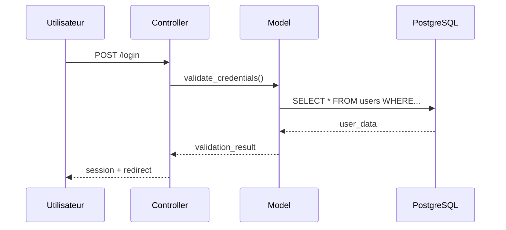
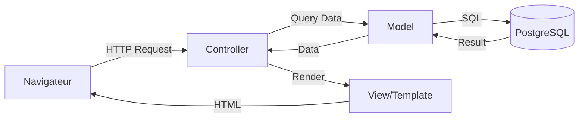
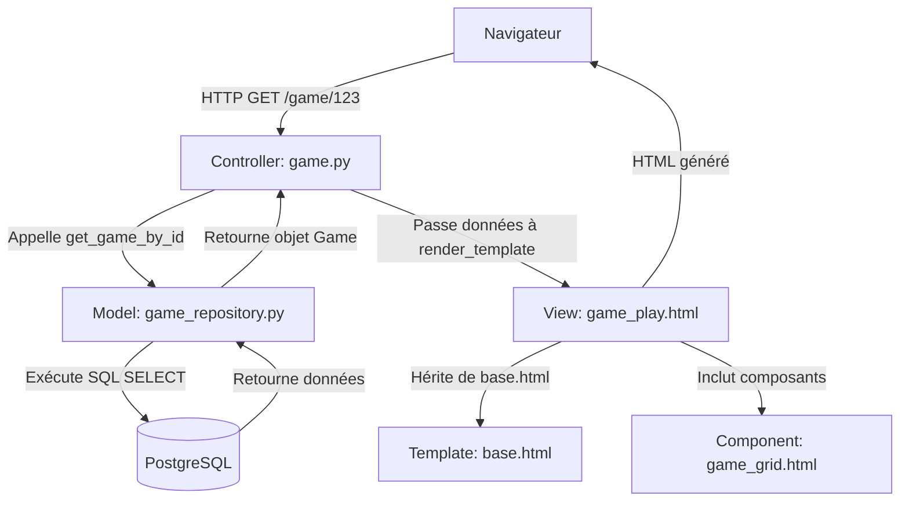

<style>
:root {
  --logo-html: url("https://cdn.jsdelivr.net/gh/devicons/devicon/icons/html5/html5-original.svg");
  --logo-css: url("https://cdn.jsdelivr.net/gh/devicons/devicon/icons/css3/css3-original.svg");
  --logo-js: url("https://cdn.jsdelivr.net/gh/devicons/devicon/icons/javascript/javascript-original.svg");
  --logo-python: url("https://cdn.jsdelivr.net/gh/devicons/devicon/icons/python/python-original.svg");
  --logo-sql: url("https://cdn.jsdelivr.net/gh/devicons/devicon/icons/postgresql/postgresql-original.svg");
  --logo-markdown: url("https://cdn.jsdelivr.net/gh/devicons/devicon/icons/markdown/markdown-original.svg");
  --logo-text: url("data:image/svg+xml,%3Csvg xmlns='http://www.w3.org/2000/svg' viewBox='0 0 16 16'%3E%3Crect x='1' y='0.5' width='14' height='15' rx='2' ry='2' fill='%23f4f4f4' stroke='%23000' stroke-width='0.8'/%3E%3Ctext x='8' y='11.5' font-family='Arial' font-size='7' text-anchor='middle' fill='%23000'%3ETXT%3C/text%3E%3C/svg%3E");
  --logo-box: url("data:image/svg+xml,%3Csvg xmlns='http://www.w3.org/2000/svg' viewBox='0 0 16 16'%3E%3Cpath d='M1 5.2L8 1l7 4.2v6.6L8 15 1 11.8z' fill='%23f0c419' stroke='%238a5a0a' stroke-width='0.8'/%3E%3Cpath d='M1 5.2l7 3.8 7-3.8' fill='none' stroke='%238a5a0a' stroke-width='0.8'/%3E%3Cpath d='M8 1v14' fill='none' stroke='%238a5a0a' stroke-width='0.8'/%3E%3C/svg%3E");
  --logo-folder: url("data:image/svg+xml,%3Csvg xmlns='http://www.w3.org/2000/svg' viewBox='0 0 16 16'%3E%3Cpath d='M1.5 4h4l1 1.5h8v7.5a1 1 0 01-1 1h-11a1 1 0 01-1-1z' fill='%23fbd490' stroke='%23c38a2e' stroke-width='0.7'/%3E%3Cpath d='M1.5 4.5h13' stroke='%23c38a2e' stroke-width='0.7'/%3E%3C/svg%3E");
  --logo-terminal: url("data:image/svg+xml,%3Csvg xmlns='http://www.w3.org/2000/svg' viewBox='0 0 16 16'%3E%3Crect x='1' y='2' width='14' height='12' rx='2' ry='2' fill='%23000' stroke='%2300c853' stroke-width='0.8'/%3E%3Cpath d='M4 6l2 2-2 2' stroke='%23fff' stroke-width='1.2' stroke-linecap='round' stroke-linejoin='round'/%3E%3Cpath d='M8 10h4' stroke='%23fff' stroke-width='1.2' stroke-linecap='round'/%3E%3C/svg%3E");
  --logo-db: url("data:image/svg+xml,%3Csvg xmlns='http://www.w3.org/2000/svg' viewBox='0 0 16 16'%3E%3Cellipse cx='8' cy='3.5' rx='6.5' ry='2.5' fill='%232196f3'/%3E%3Cpath d='M1.5 3.5v8c0 1.4 2.9 2.5 6.5 2.5s6.5-1.1 6.5-2.5v-8' fill='%232196f3' stroke='%230c47a1' stroke-width='0.8'/%3E%3Cline x1='1.5' y1='7' x2='14.5' y2='7' stroke='%230c47a1' stroke-width='0.6'/%3E%3Cline x1='1.5' y1='10.5' x2='14.5' y2='10.5' stroke='%230c47a1' stroke-width='0.6'/%3E%3C/svg%3E");
  --logo-linux: url("https://cdn.jsdelivr.net/gh/devicons/devicon/icons/linux/linux-original.svg");
  --logo-windows: url("https://cdn.jsdelivr.net/gh/devicons/devicon/icons/windows8/windows8-original.svg");
  --logo-mac: url("https://cdn.jsdelivr.net/gh/devicons/devicon/icons/apple/apple-original.svg");
  --logo-model: url("data:image/svg+xml,%3Csvg xmlns='http://www.w3.org/2000/svg' viewBox='0 0 20 20'%3E%3Cg fill='none' stroke='%23666' stroke-width='1.2'%3E%3Crect x='3' y='3' width='5' height='5'/%3E%3Crect x='12' y='3' width='5' height='5'/%3E%3Crect x='3' y='12' width='5' height='5'/%3E%3Crect x='12' y='12' width='5' height='5'/%3E%3C/g%3E%3C/svg%3E");
  --logo-view: url("data:image/svg+xml,%3Csvg xmlns='http://www.w3.org/2000/svg' viewBox='0 0 20 20'%3E%3Crect x='2' y='3' width='16' height='14' rx='1.5' fill='none' stroke='%23444' stroke-width='1.2'/%3E%3Cpath d='M2 6.5h16' stroke='%23444' stroke-width='1.2'/%3E%3Crect x='5' y='9' width='4' height='5' rx='0.5' fill='%23666'/%3E%3Crect x='11' y='9' width='4' height='5' rx='0.5' fill='%23666'/%3E%3C/svg%3E");
  --logo-controller: url("data:image/svg+xml,%3Csvg xmlns='http://www.w3.org/2000/svg' viewBox='0 0 20 20'%3E%3Ccircle cx='10' cy='10' r='7' fill='none' stroke='%23555' stroke-width='1.2'/%3E%3Cpath d='M10 3v14M3 10h14' stroke='%23555' stroke-width='1.2'/%3E%3Ccircle cx='10' cy='10' r='2.5' fill='%23555'/%3E%3Ccircle cx='10' cy='6' r='1' fill='%23777'/%3E%3Ccircle cx='10' cy='14' r='1' fill='%23777'/%3E%3Ccircle cx='6' cy='10' r='1' fill='%23777'/%3E%3Ccircle cx='14' cy='10' r='1' fill='%23777'/%3E%3C/svg%3E");
  --badge-surface:#f3f5fa;
  --badge-border:rgba(15,23,42,0.12);
  --badge-text:#1f2933;
  --badge-os-bg:rgba(30,136,229,0.12);
  --badge-os-fg:#0d47a1;
  --badge-level-bg:rgba(255,193,7,0.18);
  --badge-level-fg:#8d6e00;
  --badge-role-bg:rgba(76,175,80,0.12);
  --badge-role-fg:#1b5e20;
  --badge-mvc-bg:rgba(236,64,122,0.12);
  --badge-mvc-fg:#880e4f;
}

i {
  display: inline-block;
  width: 16px;
  height: 16px;
  vertical-align: -3px;
}

i[html]{ background-image: var(--logo-html); }
i[css]{ background-image: var(--logo-css); }
i[js]{ background-image: var(--logo-js); }
i[py]{ background-image: var(--logo-python); }
i[sql]{ background-image: var(--logo-sql); }
i[md]{ background-image: var(--logo-markdown); }
i[file]{ background-image: var(--logo-text); }
i[toml]{ background-image: var(--logo-text); }
i[project]{ background-image: var(--logo-box); }
i[folder]{ background-image: var(--logo-folder); }
i[cmd]{ background-image: var(--logo-terminal); }
i[db]{ background-image: var(--logo-db); }
i[linux]{ background-image: var(--logo-linux); }
i[windows]{ background-image: var(--logo-windows); }
i[mac]{ background-image: var(--logo-mac); }
i[model]{ background-image: var(--logo-model); }
i[view]{ background-image: var(--logo-view); }
i[controller]{ background-image: var(--logo-controller); }

@media (prefers-color-scheme: dark){
  :root{
    --badge-surface:rgba(255,255,255,0.04);
    --badge-border:rgba(255,255,255,0.18);
    --badge-text:#f5f5f5;
    --badge-os-bg:rgba(100,181,246,0.18);
    --badge-os-fg:#d0e7ff;
    --badge-level-bg:rgba(255,214,102,0.18);
    --badge-level-fg:#ffecb3;
    --badge-role-bg:rgba(129,199,132,0.18);
    --badge-role-fg:#e8f5e9;
    --badge-mvc-bg:rgba(244,143,177,0.18);
    --badge-mvc-fg:#ffe4ec;
  }
}

pre.tree{
  background:#efefef;
  padding:12px;
  border-radius:6px;
  overflow:auto;
  margin-bottom:8px;
}

.deleted-file{
  color:#d32f2f;
  text-decoration:line-through;
  text-decoration-thickness:2px;
}

pre.cmd-tree{
  background:#050505;
  color:#f2f2f2;
  padding:12px;
  border-radius:6px;
  margin-bottom:32px;
}

pre.cmd-block{
  background:#1f1f1f;
  color:#f2f2f2;
  padding:10px 12px;
  border-radius:6px;
  margin-bottom:8px;
}

pre.cmd-tree c{
  color:#050505;
}

pre.cmd-output{
  background:#141414;
  color:#8de2ff;
  padding:10px 12px;
  border-radius:6px;
  margin-bottom:16px;
  font-size:0.95em;
  position:relative;
  padding-left:28px;
}

pre.cmd-output::before{
  content:"▶";
  position:absolute;
  left:10px;
  top:10px;
  color:#4a9eff;
  font-weight:bold;
  font-size:1em;
}

.warning-block{
  background:#2b0410;
  color:#ff8a80;
  border-left:4px solid #ff1744;
  padding:12px 14px;
  border-radius:6px;
  margin:16px 0 8px;
}

.placeholder-table{
  width:100%;
  border-collapse:collapse;
  margin:8px 0 16px;
  font-size:0.95em;
}

.placeholder-table th,
.placeholder-table td{
  border:1px solid #ddd;
  padding:6px 8px;
  text-align:left;
}
.error-block{
  background:#2b040a;
  color:#ffcdd2;
  border-left:4px solid #f44336;
  padding:12px 14px;
  border-radius:6px;
  margin:16px 0 20px;
  box-shadow:0 2px 6px rgba(0,0,0,0.25);
}

.error-block strong{
  color:#ffe5e9;
}

.error-block strong::before{
  content:"⛔ ";
}

.error-block ul{
  margin:8px 0 0 20px;
  padding:0;
}

.error-block li{
  margin-bottom:8px;
  line-height:1.45;
}

.badge-row{
  display:flex;
  flex-wrap:wrap;
  gap:8px;
  margin:8px 0 18px;
}

.badge{
  display:inline-flex;
  align-items:center;
  gap:6px;
  padding:4px 10px;
  border-radius:999px;
  font-size:0.85em;
  text-transform:uppercase;
  letter-spacing:0.05em;
  background:var(--badge-surface);
  border:1px solid var(--badge-border);
  color:var(--badge-text);
  box-shadow:0 2px 6px rgba(15,15,15,0.08);
}

.badge i{
  margin-right:2px;
}

.badge-os{
  background:var(--badge-os-bg);
  border-color:var(--badge-os-fg);
  color:var(--badge-os-fg);
}

.badge-level{
  background:var(--badge-level-bg);
  border-color:var(--badge-level-fg);
  color:var(--badge-level-fg);
}

.badge-role{
  background:var(--badge-role-bg);
  border-color:var(--badge-role-fg);
  color:var(--badge-role-fg);
}

.badge-mvc{
  background:var(--badge-mvc-bg);
  border-color:var(--badge-mvc-fg);
  color:var(--badge-mvc-fg);
}

.badge-basico,
.badge-intermedio,
.badge-avanzado{
  font-weight:600;
  color:inherit;
}

.info-block{
  background:#0a1628;
  color:#b3d9ff;
  border-left:4px solid #2196f3;
  padding:12px 14px;
  border-radius:6px;
  margin:16px 0 8px;
}

.success-block{
  background:#0d2818;
  color:#a5d6a7;
  border-left:4px solid #4caf50;
  padding:12px 14px;
  border-radius:6px;
  margin:16px 0 8px;
}

.code-explained{
  border:none;
  border-radius:8px;
  margin:16px 0;
  overflow:hidden;
}

.code-explained.code-explained-md{
  position:relative;
}

.code-explained-header{
  padding:10px 14px;
  border-bottom:none;
  display:flex;
  align-items:center;
  gap:10px;
}

.code-explained-md .code-explained-header{
  position:absolute;
  top:12px;
  left:12px;
  right:12px;
  z-index:2;
  border:none;
  border-radius:8px;
  box-shadow:none;
}

.code-explained-header i{
  width:20px;
  height:20px;
}

.code-file-link{
  color:#58a6ff;
  text-decoration:none;
  font-weight:500;
  font-family:monospace;
  font-size:0.95em;
}

.code-file-link:hover{
  text-decoration:underline;
}

.code-line-link{
  color:#8b949e;
  font-size:0.85em;
  margin-left:8px;
  text-decoration:none;
}

.code-line-link:hover{
  color:#58a6ff;
}

.code-explained-body{
  padding:0;
  font-family:'Courier New', monospace;
  font-size:0.95em;
  line-height:1.7;
  color:inherit;
}

.code-explained-body pre{
  margin:0;
  padding:16px;
  white-space:pre-wrap;
  word-break:break-word;
  overflow-wrap:anywhere;
  overflow-x:hidden;
}

.code-explained-md .code-explained-body pre[data-role="codeBlock"]{
  padding:72px 18px 18px;
}

.code-comment{
  color:#a8b5c4;
  font-style:italic;
}

.code-keyword{
  color:#ff9a8b;
  font-weight:600;
}

.code-function{
  color:#ddb8ff;
  font-weight:500;
}

.code-string{
  color:#b8e0ff;
}

.code-number{
  color:#9dd6ff;
}

.glossary-term{
  border-bottom:2px dotted #58a6ff;
  cursor:help;
  position:relative;
  display:inline-block;
}

.glossary-term:hover{
  border-bottom-color:#1f6feb;
}

.glossary-definition{
  background:#1c2128;
  border:1px solid #30363d;
  border-radius:6px;
  padding:12px 16px;
  margin:12px 0;
  border-left:3px solid #58a6ff;
  color:#e6edf3;
  line-height:1.6;
}

.glossary-definition strong{
  color:#58a6ff;
  font-size:0.95em;
  text-transform:uppercase;
  letter-spacing:0.5px;
  display:block;
  margin-bottom:8px;
}

.media-placeholder{
  background:#1a1a1a;
  border:2px dashed #ffa657;
  border-radius:8px;
  padding:24px;
  text-align:center;
  margin:20px 0;
  color:#ffa657;
  font-family:monospace;
}

.media-placeholder-icon{
  font-size:3em;
  margin-bottom:12px;
  display:block;
}

.media-placeholder-type{
  font-weight:bold;
  font-size:1.2em;
  margin-bottom:8px;
  text-transform:uppercase;
  letter-spacing:1px;
}

.media-placeholder-description{
  color:#8b949e;
  font-size:0.9em;
  font-style:italic;
  margin-top:8px;
}

.media-gif .media-placeholder-icon::before{
  content:"🎬";
}

.media-img .media-placeholder-icon::before{
  content:"🖼️";
}

.media-video .media-placeholder-icon::before{
  content:"🎥";
}
</style>

# Guide de rédaction de documentation

Ce guide définit les standards et outils à utiliser pour créer une documentation technique claire, visuelle et pédagogique pour le projet.

---

## Table des matières

- [Guide de rédaction de documentation](#guide-de-rédaction-de-documentation)
  - [Table des matières](#table-des-matières)
  - [Outils disponibles](#outils-disponibles)
    - [1.1 Icônes pour fichiers et technologies](#11-icônes-pour-fichiers-et-technologies)
    - [1.2 Arbres de fichiers et dossiers](#12-arbres-de-fichiers-et-dossiers)
    - [1.3 Blocs de code terminal](#13-blocs-de-code-terminal)
      - [a) Bloc de commande simple (`cmd-block`)](#a-bloc-de-commande-simple-cmd-block)
      - [b) Bloc avec flux d'exécution (`cmd-tree`)](#b-bloc-avec-flux-dexécution-cmd-tree)
    - [1.4 Sortie de terminal (`cmd-output`)](#14-sortie-de-terminal-cmd-output)
    - [1.5 Badges de contexte](#15-badges-de-contexte)
    - [1.6 Blocs de messages](#16-blocs-de-messages)
      - [a) Avertissement (`warning-block`)](#a-avertissement-warning-block)
      - [b) Erreur (`error-block`)](#b-erreur-error-block)
      - [c) Information (`info-block`)](#c-information-info-block)
      - [d) Succès (`success-block`)](#d-succès-success-block)
    - [1.7 Tableaux de paramètres](#17-tableaux-de-paramètres)
    - [1.8 Diagrammes ASCII](#18-diagrammes-ascii)
    - [1.9 Diagrammes Mermaid](#19-diagrammes-mermaid)
    - [1.10 Blocs de code source expliqués](#110-blocs-de-code-source-expliqués)
    - [1.11 Glossaire et définitions de termes techniques](#111-glossaire-et-définitions-de-termes-techniques)
    - [1.12 Placeholders pour médias (GIF/IMG/VIDEO)](#112-placeholders-pour-médias-gifimgvideo)
  - [Directives de rédaction](#directives-de-rédaction)
    - [Directive #1 : Toujours documenter les commandes avec leur flux d'exécution](#directive-1--toujours-documenter-les-commandes-avec-leur-flux-dexécution)
    - [Directive #2 : Montrer l'impact sur le système de fichiers](#directive-2--montrer-limpact-sur-le-système-de-fichiers)
    - [Directive #3 : Contextualiser avec des arbres structurels](#directive-3--contextualiser-avec-des-arbres-structurels)
    - [Directive #4 : Afficher la sortie attendue](#directive-4--afficher-la-sortie-attendue)
    - [Directive #5 : Utiliser des placeholders clairs](#directive-5--utiliser-des-placeholders-clairs)
    - [Directive #6 : Signaler les risques](#directive-6--signaler-les-risques)
    - [Directive #7 : Documenter les erreurs courantes](#directive-7--documenter-les-erreurs-courantes)
    - [Directive #8 : Résumer les étapes importantes](#directive-8--résumer-les-étapes-importantes)
    - [Directive #9 : Utiliser les badges pour le contexte](#directive-9--utiliser-les-badges-pour-le-contexte)
    - [Directive #10 : Privilégier la clarté visuelle](#directive-10--privilégier-la-clarté-visuelle)
    - [Directive #11 : Expliquer le code source critique](#directive-11--expliquer-le-code-source-critique)
    - [Directive #12 : Définir les termes techniques](#directive-12--définir-les-termes-techniques)
    - [Directive #13 : Marquer les médias manquants](#directive-13--marquer-les-médias-manquants)
  - [Exemples d'application](#exemples-dapplication)
    - [Exemple 1 : Commande simple (installation de dépendances)](#exemple-1--commande-simple-installation-de-dépendances)
    - [Exemple 2 : Commande avec impact système (création d'environnement virtuel)](#exemple-2--commande-avec-impact-système-création-denvironnement-virtuel)
    - [Exemple 3 : Commande avec placeholders et erreurs courantes](#exemple-3--commande-avec-placeholders-et-erreurs-courantes)
    - [Exemple 4 : Commande complexe avec flux parallèles et convergents](#exemple-4--commande-complexe-avec-flux-parallèles-et-convergents)
    - [Exemple 5 : Commande destructive avec avertissement](#exemple-5--commande-destructive-avec-avertissement)
    - [Exemple 6 : Documentation complète d'architecture MVC](#exemple-6--documentation-complète-darchitecture-mvc)
      - [Architecture MVC du projet](#architecture-mvc-du-projet)
    - [Exemple 7 : Documentation complète avec code expliqué, glossaire et médias](#exemple-7--documentation-complète-avec-code-expliqué-glossaire-et-médias)
      - [Système d'intelligence artificielle pour le morpion](#système-dintelligence-artificielle-pour-le-morpion)
  - [Résumé des directives](#résumé-des-directives)
  - [Conclusion](#conclusion)
    - [Exemple temporaire de rendu (test en Markdown)](#exemple-temporaire-de-rendu-test-en-markdown)

---

## Outils disponibles

Cette section présente tous les éléments visuels et structurels disponibles pour enrichir la documentation.

### 1.1 Icônes pour fichiers et technologies

Les icônes permettent d'identifier rapidement le type de fichier ou de technologie.

| Élément | Code | Rendu |
|---------|------|-------|
| HTML | `<i html></i>` | <i html></i> |
| CSS | `<i css></i>` | <i css></i> |
| JavaScript | `<i js></i>` | <i js></i> |
| Python | `<i py></i>` | <i py></i> |
| SQL | `<i sql></i>` | <i sql></i> |
| Markdown | `<i md></i>` | <i md></i> |
| Fichier texte | `<i file></i>` | <i file></i> |
| TOML | `<i toml></i>` | <i toml></i> |
| Projet | `<i project></i>` | <i project></i> |
| Dossier | `<i folder></i>` | <i folder></i> |
| Terminal | `<i cmd></i>` | <i cmd></i> |
| Base de données | `<i db></i>` | <i db></i> |
| Linux | `<i linux></i>` | <i linux></i> |
| Windows | `<i windows></i>` | <i windows></i> |
| macOS | `<i mac></i>` | <i mac></i> |
| Model (MVC) | `<i model></i>` | <i model></i> |
| View (MVC) | `<i view></i>` | <i view></i> |
| Controller (MVC) | `<i controller></i>` | <i controller></i> |

**Note :** Vous pouvez créer de nouveaux icônes en ajoutant des définitions CSS dans le bloc `<style>` selon les besoins.

### 1.2 Arbres de fichiers et dossiers

Les arbres visualisent la structure des répertoires et fichiers.

**Syntaxe de base :**
```html
<pre class="tree">
<i project></i> project/
┣━━ <i folder></i> dossier/
┃   ┣━━ <i py></i> fichier.py
┃   ┗━━ <i html></i> index.html
┗━━ <i file></i> README.md
</pre>
```

**Rendu :**
<pre class="tree">
<i project></i> project/
┣━━ <i folder></i> dossier/
┃   ┣━━ <i py></i> fichier.py
┃   ┗━━ <i html></i> index.html
┗━━ <i file></i> README.md
</pre>

**Caractères utilisés :**
- `┣━━` : branche intermédiaire
- `┗━━` : dernière branche
- `┃` : continuation verticale
- `...` : contenu omis

**Fichiers supprimés :**

Pour marquer un fichier comme supprimé, utilisez la classe `deleted-file` :

```html
<pre class="tree">
<i project></i> project/
┣━━ <i folder></i> backups/
┃   ┗━━ <span class="deleted-file"><i file></i> latest.sql</span>
┗━━ <i py></i> server.py
</pre>
```

**Rendu :**
<pre class="tree">
<i project></i> project/
┣━━ <i folder></i> backups/
┃   ┗━━ <span class="deleted-file"><i file></i> latest.sql</span>
┗━━ <i py></i> server.py
</pre>

Le fichier apparaîtra en rouge et barré.

**Note importante sur les diagrammes ASCII :**
Les icônes `<i ...></i>` ne fonctionnent **pas** dans les blocs code markdown (` ``` `). Pour créer des diagrammes ASCII avec des icônes, utilisez toujours `<pre>` au lieu de ` ``` `.

**Exemple de diagramme ASCII avec icônes :**
```html
<pre>
┌──────────┐       ┌──────────────┐       ┌───────────┐
│ Browser  │──────▶│ <i controller></i> Controller │──────▶│ <i model></i> Model │
└──────────┘       └──────────────┘       └───────────┘
</pre>
```

### 1.3 Blocs de code terminal

#### a) Bloc de commande simple (`cmd-block`)
Pour afficher une commande copiable sans explication :

**Syntaxe :**
```html
<pre class="cmd-block">
<i cmd></i> python -m venv .venv
</pre>
```

**Rendu :**
<pre class="cmd-block">
<i cmd></i> python -m venv .venv
</pre>

#### b) Bloc avec flux d'exécution (`cmd-tree`)
Pour documenter ce qu'une commande fait étape par étape :

**Syntaxe :**
```html
<pre class="cmd-tree">
<i cmd></i> python scripts/db_init.py
    <c>#</c>└──➤ Lit la configuration config-bd.toml
        <c>#</c>└──➤ Se connecte à PostgreSQL
            <c>#</c>└──➤ Exécute schema.sql
</pre>
```

**Rendu :**
<pre class="cmd-tree">
<i cmd></i> python scripts/db_init.py
    <c>#</c>└──➤ Lit la configuration config-bd.toml
        <c>#</c>└──➤ Se connecte à PostgreSQL
            <c>#</c>└──➤ Exécute schema.sql
</pre>

**Important :** Les lignes explicatives doivent toujours commencer par `<c>#</c>` pour être copiées comme commentaires.

### 1.4 Sortie de terminal (`cmd-output`)

Pour afficher le résultat attendu d'une commande :

**Syntaxe :**
```html
<pre class="cmd-output">
Successfully installed Flask-2.3.0 psycopg2-binary-2.9.9
</pre>
```

**Rendu :**
<pre class="cmd-output">
Successfully installed Flask-2.3.0 psycopg2-binary-2.9.9
</pre>

**Note :** Le symbole `▶` apparaît automatiquement au début pour indiquer qu'il s'agit d'une sortie de commande.

### 1.5 Badges de contexte

Les badges permettent d'indiquer rapidement le système d'exploitation, le niveau de difficulté, le rôle ou la couche MVC concernés.

**Syntaxe :**
```html
<div class="badge-row">
  <span class="badge badge-os"><i linux></i>Linux</span>
  <span class="badge badge-os"><i windows></i>Windows</span>
  <span class="badge badge-os"><i mac></i>macOS</span>
  <span class="badge badge-level badge-basico">Niveau: Débutant</span>
  <span class="badge badge-role badge-dev">Rôle: Dev</span>
  <span class="badge badge-mvc"><i model></i>Model</span>
  <span class="badge badge-mvc"><i view></i>View</span>
  <span class="badge badge-mvc"><i controller></i>Controller</span>
</div>
```

**Rendu :**
<div class="badge-row">
  <span class="badge badge-os"><i linux></i>Linux</span>
  <span class="badge badge-os"><i windows></i>Windows</span>
  <span class="badge badge-os"><i mac></i>macOS</span>
  <span class="badge badge-level badge-basico">Niveau: Débutant</span>
  <span class="badge badge-role badge-dev">Rôle: Dev</span>
  <span class="badge badge-mvc"><i model></i>Model</span>
  <span class="badge badge-mvc"><i view></i>View</span>
  <span class="badge badge-mvc"><i controller></i>Controller</span>
</div>

**Types de badges disponibles :**
- **OS :** `badge-os` (Linux, Windows, macOS)
- **Niveau :** `badge-level badge-basico` / `badge-intermedio` / `badge-avanzado`
- **Rôle :** `badge-role badge-dev` / `badge-bd` / `badge-frontend`
- **MVC :** `badge-mvc` (Model, View, Controller)

### 1.6 Blocs de messages

#### a) Avertissement (`warning-block`)
**Syntaxe :**
```html
<div class="warning-block">
⚠️ Cette commande supprimera définitivement toutes les données.
</div>
```

**Rendu :**
<div class="warning-block">
⚠️ Cette commande supprimera définitivement toutes les données.
</div>

#### b) Erreur (`error-block`)
**Syntaxe :**
```html
<div class="error-block">
  <strong>Erreurs fréquentes :</strong><br>
  <ul>
    <li><code>ModuleNotFoundError: No module named 'flask'</code><br> ➔ Le module Flask n'est pas installé. Exécutez <code>pip install -r requirements.in</code>.</li>
    <li><code>psql: FATAL: password authentication failed</code><br> ➔ Mot de passe incorrect. Vérifiez <code>config-bd.toml</code>.</li>
  </ul>
</div>
```

**Rendu :**
<div class="error-block">
  <strong>Erreurs fréquentes :</strong><br>
  <ul>
    <li><code>ModuleNotFoundError: No module named 'flask'</code><br> ➔ Le module Flask n'est pas installé. Exécutez <code>pip install -r requirements.in</code>.</li>
    <li><code>psql: FATAL: password authentication failed</code><br> ➔ Mot de passe incorrect. Vérifiez <code>config-bd.toml</code>.</li>
  </ul>
</div>

#### c) Information (`info-block`)
**Syntaxe :**
```html
<div class="info-block">
💡 Astuce : Utilisez <code>make dev</code> pour lancer automatiquement le serveur et le watcher CSS.
</div>
```

**Rendu :**
<div class="info-block">
💡 Astuce : Utilisez <code>make dev</code> pour lancer automatiquement le serveur et le watcher CSS.
</div>

#### d) Succès (`success-block`)
**Syntaxe :**
```html
<div class="success-block">
✅ Installation réussie ! Vous pouvez maintenant lancer le serveur.
</div>
```

**Rendu :**
<div class="success-block">
✅ Installation réussie ! Vous pouvez maintenant lancer le serveur.
</div>

### 1.7 Tableaux de paramètres

Pour documenter les placeholders ou options de commandes :

**Syntaxe :**
```html
<table class="placeholder-table">
  <tr><th>Placeholder</th><th>Description</th><th>Exemple</th></tr>
  <tr><td>{{HOST}}</td><td>Serveur PostgreSQL</td><td>bd-pedago.univ-lyon1.fr</td></tr>
  <tr><td>{{USER}}</td><td>Identifiant de connexion</td><td>p2023001</td></tr>
  <tr><td>{{DB}}</td><td>Nom de la base</td><td>p2023001</td></tr>
</table>
```

**Rendu :**
<table class="placeholder-table">
  <tr><th>Placeholder</th><th>Description</th><th>Exemple</th></tr>
  <tr><td>{{HOST}}</td><td>Serveur PostgreSQL</td><td>bd-pedago.univ-lyon1.fr</td></tr>
  <tr><td>{{USER}}</td><td>Identifiant de connexion</td><td>p2023001</td></tr>
  <tr><td>{{DB}}</td><td>Nom de la base</td><td>p2023001</td></tr>
</table>

### 1.8 Diagrammes ASCII

Les diagrammes ASCII permettent d'expliquer des flux, des architectures ou des relations entre composants.

**IMPORTANT :** Pour utiliser des icônes dans un diagramme ASCII, vous **devez** utiliser `<pre>` au lieu de ` ``` `. Les icônes `<i ...></i>` ne fonctionnent pas dans les blocs markdown.

**Exemple : Flux MVC (avec icônes)**

Syntaxe :
```html
<pre>
┌──────────┐       ┌──────────────┐       ┌───────────┐
│ Browser  │──────▶│ <i controller></i> Controller │──────▶│ <i model></i> Model │
└──────────┘       └──────────────┘       └───────────┘
     ▲                     │                      │
     │                     ▼                      ▼
     │              ┌──────────┐           ┌──────────┐
     └──────────────│ <i view></i> View   │◀──────────│ <i db></i> Database │
                    └──────────┘           └──────────┘
</pre>
```

Rendu :
<pre>
┌──────────┐       ┌──────────────┐       ┌───────────┐
│ Browser  │──────▶│ <i controller></i> Controller │──────▶│ <i model></i> Model │
└──────────┘       └──────────────┘       └───────────┘
     ▲                     │                      │
     │                     ▼                      ▼
     │              ┌──────────┐           ┌──────────┐
     └──────────────│ <i view></i> View   │◀──────────│ <i db></i> Database │
                    └──────────┘           └──────────┘
</pre>

**Exemple : Communication entre fichiers**

Syntaxe :
```html
<pre>
<i py></i> server.py ──────┐
                    ▼
        <i toml></i> routes.toml ──────▶ <i folder></i> controllers/ ──────▶ <i folder></i> models/
                                       │                       │
                                       ▼                       ▼
                                <i folder></i> templates/          <i db></i> PostgreSQL
</pre>
```

Rendu :
<pre>
<i py></i> server.py ──────┐
                    ▼
        <i toml></i> routes.toml ──────▶ <i folder></i> controllers/ ──────▶ <i folder></i> models/
                                       │                       │
                                       ▼                       ▼
                                <i folder></i> templates/          <i db></i> PostgreSQL
</pre>

### 1.9 Diagrammes Mermaid

Pour des diagrammes plus complexes et professionnels, utilisez Mermaid.

**Exemple : Flux d'authentification**
````markdown

````

**Exemple : Architecture MVC**
````markdown

````

### 1.10 Blocs de code source expliqués

Ce type de bloc permet d'expliquer en détail des fonctions ou portions de code importantes du projet, avec un lien direct vers le fichier source.

**Syntaxe (copiez exactement ce bloc) :**
````html
<div class="code-explained code-explained-md">
  <div class="code-explained-header">
    <i py></i>
    <a href="../../website-morpion/models/game_repository.py" class="code-file-link">
      website-morpion/models/game_repository.py
    </a>
    <a href="../../website-morpion/models/game_repository.py#L45-L68" class="code-line-link">
      ↗ Aller aux lignes 45-L68
    </a>
  </div>
  <div class="code-explained-body">

```python
def get_game_by_id(game_id: int) -> dict:
    # ✏️ Exemple temporaire pour tester le rendu markdown + header flottant
    query = """
        SELECT id, plateau, tour_actuel
        FROM parties
        WHERE id = %s
    """
    conn = get_db_connection()
    cursor = conn.cursor()
    cursor.execute(query, (game_id,))
    result = cursor.fetchone()
    cursor.close()
    conn.close()
    return result  # 📤 Retourne dict ou None
```

  </div>
</div>
````

**Rendu :**
<div class="code-explained code-explained-md">
  <div class="code-explained-header">
    <i py></i>
    <a href="../../website-morpion/models/game_repository.py" class="code-file-link">
      website-morpion/models/game_repository.py
    </a>
    <a href="../../website-morpion/models/game_repository.py#L45-L68" class="code-line-link">
      ↗ Aller aux lignes 45-L68
    </a>
  </div>
  <div class="code-explained-body">

```python
def get_game_by_id(game_id: int) -> dict:
    # ✏️ Exemple temporaire pour tester le rendu markdown + header flottant
    query = """
        SELECT id, plateau, tour_actuel
        FROM parties
        WHERE id = %s
    """
    conn = get_db_connection()
    cursor = conn.cursor()
    cursor.execute(query, (game_id,))
    result = cursor.fetchone()
    cursor.close()
    conn.close()
    return result  # 📤 Retourne dict ou None
```

  </div>
</div>

**Notes d'utilisation :**
- Le lien principal pointe vers le fichier complet
- Le lien "Aller aux lignes X-Y" pointe vers la portion exacte du code (format GitHub `#L45-L68`)
- Utilisez les classes de coloration syntaxique : `code-keyword`, `code-function`, `code-string`, `code-number`, `code-comment`
- Ajoutez des émojis dans les commentaires pour rendre l'explication plus visuelle
- Pour les blocs issus de Markdown, ajoutez la classe `code-explained-md` au conteneur : le header est positionné au-dessus du code et le `pre[data-role="codeBlock"]` reçoit un padding supérieur pour ne pas masquer la première ligne.

### 1.11 Glossaire et définitions de termes techniques

Pour expliquer les termes techniques, abréviations ou concepts complexes directement dans le texte.

**Syntaxe :**
```html
Le <span class="glossary-term">ORM</span> permet de manipuler la base de données avec des objets Python.

<div class="glossary-definition">
  <strong>ORM (Object-Relational Mapping)</strong><br>
  Technique de programmation qui permet de convertir des données entre des systèmes incompatibles
  (base de données relationnelle ↔ langage orienté objet). Au lieu d'écrire du SQL brut,
  on manipule des objets Python qui sont automatiquement traduits en requêtes SQL.
  <br><br>
  <strong>Exemple :</strong> <code>User.query.filter_by(email='test@example.com').first()</code>
  au lieu de <code>SELECT * FROM users WHERE email='test@example.com' LIMIT 1</code>
</div>
```

**Rendu :**

Le <span class="glossary-term">ORM</span> permet de manipuler la base de données avec des objets Python.

<div class="glossary-definition">
  <strong>ORM (Object-Relational Mapping)</strong><br>
  Technique de programmation qui permet de convertir des données entre des systèmes incompatibles
  (base de données relationnelle ↔ langage orienté objet). Au lieu d'écrire du SQL brut,
  on manipule des objets Python qui sont automatiquement traduits en requêtes SQL.
  <br><br>
  <strong>Exemple :</strong> <code>User.query.filter_by(email='test@example.com').first()</code>
  au lieu de <code>SELECT * FROM users WHERE email='test@example.com' LIMIT 1</code>
</div>

**Variante inline (courte) :**
```html
Le serveur utilise <span class="glossary-term" title="HyperText Transfer Protocol Secure - Protocole de communication sécurisé">HTTPS</span> pour chiffrer les données.
```

**Rendu :**
Le serveur utilise <span class="glossary-term" title="HyperText Transfer Protocol Secure - Protocole de communication sécurisé">HTTPS</span> pour chiffrer les données.

**Liste des termes à définir fréquemment :**
- Abréviations techniques : ORM, CRUD, MVC, API, REST, JSON, SQL
- Concepts BDD : Transaction, Trigger, Index, Contrainte, Schéma
- Concepts Python : Décorateur, Context Manager, Générateur
- Concepts Web : Session, Cookie, CSRF, XSS, Template Engine

### 1.12 Placeholders pour médias (GIF/IMG/VIDEO)

Lorsque vous rédigez la documentation et qu'un média visuel serait utile mais n'est pas encore disponible, utilisez ces placeholders.

**Syntaxe GIF :**
```html
<div class="media-placeholder media-gif">
  <span class="media-placeholder-icon"></span>
  <div class="media-placeholder-type">⏳ En attente : GIF</div>
  <div class="media-placeholder-description">
    Animation montrant le processus complet de création d'une partie :
    sélection du morpion → choix des équipes → lancement de la partie
  </div>
</div>
```

**Rendu GIF :**
<div class="media-placeholder media-gif">
  <span class="media-placeholder-icon"></span>
  <div class="media-placeholder-type">⏳ En attente : GIF</div>
  <div class="media-placeholder-description">
    Animation montrant le processus complet de création d'une partie :
    sélection du morpion → choix des équipes → lancement de la partie
  </div>
</div>

**Syntaxe IMAGE :**
```html
<div class="media-placeholder media-img">
  <span class="media-placeholder-icon"></span>
  <div class="media-placeholder-type">⏳ En attente : IMAGE</div>
  <div class="media-placeholder-description">
    Capture d'écran du tableau de bord des statistiques avancées avec les graphiques de performance
  </div>
</div>
```

**Rendu IMAGE :**
<div class="media-placeholder media-img">
  <span class="media-placeholder-icon"></span>
  <div class="media-placeholder-type">⏳ En attente : IMAGE</div>
  <div class="media-placeholder-description">
    Capture d'écran du tableau de bord des statistiques avancées avec les graphiques de performance
  </div>
</div>

**Syntaxe VIDEO :**
```html
<div class="media-placeholder media-video">
  <span class="media-placeholder-icon"></span>
  <div class="media-placeholder-type">⏳ En attente : VIDEO</div>
  <div class="media-placeholder-description">
    Tutoriel vidéo (2-3 min) expliquant comment configurer l'environnement de développement
    de A à Z sur Ubuntu 22.04
  </div>
</div>
```

**Rendu VIDEO :**
<div class="media-placeholder media-video">
  <span class="media-placeholder-icon"></span>
  <div class="media-placeholder-type">⏳ En attente : VIDEO</div>
  <div class="media-placeholder-description">
    Tutoriel vidéo (2-3 min) expliquant comment configurer l'environnement de développement
    de A à Z sur Ubuntu 22.04
  </div>
</div>

**Bonnes pratiques :**
- Soyez **très précis** dans la description du média attendu
- Indiquez les **éléments clés** qui doivent apparaître dans le média
- Pour les vidéos, précisez la **durée approximative** souhaitée
- Pour les GIFs, décrivez **l'interaction ou le processus** à montrer
- Pour les images, mentionnez les **éléments UI** à capturer

**Remplacement ultérieur :**
Une fois le média créé, remplacez le placeholder par :
```html
<!-- Pour GIF -->


<!-- Pour IMAGE -->


<!-- Pour VIDEO -->
<video controls style="max-width:100%; border-radius:8px;">
  <source src="path/to/tutorial.mp4" type="video/mp4">
  Votre navigateur ne supporte pas la lecture de vidéos.
</video>
```

---

## Directives de rédaction

Ces directives définissent les règles à suivre lors de la rédaction de documentation technique.

### Directive #1 : Toujours documenter les commandes avec leur flux d'exécution

**Règle :**
- Chaque commande doit être accompagnée d'un diagramme de flux (`cmd-tree`) expliquant ses étapes.
- Utilisez les symboles `└──➤` pour les flux séquentiels.
- Utilisez plusieurs `└──➤` alignés pour les processus parallèles.
- Utilisez `if (condition)` pour les branches conditionnelles.

**Patterns de flux :**

**Flux séquentiel :**
```
└──➤ Étape A
    └──➤ Étape B
        └──➤ Étape C
```

**Flux parallèle :**
```
└──➤ Processus A
└──➤ Processus B
└──➤ Processus C
```

**Flux conditionnel :**
```
└──➤ Vérification
    └──➤ if (condition?)
        └─(vrai)─➤ Action A
        └─(faux)─➤ Action B
```

**Flux convergent :**
```
└──➤ Processus A ───➤ Finalisation ◄─┐
└──➤ Processus B ───➤ Finalisation ───┘
```

### Directive #2 : Montrer l'impact sur le système de fichiers

**Règle :**
- Avant/après toute commande qui crée, modifie ou supprime des fichiers, montrez un arbre du système de fichiers.
- Mettez en évidence les éléments affectés.
- Utilisez `...` pour omettre le contenu non pertinent.

### Directive #3 : Contextualiser avec des arbres structurels

**Règle :**
- Lors de l'explication d'une structure de code (dossiers controllers, models, templates), incluez un arbre contextuel.
- Cela aide le lecteur à se situer avant d'entrer dans les détails.

### Directive #4 : Afficher la sortie attendue

**Règle :**
- Après chaque bloc de commande, incluez un bloc `cmd-output` montrant le résultat typique.
- Si la commande ne produit pas de sortie, mentionnez-le explicitement dans le texte.

### Directive #5 : Utiliser des placeholders clairs

**Règle :**
- Utilisez le format `{{PLACEHOLDER}}` pour les valeurs à personnaliser.
- Incluez toujours un tableau explicatif après la commande.
- Fournissez des exemples concrets.

### Directive #6 : Signaler les risques

**Règle :**
- Les commandes destructives (`DROP`, `rm -rf`, `db_wipe`) doivent être précédées d'un `warning-block`.
- Dans les arbres, marquez les fichiers/dossiers affectés en rouge : `<span style="color:#d32f2f">...</span>`.

### Directive #7 : Documenter les erreurs courantes

**Règle :**
- Après les commandes complexes ou sujettes à erreurs, ajoutez un `error-block` listant les problèmes fréquents et leurs solutions.
- Format : `<code>message d'erreur</code><br> ➔ Explication et solution.`

### Directive #8 : Résumer les étapes importantes

**Règle :**
- À la fin de chaque section majeure (installation, configuration, déploiement), rédigez un paragraphe de synthèse.
- Incluez optionnellement un arbre montrant l'état final du projet.

### Directive #9 : Utiliser les badges pour le contexte

**Règle :**
- Au début de chaque section technique, indiquez :
  - Les systèmes d'exploitation concernés
  - Le niveau de difficulté
  - Le rôle (développeur, DBA, frontend)
  - La couche MVC concernée (si applicable)

### Directive #10 : Privilégier la clarté visuelle

**Règle :**
- Espacez les blocs pour éviter la surcharge visuelle.
- Utilisez des titres et sous-titres clairs.
- Limitez la profondeur des arbres et diagrammes (max 3-4 niveaux).
- Préférez les diagrammes Mermaid pour les flux complexes.

### Directive #11 : Expliquer le code source critique

**Règle :**
- Pour les fonctions complexes ou les algorithmes clés, utilisez des blocs `code-explained`.
- Incluez TOUJOURS un lien vers le fichier source complet.
- Ajoutez un lien vers les lignes exactes du code (format `#L45-L68`).
- Utilisez la coloration syntaxique appropriée (`code-keyword`, `code-function`, `code-string`, `code-comment`).
- Ajoutez des commentaires inline avec des émojis pour faciliter la compréhension :
  - 🔗 pour les connexions/imports
  - 📊 pour les requêtes/données
  - 🛡️ pour la sécurité
  - ✏️ pour les descriptions générales
  - 📤 pour les retours de fonction
  - ⚙️ pour les configurations
  - 🔄 pour les boucles/itérations

**Quand utiliser :**
- Algorithmes de jeu (logique de victoire, IA)
- Requêtes SQL complexes avec JOINs multiples
- Fonctions de sécurité (authentification, validation)
- Code métier non-trivial

### Directive #12 : Définir les termes techniques

**Règle :**
- La première fois qu'un terme technique ou une abréviation apparaît, marquez-le avec `glossary-term`.
- Fournissez immédiatement après une `glossary-definition` complète incluant :
  - La définition complète du terme
  - Un exemple concret d'utilisation
  - Le contexte dans lequel on l'utilise
- Pour les termes secondaires, utilisez la variante inline avec l'attribut `title`.

**Termes qui nécessitent TOUJOURS une définition :**
- Abréviations : MVC, CRUD, ORM, API, REST, AJAX, JSON, SQL, HTTP, HTTPS
- Concepts BDD : Transaction, Trigger, Index, Foreign Key, Schema, Migration
- Concepts Python : Decorator, Generator, Context Manager, Comprehension
- Concepts Web : Session, Cookie, CSRF, XSS, Template Engine, Middleware

**Format de définition :**
```
<strong>TERME (développement)</strong><br>
[Définition claire en 1-2 phrases]
<br><br>
<strong>Exemple :</strong> [Code ou cas d'usage concret]
```

### Directive #13 : Marquer les médias manquants

**Règle :**
- Lorsqu'un GIF, une image ou une vidéo serait pédagogique mais n'est pas encore disponible, utilisez un `media-placeholder`.
- Spécifiez le type exact : `media-gif`, `media-img`, ou `media-video`.
- Décrivez PRÉCISÉMENT ce que le média doit montrer :
  - Pour GIF : l'interaction ou le processus animé
  - Pour IMG : les éléments UI ou le résultat visuel
  - Pour VIDEO : le tutoriel complet avec durée approximative
- Incluez les détails techniques si nécessaire (résolution, format, durée).

**Priorité des médias :**
1. **GIF** : Interactions utilisateur, animations de processus courts (< 10 sec)
2. **IMAGE** : Captures d'écran, schémas statiques, résultats visuels
3. **VIDEO** : Tutoriels longs (> 1 min), installations complexes, démonstrations complètes

**Ne laissez JAMAIS un placeholder vide** : toujours décrire en détail ce qui doit y figurer pour que quelqu'un d'autre puisse créer le média.

---

## Exemples d'application

Cette section présente des cas concrets d'utilisation des outils et directives.

### Exemple 1 : Commande simple (installation de dépendances)

<div class="badge-row">
  <span class="badge badge-os"><i linux></i>Linux</span>
  <span class="badge badge-os"><i mac></i>macOS</span>
  <span class="badge badge-level badge-basico">Niveau: Débutant</span>
  <span class="badge badge-role badge-dev">Rôle: Dev</span>
</div>

**Code :**
```html
<pre class="cmd-block">
<i cmd></i> pip install -r requirements.in
</pre>
<pre class="cmd-tree">
<i cmd></i> pip install -r requirements.in
    <c>#</c>└──➤ Lit le fichier requirements.in
        <c>#</c>└──➤ Télécharge les packages depuis PyPI
            <c>#</c>└──➤ Installe dans .venv/lib/python*/site-packages
</pre>
<pre class="cmd-output">
Collecting Flask==2.3.0
Collecting psycopg2-binary==2.9.9
Successfully installed Flask-2.3.0 psycopg2-binary-2.9.9
</pre>
```

**Rendu :**
<pre class="cmd-block">
<i cmd></i> pip install -r requirements.in
</pre>
<pre class="cmd-tree">
<i cmd></i> pip install -r requirements.in
    <c>#</c>└──➤ Lit le fichier requirements.in
        <c>#</c>└──➤ Télécharge les packages depuis PyPI
            <c>#</c>└──➤ Installe dans .venv/lib/python*/site-packages
</pre>
<pre class="cmd-output">
Collecting Flask==2.3.0
Collecting psycopg2-binary==2.9.9
Successfully installed Flask-2.3.0 psycopg2-binary-2.9.9
</pre>

**Explication :**
- **Badges** : Indiquent que cette commande fonctionne sur Linux/macOS, niveau débutant, pour les développeurs.
- **cmd-block** : Commande copiable.
- **cmd-tree** : Explique le flux d'exécution étape par étape.
- **cmd-output** : Montre le résultat attendu pour validation.

---

### Exemple 2 : Commande avec impact système (création d'environnement virtuel)

<div class="badge-row">
  <span class="badge badge-os"><i linux></i>Linux</span>
  <span class="badge badge-os"><i windows></i>Windows</span>
  <span class="badge badge-os"><i mac></i>macOS</span>
  <span class="badge badge-level badge-basico">Niveau: Débutant</span>
  <span class="badge badge-role badge-dev">Rôle: Dev</span>
</div>

**Code :**
```html
<h4>Avant :</h4>
<pre class="tree">
<i project></i> project/
┗━━ <i py></i> server.py
</pre>

<pre class="cmd-block">
<i cmd></i> python -m venv .venv
</pre>

<h4>Après :</h4>
<pre class="tree">
<i project></i> project/
┣━━ <i folder></i> .venv/
┃   ┣━━ <i folder></i> bin/
┃   ┣━━ <i folder></i> lib/
┃   ┗━━ <i file></i> pyvenv.cfg
┗━━ <i py></i> server.py
</pre>

<pre class="cmd-tree">
<i cmd></i> python -m venv .venv
    <c>#</c>└──➤ Crée le dossier .venv/
        <c>#</c>└──➤ Installe Python isolé dans .venv/bin/
            <c>#</c>└──➤ Configure pyvenv.cfg
</pre>

<div class="success-block">
✅ Environnement virtuel créé avec succès ! Activez-le avec <code>source .venv/bin/activate</code>.
</div>
```

**Rendu :**

Avant :
<pre class="tree">
<i project></i> project/
┗━━ <i py></i> server.py
</pre>

<pre class="cmd-block">
<i cmd></i> python -m venv .venv
</pre>

Après :
<pre class="tree">
<i project></i> project/
┣━━ <i folder></i> .venv/
┃   ┣━━ <i folder></i> bin/
┃   ┣━━ <i folder></i> lib/
┃   ┗━━ <i file></i> pyvenv.cfg
┗━━ <i py></i> server.py
</pre>

<pre class="cmd-tree">
<i cmd></i> python -m venv .venv
    <c>#</c>└──➤ Crée le dossier .venv/
        <c>#</c>└──➤ Installe Python isolé dans .venv/bin/
            <c>#</c>└──➤ Configure pyvenv.cfg
</pre>

<div class="success-block">
✅ Environnement virtuel créé avec succès ! Activez-le avec <code>source .venv/bin/activate</code>.
</div>

**Explication :**
- **Arbre avant/après** : Montre visuellement l'impact de la commande sur le système de fichiers (Directive #2).
- **cmd-tree** : Détaille les étapes internes (Directive #1).
- **success-block** : Confirme le succès et indique l'étape suivante.

---

### Exemple 3 : Commande avec placeholders et erreurs courantes

<div class="badge-row">
  <span class="badge badge-os"><i linux></i>Linux</span>
  <span class="badge badge-os"><i mac></i>macOS</span>
  <span class="badge badge-level badge-intermedio">Niveau: Intermédiaire</span>
  <span class="badge badge-role badge-bd">Rôle: BD</span>
  <span class="badge badge-mvc"><i model></i>Model</span>
</div>

**Code :**
```html
<pre class="cmd-block">
<i cmd></i> psql -h {{HOST}} -U {{USER}} -d {{DB}} -f website-morpion/sql/schema.sql
</pre>

<table class="placeholder-table">
  <tr><th>Placeholder</th><th>Description</th><th>Exemple</th></tr>
  <tr><td>{{HOST}}</td><td>Serveur PostgreSQL</td><td>bd-pedago.univ-lyon1.fr</td></tr>
  <tr><td>{{USER}}</td><td>Identifiant de connexion</td><td>p2023001</td></tr>
  <tr><td>{{DB}}</td><td>Nom de la base de données</td><td>p2023001</td></tr>
</table>

<pre class="cmd-tree">
<i cmd></i> psql -h {{HOST}} -U {{USER}} -d {{DB}} -f schema.sql
    <c>#</c>└──➤ Établit connexion avec PostgreSQL
        <c>#</c>└──➤ Authentifie l'utilisateur {{USER}}
            <c>#</c>└──➤ Exécute les commandes SQL du fichier
                <c>#</c>└──➤ Crée tables, fonctions et triggers
</pre>

<pre class="cmd-output">
SET
CREATE SCHEMA
CREATE TABLE
CREATE FUNCTION
COMMIT
</pre>

<div class="error-block">
  <strong>Erreurs fréquentes :</strong><br>
  <ul>
    <li><code>psql: FATAL: password authentication failed for user "{{USER}}"</code><br> ➔ Mot de passe incorrect. Vérifiez les credentials dans <code>config-bd.toml</code> et réessayez.</li>
    <li><code>psql: could not connect to server: Connection refused</code><br> ➔ Le serveur PostgreSQL n'est pas accessible. Vérifiez votre connexion VPN et le paramètre <code>{{HOST}}</code>.</li>
    <li><code>ERROR: relation "parties" already exists</code><br> ➔ Les tables existent déjà. Utilisez <code>DROP SCHEMA morpion CASCADE;</code> avant de recréer (attention : destructif).</li>
  </ul>
</div>
```

**Rendu :**

<pre class="cmd-block">
<i cmd></i> psql -h {{HOST}} -U {{USER}} -d {{DB}} -f website-morpion/sql/schema.sql
</pre>

<table class="placeholder-table">
  <tr><th>Placeholder</th><th>Description</th><th>Exemple</th></tr>
  <tr><td>{{HOST}}</td><td>Serveur PostgreSQL</td><td>bd-pedago.univ-lyon1.fr</td></tr>
  <tr><td>{{USER}}</td><td>Identifiant de connexion</td><td>p2023001</td></tr>
  <tr><td>{{DB}}</td><td>Nom de la base de données</td><td>p2023001</td></tr>
</table>

<pre class="cmd-tree">
<i cmd></i> psql -h {{HOST}} -U {{USER}} -d {{DB}} -f schema.sql
    <c>#</c>└──➤ Établit connexion avec PostgreSQL
        <c>#</c>└──➤ Authentifie l'utilisateur {{USER}}
            <c>#</c>└──➤ Exécute les commandes SQL du fichier
                <c>#</c>└──➤ Crée tables, fonctions et triggers
</pre>

<pre class="cmd-output">
SET
CREATE SCHEMA
CREATE TABLE
CREATE FUNCTION
COMMIT
</pre>

<div class="error-block">
  <strong>Erreurs fréquentes :</strong><br>
  <ul>
    <li><code>psql: FATAL: password authentication failed for user "{{USER}}"</code><br> ➔ Mot de passe incorrect. Vérifiez les credentials dans <code>config-bd.toml</code> et réessayez.</li>
    <li><code>psql: could not connect to server: Connection refused</code><br> ➔ Le serveur PostgreSQL n'est pas accessible. Vérifiez votre connexion VPN et le paramètre <code>{{HOST}}</code>.</li>
    <li><code>ERROR: relation "parties" already exists</code><br> ➔ Les tables existent déjà. Utilisez <code>DROP SCHEMA morpion CASCADE;</code> avant de recréer (attention : destructif).</li>
  </ul>
</div>

**Explication :**
- **Placeholders** : Format `{{}}` clairement documenté dans un tableau (Directive #5).
- **cmd-output** : Montre le résultat normal (Directive #4).
- **error-block** : Liste les erreurs courantes avec solutions (Directive #7).
- **Badges** : Indiquent niveau intermédiaire, rôle BD et couche Model (Directive #9).

---

### Exemple 4 : Commande complexe avec flux parallèles et convergents

<div class="badge-row">
  <span class="badge badge-os"><i linux></i>Linux</span>
  <span class="badge badge-os"><i mac></i>macOS</span>
  <span class="badge badge-level badge-avanzado">Niveau: Avancé</span>
  <span class="badge badge-role badge-dev">Rôle: Dev</span>
  <span class="badge badge-mvc"><i view></i>View</span>
  <span class="badge badge-mvc"><i controller></i>Controller</span>
</div>

**Code :**
```html
<pre class="cmd-block">
<i cmd></i> make dev
</pre>

<pre class="tree">
<i project></i> project/
┣━━ <i file></i> Makefile
┣━━ <i py></i> server.py
┣━━ <i folder></i> scripts/
┃   ┗━━ <i py></i> build_css.py
┗━━ <i folder></i> website-morpion/
    ┣━━ <i toml></i> routes.toml
    ┗━━ <i folder></i> static/
        └━━ <i folder></i> styles/
</pre>

<pre class="cmd-tree">
<i cmd></i> make dev
    <c>#</c>└──➤ Lance npm run watch (frontend)
        <c>#</c>└──➤ Compile les bundles JavaScript
            <c>#</c>└──➤ if (webpack échoue?)
                <c>#</c>└─(vrai)─➤ Affiche erreur et redémarre watcher
                <c>#</c>└─(faux)─➤ Continue le watch mode
    <c>#</c>└──➤ Démarre python server.py website-morpion
        <c>#</c>└──➤ Charge routes.toml ───➤ Rafraîchit SESSION ◄─┐
    <c>#</c>└──➤ Exécute scripts/build_css.py ───➤ Rafraîchit SESSION ───┘
</pre>

<pre class="cmd-output">
[webpack] Watching for file changes...
[Flask] * Running on http://127.0.0.1:4242
[CSS] Building styles... Done.
</pre>

<div class="info-block">
💡 <strong>Astuce :</strong> Le watcher webpack recompile automatiquement les fichiers JS à chaque modification. Le serveur Flask redémarre automatiquement si vous modifiez un fichier Python.
</div>
```

**Rendu :**

<pre class="cmd-block">
<i cmd></i> make dev
</pre>

<pre class="tree">
<i project></i> project/
┣━━ <i file></i> Makefile
┣━━ <i py></i> server.py
┣━━ <i folder></i> scripts/
┃   ┗━━ <i py></i> build_css.py
┗━━ <i folder></i> website-morpion/
    ┣━━ <i toml></i> routes.toml
    ┗━━ <i folder></i> static/
        └━━ <i folder></i> styles/
</pre>

<pre class="cmd-tree">
<i cmd></i> make dev
    <c>#</c>└──➤ Lance npm run watch (frontend)
        <c>#</c>└──➤ Compile les bundles JavaScript
            <c>#</c>└──➤ if (webpack échoue?)
                <c>#</c>└─(vrai)─➤ Affiche erreur et redémarre watcher
                <c>#</c>└─(faux)─➤ Continue le watch mode
    <c>#</c>└──➤ Démarre python server.py website-morpion
        <c>#</c>└──➤ Charge routes.toml ───➤ Rafraîchit SESSION ◄─┐
    <c>#</c>└──➤ Exécute scripts/build_css.py ───➤ Rafraîchit SESSION ───┘
</pre>

<pre class="cmd-output">
[webpack] Watching for file changes...
[Flask] * Running on http://127.0.0.1:4242
[CSS] Building styles... Done.
</pre>

<div class="info-block">
💡 <strong>Astuce :</strong> Le watcher webpack recompile automatiquement les fichiers JS à chaque modification. Le serveur Flask redémarre automatiquement si vous modifiez un fichier Python.
</div>

**Explication :**
- **Arbre contextuel** : Montre les fichiers impliqués (Directive #3).
- **Flux complexe** : Combine processus parallèles (3 `└──➤` au même niveau), conditionnels (`if`), et convergents (`◄─┐` et `───┘`) (Directive #1).
- **info-block** : Ajoute des informations utiles sur le comportement du système.
- **Badges** : Niveau avancé, Dev, View/Controller pour indiquer les couches concernées.

---

### Exemple 5 : Commande destructive avec avertissement

<div class="badge-row">
  <span class="badge badge-os"><i linux></i>Linux</span>
  <span class="badge badge-os"><i mac></i>macOS</span>
  <span class="badge badge-level badge-avanzado">Niveau: Avancé</span>
  <span class="badge badge-role badge-bd">Rôle: BD</span>
  <span class="badge badge-mvc"><i model></i>Model</span>
</div>

**Code :**
```html
<div class="warning-block">
⚠️ <strong>ATTENTION :</strong> Cette commande supprimera définitivement toutes les données du schéma <code>morpion</code>. Assurez-vous d'avoir une sauvegarde avant de continuer.
</div>

<pre class="cmd-block">
<i cmd></i> python scripts/db_wipe.py
</pre>

<pre class="cmd-tree">
<i cmd></i> python scripts/db_wipe.py
    <c>#</c>└──➤ Demande confirmation utilisateur
        <c>#</c>└──➤ Se connecte à PostgreSQL
            <c>#</c>└──➤ Exécute DROP SCHEMA morpion CASCADE
                <c>#</c>└──➤ Supprime <span style="color:#d32f2f">toutes les tables</span>
                <c>#</c>└──➤ Supprime <span style="color:#d32f2f">toutes les fonctions</span>
                <c>#</c>└──➤ Supprime <span style="color:#d32f2f">tous les triggers</span>
    <c>#</c>└──➤ Supprime <span style="color:#d32f2f">backups/latest.sql</span>
</pre>

<pre class="tree">
<i project></i> project/
┣━━ <i folder></i> backups/
┃   ┗━━ <span style="color:#d32f2f"><i file></i> latest.sql</span>
┗━━ <i folder></i> website-morpion/
    ┗━━ <i folder></i> sql/
        ┗━━ <i sql></i> schema.sql
</pre>

<pre class="cmd-output">
⚠️  WARNING: This will permanently delete all data in schema 'morpion'.
Are you sure? (yes/no): yes
Dropping schema morpion...
Deleting latest backup...
Done.
</pre>

<div class="error-block">
  <strong>Erreurs fréquentes :</strong><br>
  <ul>
    <li><code>ERROR: must be owner of schema morpion</code><br> ➔ Vous n'êtes pas propriétaire du schéma. Connectez-vous avec le bon utilisateur ou demandez les permissions.</li>
    <li><code>ERROR: schema "morpion" does not exist</code><br> ➔ Le schéma a déjà été supprimé ou n'a jamais été créé. Vérifiez avec <code>\dn</code> dans psql.</li>
  </ul>
</div>
```

**Rendu :**

<div class="warning-block">
⚠️ <strong>ATTENTION :</strong> Cette commande supprimera définitivement toutes les données du schéma <code>morpion</code>. Assurez-vous d'avoir une sauvegarde avant de continuer.
</div>

<pre class="cmd-block">
<i cmd></i> python scripts/db_wipe.py
</pre>

<pre class="cmd-tree">
<i cmd></i> python scripts/db_wipe.py
    <c>#</c>└──➤ Demande confirmation utilisateur
        <c>#</c>└──➤ Se connecte à PostgreSQL
            <c>#</c>└──➤ Exécute DROP SCHEMA morpion CASCADE
                <c>#</c>└──➤ Supprime <span style="color:#d32f2f">toutes les tables</span>
                <c>#</c>└──➤ Supprime <span style="color:#d32f2f">toutes les fonctions</span>
                <c>#</c>└──➤ Supprime <span style="color:#d32f2f">tous les triggers</span>
    <c>#</c>└──➤ Supprime <span style="color:#d32f2f">backups/latest.sql</span>
</pre>

<pre class="tree">
<i project></i> project/
┣━━ <i folder></i> backups/
┃   ┗━━ <span style="color:#d32f2f"><i file></i> latest.sql</span>
┗━━ <i folder></i> website-morpion/
    ┗━━ <i folder></i> sql/
        ┗━━ <i sql></i> schema.sql
</pre>

<pre class="cmd-output">
⚠️  WARNING: This will permanently delete all data in schema 'morpion'.
Are you sure? (yes/no): yes
Dropping schema morpion...
Deleting latest backup...
Done.
</pre>

<div class="error-block">
  <strong>Erreurs fréquentes :</strong><br>
  <ul>
    <li><code>ERROR: must be owner of schema morpion</code><br> ➔ Vous n'êtes pas propriétaire du schéma. Connectez-vous avec le bon utilisateur ou demandez les permissions.</li>
    <li><code>ERROR: schema "morpion" does not exist</code><br> ➔ Le schéma a déjà été supprimé ou n'a jamais été créé. Vérifiez avec <code>\dn</code> dans psql.</li>
  </ul>
</div>

**Explication :**
- **warning-block** : Avertissement clair avant une commande destructive (Directive #6).
- **Éléments en rouge** : Les fichiers/données supprimés sont marqués en rouge dans le flux et l'arbre (Directive #6).
- **Arbre** : Montre visuellement l'impact sur le système de fichiers (Directive #2).
- **error-block** : Documente les erreurs possibles (Directive #7).

---

### Exemple 6 : Documentation complète d'architecture MVC

<div class="badge-row">
  <span class="badge badge-level badge-intermedio">Niveau: Intermédiaire</span>
  <span class="badge badge-role badge-dev">Rôle: Dev</span>
  <span class="badge badge-mvc"><i model></i>Model</span>
  <span class="badge badge-mvc"><i view></i>View</span>
  <span class="badge badge-mvc"><i controller></i>Controller</span>
</div>

#### Architecture MVC du projet

Le projet suit le pattern Model-View-Controller pour séparer les responsabilités :

**Structure des dossiers :**
<pre class="tree">
<i folder></i> website-morpion/
┣━━ <i folder></i> controllers/
┃   ┣━━ <i py></i> home.py
┃   ┣━━ <i py></i> game.py
┃   ┗━━ <i py></i> team_list.py
┣━━ <i folder></i> models/
┃   ┣━━ <i py></i> game_repository.py
┃   ┣━━ <i py></i> team_repository.py
┃   ┗━━ <i py></i> db_utils.py
┗━━ <i folder></i> templates/
    ┣━━ <i folder></i> base/
    ┃   ┗━━ <i html></i> base.html
    ┣━━ <i folder></i> components/
    ┃   ┗━━ <i html></i> game_grid.html
    ┗━━ <i folder></i> pages/
        ┗━━ <i html></i> game_play.html
</pre>

**Diagramme de flux :**



**Responsabilités :**

| Couche | Fichiers | Rôle |
|--------|----------|------|
| **Controller** <i controller></i> | `controllers/*.py` | Gère les routes, reçoit les requêtes HTTP, orchestre la logique métier, appelle les Models et retourne les Views. |
| **Model** <i model></i> | `models/*.py` | Gère l'accès aux données, communique avec PostgreSQL, effectue les validations métier et retourne les objets structurés. |
| **View** <i view></i> | `templates/**/*.html` | Présente les données à l'utilisateur, utilise Jinja2 pour le rendu dynamique, gère l'affichage HTML/CSS. |

**Exemple de flux complet :**

1. L'utilisateur accède à `/game/123`
2. Flask route vers `controllers/game.py::show_game()`
3. Le controller appelle `models/game_repository.py::get_game_by_id(123)`
4. Le model exécute `SELECT * FROM parties WHERE id = 123`
5. PostgreSQL retourne les données
6. Le model construit un objet `Game` et le retourne
7. Le controller passe l'objet à `render_template('pages/game_play.html', game=game)`
8. Jinja2 compile le template avec les données
9. Le HTML final est envoyé au navigateur

<div class="info-block">
💡 <strong>Bonne pratique :</strong> Ne jamais accéder directement à la base de données depuis un controller. Toujours passer par un repository (model) pour maintenir la séparation des responsabilités.
</div>

**Explication :**
- **Arbre contextuel** : Montre la structure MVC du projet (Directive #3).
- **Diagramme Mermaid** : Visualise le flux de données complexe de manière professionnelle.
- **Tableau** : Résume clairement les responsabilités de chaque couche.
- **Flux narratif** : Explique étape par étape le parcours d'une requête (Directive #8).
- **info-block** : Ajoute une bonne pratique pédagogique.

---

### Exemple 7 : Documentation complète avec code expliqué, glossaire et médias

<div class="badge-row">
  <span class="badge badge-os"><i linux></i>Linux</span>
  <span class="badge badge-level badge-avanzado">Niveau: Avancé</span>
  <span class="badge badge-role badge-dev">Rôle: Dev</span>
  <span class="badge badge-mvc"><i model></i>Model</span>
</div>

#### Système d'intelligence artificielle pour le morpion

Cette section explique comment l'<span class="glossary-term">IA</span> prend ses décisions dans le jeu.

<div class="glossary-definition">
  <strong>IA (Intelligence Artificielle)</strong><br>
  Dans le contexte de ce projet, il s'agit d'un algorithme qui analyse le plateau de jeu
  et calcule le meilleur coup à jouer. Notre IA utilise l'algorithme Minimax avec élagage Alpha-Beta
  pour évaluer toutes les positions possibles jusqu'à une certaine profondeur.
  <br><br>
  <strong>Exemple :</strong> L'IA évalue chaque case vide, simule les coups possibles de l'adversaire,
  et choisit le coup qui maximise ses chances de victoire tout en minimisant celles de l'adversaire.
</div>

**Code source de l'algorithme principal :**

<div class="code-explained">
  <div class="code-explained-header">
    <i py></i>
    <a href="../../website-morpion/models/ai_engine.py" class="code-file-link">
      website-morpion/models/ai_engine.py
    </a>
    <a href="../../website-morpion/models/ai_engine.py#L78-L115" class="code-line-link">
      ↗ Aller aux lignes 78-115
    </a>
  </div>
  <div class="code-explained-body">
<pre>
<span class="code-keyword">def</span> <span class="code-function">minimax</span>(plateau, profondeur, est_maximisant, alpha, beta):
    <span class="code-comment"># ✏️ Algorithme Minimax avec élagage Alpha-Beta</span>
    <span class="code-comment"># Évalue récursivement toutes les positions possibles du jeu</span>

    <span class="code-comment"># 🛡️ Cas de base : victoire, défaite ou match nul</span>
    resultat = verifier_victoire(plateau)
    <span class="code-keyword">if</span> resultat == <span class="code-string">"X"</span>:
        <span class="code-keyword">return</span> <span class="code-number">10</span> - profondeur  <span class="code-comment"># 📤 Victoire IA (score positif)</span>
    <span class="code-keyword">elif</span> resultat == <span class="code-string">"O"</span>:
        <span class="code-keyword">return</span> profondeur - <span class="code-number">10</span>  <span class="code-comment"># 📤 Victoire adversaire (score négatif)</span>
    <span class="code-keyword">elif</span> est_plateau_plein(plateau):
        <span class="code-keyword">return</span> <span class="code-number">0</span>  <span class="code-comment"># 📤 Match nul</span>

    <span class="code-comment"># 🔄 Exploration récursive de toutes les positions</span>
    <span class="code-keyword">if</span> est_maximisant:
        <span class="code-comment"># 📊 Tour de l'IA : cherche à maximiser le score</span>
        meilleur_score = -<span class="code-number">1000</span>
        <span class="code-keyword">for</span> (ligne, col) <span class="code-keyword">in</span> cases_vides(plateau):
            plateau[ligne][col] = <span class="code-string">"X"</span>  <span class="code-comment"># ⚙️ Simulation du coup</span>
            score = minimax(plateau, profondeur + <span class="code-number">1</span>, <span class="code-keyword">False</span>, alpha, beta)
            plateau[ligne][col] = <span class="code-string">""</span>  <span class="code-comment"># ⚙️ Annulation du coup</span>

            meilleur_score = max(score, meilleur_score)
            alpha = max(alpha, score)

            <span class="code-comment"># 🛡️ Élagage Alpha-Beta : coupe les branches inutiles</span>
            <span class="code-keyword">if</span> beta <= alpha:
                <span class="code-keyword">break</span>  <span class="code-comment"># ⚡ Optimisation : pas besoin d'explorer plus loin</span>

        <span class="code-keyword">return</span> meilleur_score

    <span class="code-keyword">else</span>:
        <span class="code-comment"># 📊 Tour de l'adversaire : cherche à minimiser le score de l'IA</span>
        meilleur_score = <span class="code-number">1000</span>
        <span class="code-keyword">for</span> (ligne, col) <span class="code-keyword">in</span> cases_vides(plateau):
            plateau[ligne][col] = <span class="code-string">"O"</span>
            score = minimax(plateau, profondeur + <span class="code-number">1</span>, <span class="code-keyword">True</span>, alpha, beta)
            plateau[ligne][col] = <span class="code-string">""</span>

            meilleur_score = min(score, meilleur_score)
            beta = min(beta, score)

            <span class="code-keyword">if</span> beta <= alpha:
                <span class="code-keyword">break</span>

        <span class="code-keyword">return</span> meilleur_score
</pre>
  </div>
</div>

**Explication de l'algorithme :**

1. **Évaluation récursive** : L'algorithme explore toutes les positions possibles du jeu en profondeur
2. **Élagage Alpha-Beta** : Optimisation qui évite d'explorer les branches qui ne peuvent pas améliorer le résultat
3. **Score ajusté par profondeur** : Les victoires rapides sont préférées (score + 10 - profondeur)

Le terme <span class="glossary-term" title="Technique d'optimisation qui évite d'explorer certaines branches de l'arbre de décision">élagage Alpha-Beta</span> fait référence à une optimisation qui réduit le nombre de positions à évaluer de manière exponentielle.

**Visualisation du processus de décision :**

<div class="media-placeholder media-gif">
  <span class="media-placeholder-icon"></span>
  <div class="media-placeholder-type">⏳ En attente : GIF</div>
  <div class="media-placeholder-description">
    Animation montrant l'IA en train d'analyser un plateau 3×3 :
    - Afficher toutes les cases vides disponibles (surlignées en vert)
    - Montrer l'arbre de décision se construire avec les scores (5-6 secondes)
    - Indiquer la case choisie avec le meilleur score (surlignée en bleu)
    - Format : 800×600px, fond sombre, durée ≈ 8 secondes
  </div>
</div>

**Performance de l'algorithme :**

<div class="media-placeholder media-img">
  <span class="media-placeholder-icon"></span>
  <div class="media-placeholder-type">⏳ En attente : IMAGE</div>
  <div class="media-placeholder-description">
    Graphique comparant le temps de calcul de l'IA en fonction de la taille du plateau :
    - Axe X : Taille du plateau (3×3, 4×4, 5×5)
    - Axe Y : Temps de calcul en millisecondes (échelle logarithmique)
    - Deux courbes : avec et sans élagage Alpha-Beta
    - Capture depuis la page /stats_advanced après avoir joué 50 parties
  </div>
</div>

**Tutoriel complet :**

<div class="media-placeholder media-video">
  <span class="media-placeholder-icon"></span>
  <div class="media-placeholder-type">⏳ En attente : VIDEO</div>
  <div class="media-placeholder-description">
    Tutoriel vidéo (4-5 min) : "Comprendre l'IA du morpion"
    <br>Contenu :
    <br>- 00:00 - Introduction à l'algorithme Minimax
    <br>- 01:00 - Démonstration sur un plateau 3×3 avec arbre de décision
    <br>- 02:30 - Explication de l'élagage Alpha-Beta avec exemples
    <br>- 03:30 - Comparaison des performances (avec/sans élagage)
    <br>- 04:00 - Conclusion et ressources supplémentaires
    <br>Format : 1920×1080, sous-titres français, fond d'écran de l'application
  </div>
</div>

**Test de l'IA :**

<pre class="cmd-block">
<i cmd></i> pytest tests/test_ai_engine.py -v
</pre>

<pre class="cmd-output">
tests/test_ai_engine.py::test_minimax_victoire PASSED
tests/test_ai_engine.py::test_minimax_blocage PASSED
tests/test_ai_engine.py::test_minimax_performance PASSED
======================== 3 passed in 0.45s ========================
</pre>

<div class="success-block">
✅ L'IA est maintenant opérationnelle ! Elle peut jouer de manière optimale sur des plateaux jusqu'à 5×5.
</div>

**Explication de cet exemple :**
- **Glossaire inline** : Définit "IA" et "élagage Alpha-Beta" au moment où ces termes apparaissent (Directive #12)
- **Code expliqué** : Montre l'algorithme complet avec commentaires émojis et liens vers le fichier source (Directive #11)
- **Placeholders médias** : Trois types de médias (GIF, IMG, VIDEO) avec descriptions très précises (Directive #13)
- **Badges contextuels** : Indique niveau avancé, Linux, rôle Dev, couche Model (Directive #9)
- **Blocs de messages** : `success-block` pour confirmer le fonctionnement (Directive #8)

---

## Résumé des directives

Pour référence rapide :

1. **Documenter les flux** : Toujours expliquer les commandes avec `cmd-tree`
2. **Montrer l'impact** : Arbres avant/après pour les modifications système
3. **Contextualiser** : Arbres structurels pour expliquer l'organisation du code
4. **Afficher les sorties** : Résultats attendus avec `cmd-output`
5. **Clarifier les placeholders** : Format `{{}}` + tableau explicatif
6. **Signaler les risques** : `warning-block` + éléments en rouge
7. **Documenter les erreurs** : `error-block` avec solutions
8. **Résumer les étapes** : Synthèse à la fin des sections importantes
9. **Badges de contexte** : OS, niveau, rôle, MVC
10. **Clarté visuelle** : Espacement, titres clairs, diagrammes adaptés
11. **Expliquer le code** : `code-explained` avec liens vers les sources et commentaires émojis
12. **Définir les termes** : `glossary-term` et `glossary-definition` pour les concepts techniques
13. **Marquer les médias** : `media-placeholder` avec descriptions précises pour GIF/IMG/VIDEO

---

## Conclusion

Ce guide fournit tous les outils et directives nécessaires pour créer une documentation technique de qualité professionnelle. En combinant :

- **Icônes visuels** pour identifier rapidement les technologies
- **Arbres de fichiers** pour contextualiser la structure
- **Blocs de commandes** avec flux d'exécution détaillés
- **Badges** pour préciser le contexte
- **Blocs de messages** pour alerter, informer et guider
- **Diagrammes ASCII et Mermaid** pour expliquer les architectures complexes
- **Tableaux** pour documenter les paramètres
- **Code source expliqué** avec liens directs et coloration syntaxique
- **Glossaire intégré** pour les termes techniques et abréviations
- **Placeholders médias** pour marquer les GIF, images et vidéos à créer

...vous pouvez créer une documentation claire, complète et accessible à tous les niveaux d'expertise.

**Référez-vous toujours aux 13 directives lors de la rédaction pour garantir la cohérence et la qualité de la documentation.**

---

### Exemple temporaire de rendu (test en Markdown)

> Exemple à valider visuellement puis à supprimer une fois testé.

<div class="code-explained code-explained-md">
  <div class="code-explained-header">
    <i py></i>
    <a href="../../website-morpion/models/game_repository.py" class="code-file-link">
      website-morpion/models/game_repository.py
    </a>
    <a href="../../website-morpion/models/game_repository.py#L45-L68" class="code-line-link">
      ↗ Aller aux lignes 45-68
    </a>
  </div>
  <div class="code-explained-body">

```python
def get_game_by_id(game_id: int) -> dict:
    # ✏️ Exemple temporaire pour tester le rendu markdown + header flottant
    query = """
        SELECT id, plateau, tour_actuel
        FROM parties
        WHERE id = %s
    """
    conn = get_db_connection()
    cursor = conn.cursor()
    cursor.execute(query, (game_id,))
    result = cursor.fetchone()
    cursor.close()
    conn.close()
    return result  # 📤 Retourne dict ou None
```

  </div>
</div>
